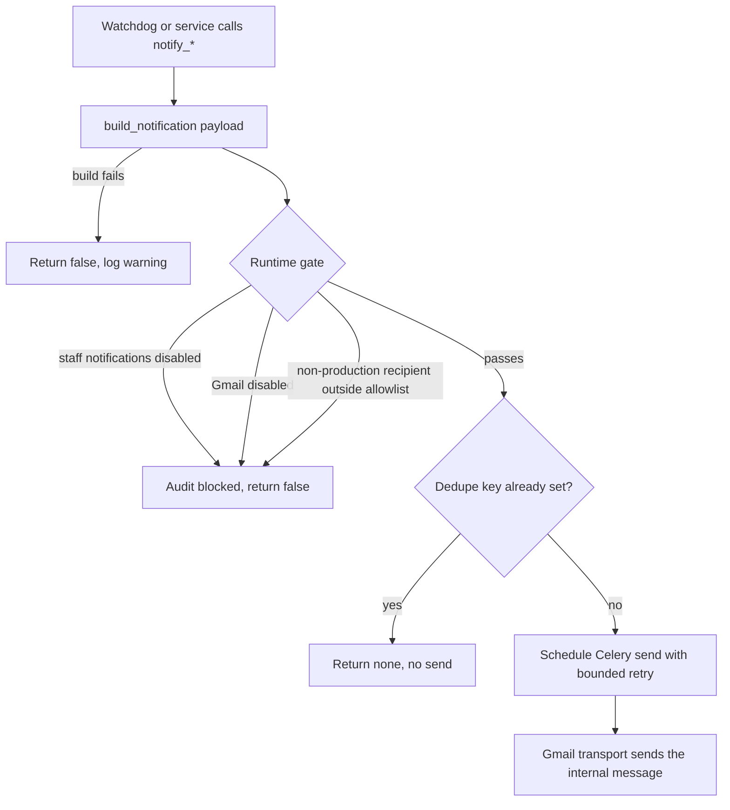

# Background Jobs and Scheduled Work

PSD401 PRR runs background work on Celery with Redis. Celery beat, configured in
[`config/celery.py`](../../config/celery.py), is the single schedule. Every periodic job
either checks a legal deadline, recovers a stuck durable state, or repairs a derived work
queue. None of them makes a legal decision on its own.

## Why this exists

Statutory clocks (RCW 42.56) and correspondence delivery cannot depend on someone
remembering to run a check. The design keeps three rules:

- **Watchdogs only notify or queue.** A watchdog raises a staff alert, queues a durable
  record, or surfaces work. It never denies, closes, or changes a status. The automated
  acknowledgment is queued, and it takes legal effect only after the provider confirms
  delivery ([correspondence](../domain/correspondence.md#outbound)).
- **Recovery reconciles, it does not resend.** Stuck deliveries and stale scans are
  reclaimed under a lease. A reconciliation checks what the provider already did first.
- **Derived queues are rebuilt from source evidence.** Work-item backfills repair the
  Inbox and case queues from committed evidence. They never edit that evidence
  ([work queue](../domain/work-queue.md)).

## Beat schedule

The schedule is `app.conf.beat_schedule` in `config/celery.py`.

| Schedule entry | Task (module) | Cadence | Owning page |
|---|---|---|---|
| `deadline-watchdog-hourly` | `apps.records.tasks.deadline_watchdog` | Hourly | [compliance](../domain/compliance.md) |
| `auto-acknowledge-safety-net` | `apps.records.tasks.auto_acknowledge_safety_net` | Hourly at :30 | [compliance](../domain/compliance.md) |
| `estimate-watchdog-daily` | `apps.records.tasks.estimate_watchdog` | Daily 07:00 | [compliance](../domain/compliance.md) |
| `unpaid-fee-watchdog-daily` | `apps.records.tasks.unpaid_fee_watchdog` | Daily 07:15 | [fees and deposits](../domain/fees-and-deposits.md) |
| `stall-detector-weekly` | `apps.records.tasks.stall_detector` | Mondays 07:30 | [requests](../domain/requests.md) |
| `poll-vault-exports` | `apps.records.tasks.poll_vault_exports` | Every 10 minutes | [collection and Vault](../domain/collection-and-vault.md) |
| `prepare-record-review-advisories` | `apps.records.tasks.prepare_record_review_advisories` | Every 5 minutes, limit 25 | [advisory AI](../domain/advisory-ai.md) |
| `prepare-scope-letters` | `apps.records.tasks.prepare_scope_letters` | Every 10 minutes, limit 10; drafts only | [correspondence](../domain/correspondence.md#scope-conversation-letter) |
| `prepare-estimate-letters` | `apps.records.tasks.prepare_estimate_letters` | Hourly at :15, limit 10; drafts only | [estimates](../domain/estimates.md) |
| `build-pending-record-derivatives` | `apps.records.tasks.build_pending_record_derivatives` | Every 10 minutes, limit 25 | [record review](../domain/record-review-and-handling.md) |
| `poll-inbound-gmail` | `apps.correspondence.tasks.poll_inbound_gmail` | Every minute | [correspondence](../domain/correspondence.md#gmail-transport) |
| `reconcile-inbound-gmail` | `apps.correspondence.tasks.reconcile_inbound_gmail` | Hourly at :45 | [correspondence](../domain/correspondence.md#gmail-transport) |
| `recover-stuck-correspondence-deliveries` | `apps.correspondence.tasks.watch_stuck_correspondence_deliveries` | Every minute, limit 100 | [correspondence](../domain/correspondence.md#gmail-transport) |
| `recover-stale-correspondence-attachment-scans` | `apps.correspondence.tasks.requeue_stale_correspondence_attachment_scans` | Every minute | [correspondence](../domain/correspondence.md) |
| `recover-pending-correspondence-attachment-cleanups` | `apps.correspondence.tasks.requeue_pending_correspondence_attachment_cleanups` | Every minute | [correspondence](../domain/correspondence.md) |
| `recover-stale-inbound-quarantine-writes` | `apps.correspondence.tasks.requeue_stale_inbound_quarantine_writes` | Every minute | [correspondence](../domain/correspondence.md) |
| `alert-waiting-inbound-triage` | `apps.work_queue.tasks.alert_waiting_inbound_triage_daily` | Weekdays 07:45 | [work queue](../domain/work-queue.md) |
| `reconcile-inbound-work-items` | `apps.work_queue.tasks.reconcile_inbound_work_item_backfill` | Every 5 minutes, limit 250 | [work queue](../domain/work-queue.md) |
| `reconcile-case-work-items` | `apps.work_queue.tasks.reconcile_case_work_item_backfill` | Every 5 minutes, source `requests`, limit 250 | [work queue](../domain/work-queue.md) |

Two families chain themselves rather than relying on the schedule alone. A backfill that
returns a `next_cursor` re-enqueues itself with that cursor. The case backfill also walks
the sources in the order `requests`, `collections`, `drafts`, `records`
(`apps/work_queue/tasks.py`).

## Watchdog rules

- **Deadline watchdog** (`deadline_watchdog`, `apps/records/tasks.py`). Escalates a
  request that has no first response. A request due within two business days notifies
  the assigned officer. A request due today or tomorrow notifies the officer and the
  supervisor. An overdue request notifies the supervisor and records officer each day.
  Only `public_records` matters are clocked ([matter kinds](../domain/matter-kinds.md)).
- **Safety-net acknowledgment** (`auto_acknowledge_safety_net`). On the last day of an
  RCW 42.56.520 window with no human response, it queues an automated acknowledgment. It
  reads the automatic-acknowledgment switch with `raise_on_store_error=True`, so an
  unreadable settings store fails the run visibly instead of skipping a due letter. The
  request stays `received` until the provider success callback applies the effect.
- **Estimate watchdog** (`estimate_watchdog`). An estimated completion date is a
  commitment. Within three business days it raises an "approaching" alert. After the date
  it raises an "overdue" alert. The officer must then produce the records or file a
  reasoned revision through correspondence ([compliance](../domain/compliance.md)).
- **Unpaid-fee watchdog** (`unpaid_fee_watchdog`). Surfaces a case whose fee or deposit
  is unanswered. It closes nothing ([fees and deposits](../domain/fees-and-deposits.md)).
- **Stall detector** (`stall_detector`). Flags open requests with no recorded activity.
  Recent collection-task activity counts as activity, so a case being worked is not
  flagged; see `apps/records/tests/test_feature_audit_regressions.py`.

## Staff alerts

Internal operational mail goes through `apps/records/notifications.py`. It is separate
from requester correspondence and shares only the Gmail transport. Alerts carry no
statutory effect.

Three settings control delivery, and all are read through [configuration](configuration.md):

- `PRR_STAFF_NOTIFICATIONS_ENABLED` is the alert switch. It defaults off and requires
  `PRR_GMAIL_ENABLED`. Turning it on is refused until
  `PRR_STAFF_NOTIFICATION_RECORDS_OFFICERS` lists at least one address
  (`staff_notification_recipients_configured` in `apps/configuration/prerequisites.py`).
- `PRR_STAFF_NOTIFICATION_RECORDS_OFFICERS` is the recipient list for records-officer alerts.
- `PRR_STAFF_NOTIFICATION_SUPPRESSION_SECONDS` sets how long an unchanged alert stays
  suppressed. Production should use shared Redis so the suppression applies across processes.

- `enqueue_staff_notification` builds the payload and schedules a Celery send with
  bounded retry for transport failures. Named helpers (`notify_deadline`,
  `notify_estimate`, `notify_stalled`, `notify_footage_manual_hold`,
  `notify_collection_task`, `notify_inbound_mailbox`, and others) map one signal each.
- The signal set is `SIGNAL_TYPES` in that module. It covers deadline, estimate, stall,
  footage, collection, correspondence-effect failure, and inbound-mail signals.
- A cache-backed dedupe key stops repeated watchdog runs from resending an unchanged
  alert. When the send task finds a runtime gate blocking the alert, it releases that key
  so a later run can retry.
- Alert bodies are plain-text templates under `templates/notifications/`, such as
  `deadline.txt`, `footage_manual_hold.txt`, and `collection_task.txt`. The call sites pass
  them as `template_name`: `apps/records/notifications.py` for the case and footage signals,
  `apps/correspondence/gmail_sync.py` for inbound failure, quarantine, and recovery mail, and
  `apps/work_queue/triage_alerts.py` for the daily triage alert. These are internal staff
  messages, separate from the requester wording in `templates/correspondence/`
  ([correspondence](../domain/correspondence.md#template-registry)).

Caption: a staff alert passes runtime gates and a dedupe check before it reaches the
Gmail transport. Blocked alerts are audited without the message body.

## Gmail poll telemetry

The `poll_inbound_gmail` task (`apps/correspondence/tasks.py`) reports every poll
outcome through `publish_inbound_poll_metrics()` in
`apps/correspondence/gmail_observability.py`, under the CloudWatch namespace
`PSD401/PRR`. The task returns the poll result unchanged, and the metric call runs
either way.

- **Success.** Publishes a health value (1 only when the poll returned status `ok`),
  an inbound-enabled value, the poll duration, and counts of received, deduplicated,
  and label-failure messages.
- **Failure.** Publishes a failure count with a bounded category: a sanitized Gmail
  failure category when one applies, or `permission_denied`, `validation_error`,
  `database_error`, or `internal_error`. The original exception is re-raised.
- **Privacy.** Metrics carry no message or mailbox identifiers.
- **Gates.** Telemetry runs only while `PRR_CLOUDWATCH_METRICS_ENABLED` is on, so a
  disabled setting makes no AWS call. The module treats a running poller with inbound
  intake disabled as unhealthy, so an accidental kill-switch change does not look
  green. A telemetry failure is logged and never changes the poll outcome.

The production alarm built on these metrics is described in
[AWS production release](../operations/aws-deployment.md). Settings are read through
[configuration](configuration.md).

Focused tests: `apps/correspondence/tests/test_gmail_observability.py`
(`test_success_publishes_health_counts_and_duration_without_mailbox`,
`test_provider_failure_uses_bounded_category_and_unhealthy_value`,
`test_disabled_telemetry_makes_no_aws_call`,
`test_metric_failure_is_logged_without_masking_poll_result`,
`test_task_reports_failure_then_reraises_original_error`). Minimal validation:
`PYTHON_DOTENV_DISABLED=1 python manage.py test apps.correspondence.tests.test_gmail_observability --settings=config.test_settings`.

## Change guidance

- Add a periodic job in `config/celery.py`, and keep its task in the owning app's
  `tasks.py`. Make the task idempotent: repeated runs must not repeat an alert, a queued
  delivery, or a work item.
- Recovery tasks must claim work under a lease and check provider state before any
  resend. Do not add a path that re-sends a delivery without that check
  ([correspondence](../domain/correspondence.md#gmail-transport)).
- A new staff alert needs a `SIGNAL_TYPES` entry, a `notify_*` helper, and a template. It
  must not carry requester identity or case content beyond the request number.
- Focused tests: `apps/records/tests/test_compliance.py` (deadline, estimate, and
  safety-net watchdogs), `apps/records/tests/test_feature_audit_regressions.py` (stall
  detection), `apps/records/tests/test_staff_notifications.py` (alert delivery and gates),
  `apps/correspondence/tests/test_internal_gmail_poller.py` (poller and beat registration),
  and `apps/work_queue/tests/` (work-item backfills).
- Minimal validation: `PYTHON_DOTENV_DISABLED=1 python manage.py test apps.records.tests.test_compliance apps.records.tests.test_staff_notifications --settings=config.test_settings`.
  Run the full `apps` suite only when a change touches a shared runtime gate such as
  `runtime.get()` ([configuration](configuration.md)).

## Related concepts

- [Compliance](../domain/compliance.md): the statutory clock and watchdog rules the schedule enforces.
- [Requester correspondence](../domain/correspondence.md): the delivery recovery and Gmail poll loops.
- [Work queue](../domain/work-queue.md): the inbound and case backfills that rebuild the Inbox.
- [Configuration](configuration.md): the runtime switches each job reads.
- [Deployment](../operations/deployment.md): how the worker and beat processes run.
