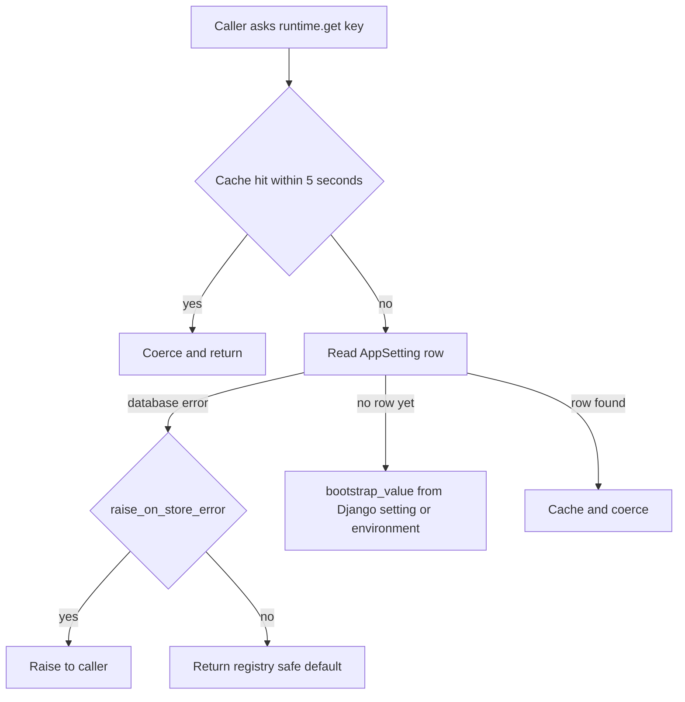

# In-App Configuration and Settings Store

AGENTS.md rule 6 and the layout notes set the principle: configuration a
district can legitimately change belongs in the application, where a named
Application Admin is accountable for it, not in an operator-held `.env.app`.
`apps/configuration/` implements that store. The operator-facing story is in
[`docs/aws-deploy.md`](../../docs/aws-deploy.md). This page covers the code shape
and the invariants.

What stays in `config/settings.py` is credentials, identity, infrastructure
addresses, and the eleven Phase A on/off switches kept as a bootstrap seed. A
bound on a district value belongs in the registry, enforced when an admin saves
it, not in a settings module that raises at import and crash-loops a container.

## Components

| Piece | Responsibility | Entry points |
|---|---|---|
| Registry | The typed list of every managed setting: type, default, bounds, unit, category, dependencies, and the consequence text the admin reads | `SettingSpec` entries in [`registry.py`](../../apps/configuration/registry.py) |
| Values | The one place a value is parsed, validated, and normalized for saves, reads, and the import | `coerce()`, `to_json()` in [`values.py`](../../apps/configuration/values.py) |
| Runtime reads | Cached, restart-free reads with fail-closed defaults | `runtime.get()`, `runtime.get_secret()`, `runtime.invalidate()` in [`runtime.py`](../../apps/configuration/runtime.py) |
| Writes | The only write path. Requires reason, role, dependency checks, history, and audit | `set_value()`, `set_secret()` in [`services.py`](../../apps/configuration/services.py) |
| Storage | Current value, append-only change history, encrypted secrets, and verification state | `AppSetting`, `AppSettingChange`, `AppSecret`, `SettingVerification` in [`models.py`](../../apps/configuration/models.py) |
| Prerequisites | Checks that span more than one setting, such as Gmail transport needing its identity | `PREREQUISITES` in [`prerequisites.py`](../../apps/configuration/prerequisites.py) |
| Sign-in guard | Refuses a sign-in change that would lock every Application Admin out | `lockout_blocker()` in [`signin.py`](../../apps/configuration/signin.py) |
| Secrets | Encryption for write-only values; key from `PRR_SETTINGS_ENCRYPTION_KEY` or derived from `SECRET_KEY` with HKDF | [`secrets.py`](../../apps/configuration/secrets.py) |
| Process-start secrets | Loads the Django signing key and settings-store key from one deployment secret before settings are read | `read_runtime_secret()`, `load_runtime_environment()` in [`runtime_secrets.py`](../../config/runtime_secrets.py) |
| Verification | A live check when a credential is saved. A failed check records "saved, unverified" with a reason | `verify()`, `CHECKS` in [`verification.py`](../../apps/configuration/verification.py) |
| Staff API | Admin read and reasoned write surface with full change history | `AppSettingViewSet` in [`app_settings.py`](../../apps/api/resources/app_settings.py), routed at `/api/staff/settings/` |
| Import | One-time move of operator environment values into the store | `manage.py import_environment_settings`, `import_environment_value()` |

The registry holds about 120 settings in 14 categories, including the advisory
model and its switches, Gmail transport, correspondence limits, intake and
attachment limits, sign-in, Google group recheck, and the Vault, Gmail, and
Google group identities.

## Read path

Caption: the read path. A switch whose failure mode reaches a requester defaults
off. The safety net passes `raise_on_store_error` so an unreadable switch fails
loudly rather than skipping a run.

- **Cache.** `CACHE_TTL_SECONDS` is 5. The cache is shared across web, worker,
  and beat, and a change takes effect in seconds without a restart. Overrides
  drop the cache.
- **Bootstrap.** A key with no row yet resolves from the Django setting or
  environment. That path is not cached, so an override cannot outlive its source.
- **Read once per batch.** AGENTS.md says to read a value once before a loop,
  not once per item, because each read is a cache or database round trip.

## Write path

`set_value()` in `services.py` is the only write path. It requires:

- An Application Admin actor.
- A reason of 10 to 2000 characters (`REASON_MIN_LENGTH`, `REASON_MAX_LENGTH`).
- The value parsed through the registry type and bounds.
- Enable-time dependency checks (`_check_enable_allowed`, `_check_relations`).
  `enable_blocker()` names the first unmet prerequisite.
- The sign-in lockout check (`_check_no_lockout`), which takes the
  `SIGN_IN_ADVISORY_LOCK_ID` advisory lock.

It appends an `AppSettingChange` row, which is append-only and holds the actor,
reason, and both values, and it writes an audit row. The Settings page shows that
history for every setting.

Secrets go through `set_secret()`. The value is encrypted with a Fernet key
derived from `SECRET_KEY`, or from `PRR_SETTINGS_ENCRYPTION_KEY` when set, and
the database never holds the key. The API returns only a fingerprint (an HMAC
under the same key), never the value. Rotating `SECRET_KEY` without the explicit
key makes stored secrets unreadable, and they must be entered again. The
docstring of `secrets.py` states this trade-off.

The deploy-time check for this failure is `manage.py verify_settings_secrets`
([`verify_settings_secrets.py`](../../apps/configuration/management/commands/verify_settings_secrets.py)).
It exits nonzero unless every stored secret decrypts under the running key, and it
prints counts and key names only. Its docstring says that the production deployment
runs it after starting the new release and rolls back on failure. Because
`runtime.get_secret` treats an unreadable secret as unset and only logs it, this
command is the only place the mismatch becomes a failed deploy.

## Process-start and bootstrap secrets

Two values are not stored in the database and are not read from a host
environment file on the deployed instance: the Django signing key
(`DJANGO_SECRET_KEY`) and the settings-store encryption key
(`PRR_SETTINGS_ENCRYPTION_KEY`). They load in two places, both in
`config/`:

- **Process start.** `config/settings.py` calls `read_runtime_secret(os.environ)`
  before it reads any other setting. With no `PRR_RUNTIME_SECRET_ID`, it returns
  `{}`, so local, CI, and test runs use the environment unchanged. With the
  id set, `load_runtime_environment()` reads the current version from AWS
  Secrets Manager through the instance role. It requires a JSON object with
  exactly `RUNTIME_SECRET_KEYS`, string values, and a non-empty signing key.
  Setting either key also in the environment is refused at startup, and the
  error names only the key. The values are returned to settings and are never
  written into `os.environ`, so child processes inherit no secret. A blank
  encryption key means "derive from the signing key", and nothing generates one.
- **Bootstrap of a write-only secret.** Before a secret has a stored row,
  `runtime._bootstrap_secret()` resolves the deployment's value through
  `resolve_runtime_secret()`. That value comes from the inline `<KEY>` environment
  variable or from a `<KEY>_ID` pointer to Secrets Manager, so sign-in keeps
  working between a deploy and the import. A failed resolution is logged and
  treated as unset. The Google OIDC client secret is the case this serves.

Focused tests are in `apps/api/tests/test_runtime_secrets.py`:
`RuntimeSecretTests` covers the resolver, `RuntimeEnvironmentSecretTests`
covers the exact key set and inline-duplicate refusal, and
`RuntimeEnvironmentSettingsWiringTests` covers the settings import. Run
`PYTHON_DOTENV_DISABLED=1 python manage.py test apps.api.tests.test_runtime_secrets --settings=config.test_settings`.

## Verification of credentials

`verify(key)` in `verification.py` runs a live check when an identity is saved.
`CHECKS` covers the Gmail identity, the Vault identity, the Google group reader,
and the malware scanner. A failed check does not reject the save. It records
`SettingVerification` as unverified with the reason, so the operator can see
that the value is installed but not proven.

## Change guidance

- To add a tunable value: add a `SettingSpec` in `registry.py` with a safe default,
  bounds, category, and a consequence sentence in the district's terms. Add its
  type in `values.py` only if the type is new. Read it with `runtime.get(key)`.
  Do not read `settings.PRR_*` or a module constant for a registered key.
- Enable-only switches need a prerequisite in `prerequisites.py` if they depend on
  another setting.
- A new secret goes through `set_secret()` and `runtime.get_secret()`. It must
  never reach a log, a serializer, or an export.
- Use `test_settings_store` for the write and read contract, `test_settings_concurrency`
  for races, and `test_phase_c_settings` for sign-in and secret behavior.
- Do not put a district-tunable value in `.env.app`. It would silently do
  nothing after the import has run.

Related: [Google Workspace identity](google-identity.md) (sign-in and group
recheck settings), [Advisory AI](../domain/advisory-ai.md) (the advisory
switches), [AWS deployment](../operations/aws-deployment.md) (the operator view
of settings and the one-time import).
