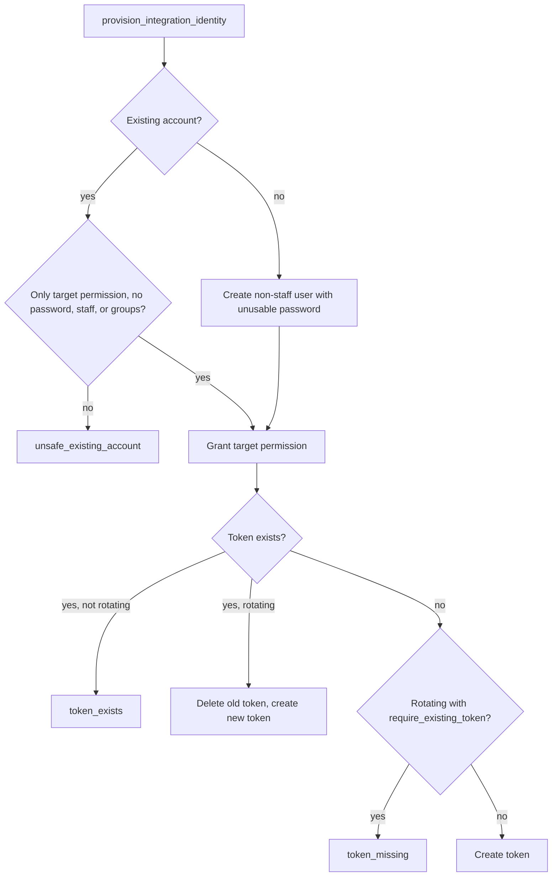

# Integration Identities and Exact-Scope Service Principals

The system has three non-human principals, and each one is allowed to do exactly one
thing. A read-only MCP client reads staff records through the API. An outbound transport
sends frozen correspondence through Gmail. An inbound transport submits received mail. Each
principal is a Django user that holds a single direct permission, with no staff access and
no password. [`apps/records/service_identities.py`](../../apps/records/service_identities.py)
is the one module that defines what "exact" means for all three, so the rule is not
re-implemented per caller.

## Scope definitions

| Principal | Permission checked | Where it is enforced |
|---|---|---|
| Read-only MCP client | `records.read_staff_api` (`MCP_PERMISSION`) | `is_exact_mcp_identity`, used by `apps/api/permissions.py` |
| Outbound Gmail transport | `correspondence.deliver_outbound_correspondence` (`OUTBOUND_PERMISSION`) | `require_exact_outbound_identity`, used by `apps/correspondence/services.py` and `transport.py` |
| Inbound Gmail transport | `correspondence.submit_inbound_correspondence` (`INBOUND_PERMISSION`) | `require_exact_inbound_identity`, used by `apps/correspondence/receiving.py`, `gmail_sync.py`, and `apps/records/email_intake.py` |

`is_exact_service_identity_row()` is the shared check. It rejects an inactive user, a staff or
superuser account, a user with a usable password, a user in any group, and any user whose
direct permissions are not exactly the one expected permission.

## Provisioning

`provision_integration_identity()` is the canonical path. It runs in a transaction and
requires an identity ID from `INTEGRATION_IDENTITY_DEFINITIONS`. The only registered
definition today is the read-only MCP identity, so `mcp_readonly` is the only accepted ID.

- A new account is created active, non-staff, non-superuser, with an unusable password.
- An existing account is reused only if it has no staff or superuser flag, no password, no
  group, and no permission other than the target. Otherwise the call raises
  `IntegrationIdentityProvisionError` with `unsafe_existing_account`, and the operator must
  choose a new integration-specific name.
- Creating a token when one already exists fails with `token_exists`. Rotation deletes the old
  token and issues a new one. `require_existing_token` makes rotation fail with
  `token_missing` when there is nothing to rotate.
- The two reserved Gmail transport usernames can never receive a token through this path.

The management command `provision_mcp_readonly` (in `apps/records/management/commands/`)
calls this function. The staff API resource
[`apps/api/resources/integration_identities.py`](../../apps/api/resources/integration_identities.py)
lists the status of each definition, using `integration_identity_statuses()`, and calls the
same provisioning function. Its status view reports whether each account's scope is valid,
and it never loads token key values.

Caption: the provisioning decision path. Transport accounts never reach this path, because the
reserved-name check runs first.

## Transport principals

The outbound and inbound Gmail principals exist so that the in-process transport runs under a
named, scoped identity, not a shared admin account. Migrations provision both rows
(`apps/correspondence/migrations/0013_system_outbound_transport.py` and
`0014_gmail_inbound_poller.py`).

- `system_transport_principal()` in [`transport.py`](../../apps/correspondence/transport.py)
  and `system_inbound_principal()` in [`gmail_sync.py`](../../apps/correspondence/gmail_sync.py)
  load the row and refuse it when its scope is not exact or when a token exists for it.
- When a caller passes no credential, `_require_exact_transport_identity` accepts the
  reserved system row only. When a credential is presented, it must be a current token for
  that same user (`_current_presented_token`), so a revoked token fails even if the account
  still has the permission.
- Readiness checks call these principal loaders, so an unsafe principal makes the
  correspondence readiness report `not_ready` ([correspondence operations](../domain/correspondence.md#operations-and-readiness)).

## Invariants and change guidance

- **Adding a new integration identity.** Add an `IntegrationIdentityDefinition` to
  `INTEGRATION_IDENTITY_DEFINITIONS`. The permission must already exist, and it must be
  checked with `is_exact_service_identity_row`. Do not write a looser check in the caller.
  Add the caller test next to the existing MCP tests in `apps/api/tests/test_mcp_write_tools.py`.
- **Changing a transport principal.** The usernames, permissions, and migration rows are a
  single contract. Changing one without the others breaks `require_exact_*` at send or poll
  time, and the readiness check reports it. Pair the change with a migration and with the
  transport tests.
- **Changing token behavior.** `provision_integration_identity` is the only sanctioned way to
  create or rotate a token. Do not create `Token` rows elsewhere.
- Scope boundary: this page covers the principal rules. The MCP tools themselves are in
  [MCP server](../integrations/mcp.md), and the capability catalog is in
  [agent parity](agent-parity.md).

Focused tests: `apps/api/tests/test_integration_identities.py` (provisioning, rotation, unsafe
accounts, and status), `apps/api/tests/test_legacy_transport_removal.py` (definitions and
removed transport paths), `apps/correspondence/tests/test_internal_gmail_sender.py`
(`test_system_transport_principal_is_noninteractive_and_exact_scope`,
`test_system_transport_principal_rejects_a_tokenized_row`,
`test_reserved_system_username_cannot_be_token_provisioned`), and
`apps/correspondence/tests/test_internal_gmail_poller.py` (the same three checks for the inbound
principal, `test_system_inbound_principal_*`).

Minimal validation: `PYTHON_DOTENV_DISABLED=1 python manage.py test apps.api.tests.test_integration_identities apps.correspondence.tests.test_internal_gmail_sender --settings=config.test_settings`.

## Related concepts

- [Agent parity](agent-parity.md): the capability rules that the MCP principal is subject to.
- [MCP server](../integrations/mcp.md): the read-only client that uses the MCP identity.
- [Requester correspondence](../domain/correspondence.md): the outbound and inbound transports
  that depend on the reserved principals.
- [Google identity and RBAC](google-identity.md): how human staff identities are authenticated,
  which this page's non-human principals deliberately bypass.
