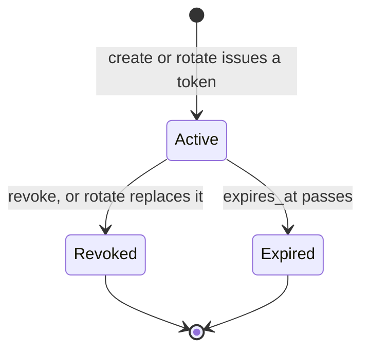

# Personal Access Tokens

A personal access token (PAT) is the credential an attributed staff member gives an
agent, script, or command-line session, so that its writes carry that person's name in
the audit trail. [GUI and agent parity](agent-parity.md) decides which operations a token
may reach. This page covers the token itself: how it is issued, stored, checked, and
retired. The hosted MCP server acts as the attributed token holder
([MCP](../integrations/mcp.md)), and the [staff command-line client](../integrations/cli.md)
authenticates with the same tokens. Scoped service principals are a separate identity
class, described in [integration identities](integration-identities.md).

## Format and storage

A presented token is `prr_pat_<prefix>_<secret>`. The prefix is 12 hex characters from
`secrets.token_hex(6)`, and the secret is `secrets.token_urlsafe(32)`. The model
`PersonalAccessToken` in [`apps/api/models.py`](../../apps/api/models.py) stores the
owner, the name, a unique `prefix`, a unique `token_hash` (SHA-256 of the whole presented
string), `expires_at`, `last_used_at`, and `revoked_at`. The raw secret is never stored.
A partial unique constraint (`api_unique_live_pat_name_per_user`) prevents two live tokens
with the same case-insensitive name for one person. Creation retries up to five times when
a prefix collides.

## Lifecycle

The routes are in [`apps/api/urls.py`](../../apps/api/urls.py) under `/api/staff/auth/api-tokens/`.
[`apps/api/access_tokens.py`](../../apps/api/access_tokens.py) implements them.

Staff manage their own tokens on the Agent access screen at `/configuration/agent-access`
(`frontend/src/pages/AgentAccess.tsx`, reachable by every staff role). It lists metadata,
creates, rotates, and revokes through the routes above, and shows the presented secret
once. The same screen reads the capability catalog from `/api/staff/capabilities/` to show
which operations are direct, need human confirmation, or are human-only
([agent parity](agent-parity.md#execution-policies)). The screen is a view over these
rules. The server enforces the limits and the audit rows described below.

| Operation | Route | Capability id | Effect |
|---|---|---|---|
| List metadata | `GET /api/staff/auth/api-tokens/` | `api_tokens.list` | Returns metadata only, never a secret |
| Create | `POST /api/staff/auth/api-tokens/` | `api_tokens.create` | Returns the presented token once |
| Rotate | `POST .../api-tokens/<id>/rotate` | `api_tokens.rotate` | Revokes the old token and returns a replacement once |
| Revoke | `DELETE .../api-tokens/<id>` | `api_tokens.revoke` | Sets `revoked_at` once; repeat calls return 204 |

Caption: each row is one token. Rotation moves the old row to revoked and starts a new row.

Rules enforced by `access_tokens.py`:

- **Limits.** Lifetime is bounded by `PRR_PERSONAL_TOKEN_MAX_LIFETIME_DAYS` (default 90),
  and the live-token count by `PRR_PERSONAL_TOKEN_MAX_ACTIVE` (default 5). Both are
  registry entries in [`registry.py`](../../apps/configuration/registry.py), read with
  `runtime.get`. Creation rate is limited by `PersonalAccessTokenCreateThrottle` in
  [`throttles.py`](../../apps/api/throttles.py), using `PRR_PERSONAL_TOKEN_CREATE_RATE`.
- **Locking.** Create and rotate lock the owner row before counting live tokens, so
  concurrent creates cannot exceed the limit.
- **Duplicate names.** A second live token with the same name is a field error.
- **Rotation.** A revoked token cannot be rotated. The replacement's lifetime is the smaller
  of the old token's lifetime (rounded up to whole days) and the current maximum. The old
  token is revoked before the new one is created, and the capacity check excludes the token
  being replaced, so rotating an expired token cannot bypass the limit.
- **Audit.** `identity.personal_api_token_created`, `..._rotated` (with `replaced_prefix`),
  and `..._revoked` record the name and prefix. The secret does not appear in the audit row.

Token callers are not refused silently. `PersonalAccessTokenPermission` admits them so that
each operation can call `human_only_handoff(...)` with `required_role="role_mapped_staff"`
and return the explicit handoff. Session callers must pass the staff permission. The
session path is protected by CSRF, which `test_session_mutations_require_csrf` covers.

## Authentication

`PersonalAccessTokenAuthentication` in [`apps/api/authentication.py`](../../apps/api/authentication.py)
handles the `Authorization: Token prr_pat_...` header. A header that does not carry the
marker is left to other authenticators. For a marked token, the code looks up the row by
prefix and compares the hash with `hmac.compare_digest`. Then it checks, in order:

1. The row exists and the hash matches. Otherwise the code is `invalid_token`.
2. The token is not revoked. Otherwise the code is `token_revoked`.
3. The token has not expired. Otherwise the code is `token_expired`.
4. The owner is active. Otherwise the code is `invalid_token`.

`last_used_at` is written only when it is older than `PRR_PERSONAL_TOKEN_LAST_USED_WINDOW_SECONDS`
(default 60), through a conditional update. That keeps a busy agent from writing on every call.

A token does not outlive its owner's staff role. `test_personal_token_cannot_outlive_google_group_removal`
shows that a token request triggers the owner's Google group lookup, and that a removed
group membership returns 403. The group recheck is in the identity layer
([Google identity](google-identity.md)).

Migration history: the upgrade that retired the legacy staff tokens revokes them and keeps
scoped service tokens, and the old plaintext self-service route is removed
(`test_upgrade_revokes_legacy_staff_tokens_but_keeps_service_tokens`,
`test_legacy_plaintext_self_service_route_is_removed`).

## Change guidance

- **Do not change the presented format or the hash function casually.** Authentication
  parses the prefix as exactly 12 characters and compares a SHA-256 of the full string.
  Changing either invalidates every stored token.
- **New limit or policy knob.** Add a `SettingSpec` in `registry.py` and read it with
  `runtime.get`. Do not read a `settings.PRR_*` value.
- **New token-reachable operation.** Register it in the capability catalog
  ([agent parity](agent-parity.md)). A human-only operation must call `human_only_handoff`
  before any effect.
- **Focused tests.** `test_personal_api_tokens` covers lifecycle, authorization, and role
  revalidation. `test_personal_api_tokens_concurrency` covers the active limit under races.
  Run the concurrency lane only when you change the locking or the count. Use
  `test_agent_capabilities` when you change the capability rows.
- **Minimal validation.** `PYTHON_DOTENV_DISABLED=1 python manage.py test apps.api.tests.test_personal_api_tokens --settings=config.test_settings`.
  The concurrency label is `apps.api.tests.test_personal_api_tokens_concurrency`.
