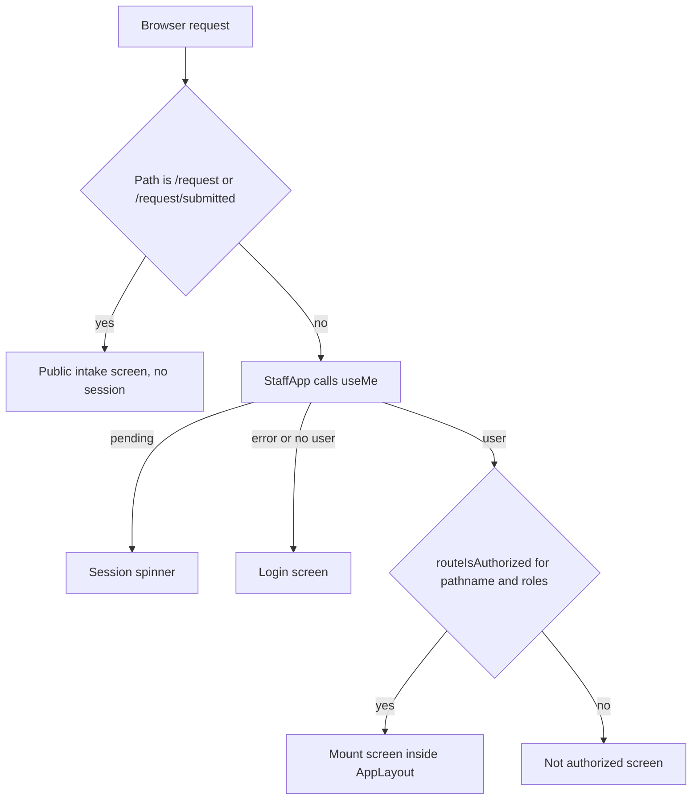

# Staff Frontend Shell, Routing, and API Client

The staff workspace is a React 19 and TypeScript single-page app in `frontend/`, built
with Vite and styled with Tailwind. It owns screens, not legal decisions. Requests,
deadlines, exemptions, and audit records are enforced by the Django staff API that
the app calls ([agent parity](agent-parity.md) lists the operations). Read this page
before adding a screen, changing which roles see a route, or changing how the browser
calls the API. Domain behavior belongs in the owning domain page.

## Two front doors

`frontend/src/App.tsx` mounts two trees under one `BrowserRouter`:

- **Public:** `/request` (`PublicRequestForm`) and `/request/submitted`
  (`PublicRequestReceipt`). These are outside the staff shell and need no session. The
  public form is the anonymous intake described in [requests](../domain/requests.md#intake-and-triage).
- **Staff:** every other path goes to `StaffApp`. The app first calls `useMe()` from
  `frontend/src/api/auth.ts`. While it is pending, the user sees a session spinner. On
  error or an empty session, the user sees `Login`. The login screen offers only Google
  sign-in in deployed mode, and a password form only in local developer mode
  ([Google identity](google-identity.md)).

Caption: a staff route mounts only after the session loads and the client-side role
table allows it. The denial is for the screen only. The API still checks each call.

## Role-aware routes and navigation

`frontend/src/nav.ts` is the single registry for the authenticated shell. It has three
navigation lists, and `ROUTE_ROLES` is built from them:

| Registry | What it covers | Source |
|---|---|---|
| `PRIMARY_NAV` | Inbox, Review, Decisions (see [decision batches](../domain/decision-batches.md)), Staff Intake, Oversight, Configuration | `nav.ts` |
| `CONFIGURATION_NAV` | Agent access, identity, registry, templates, exemptions, knowledge pack ([knowledge pack](../domain/knowledge-pack.md)), counsel domains, settings, message operations | `nav.ts` |
| `OVERSIGHT_NAV` | JLARC reporting, audit log ([audit trail](../domain/compliance.md#audit-trail)), AI evaluation ([advisory model comparison](../domain/advisory-evaluation.md), Records Officer only), and AI agreement ([AI-human agreement](../domain/advisory-ai.md#ai-human-agreement), Records Officer only) | `nav.ts` |

- `visibleNav(items, roles)` filters a list to the items that share a role with the user.
- `routeIsAuthorized(path, roles)` checks the path pattern (`/work/:id`,
  `/requests/:number`, or an exact registry path). A case path such as
  `/requests/<number>/<tab>` is checked against `CASE_TAB_ROLES`. An unknown tab is denied.
- `defaultLanding(roles)` chooses the first screen. Records officers and liaisons land on
  `/inbox`, reviewers on `/review`, intake clerks on `/staff-intake`, and admins on
  `/configuration`.

Role names come from `StaffRole` in `frontend/src/api/auth.ts`. Current values are
`records_officer`, `liaison`, `reviewer`, `intake_clerk`, and `admin`. Those names must match the
server's roles. `nav.ts` says that API role policies remain authoritative.

### Case stages and views

A case opens at `/requests/:number/:segment`. `CaseWorkspace` in
`frontend/src/case/CaseWorkspace.tsx` accepts seven stage segments (`intake`, `scope`,
`collect`, `review`, `redact`, `release`, `close`) and two side views (`messages`,
`activity`). The stage rail that orders them is derived on the server
([case stage rail](../domain/case-workspace.md#case-stage-rail)).

- **Roles.** `CASE_TAB_ROLES` in `nav.ts` gives each segment its roles. Stage roles come
  from `STAGE_ROLES`, so `scope` is Records Officer only, and `review` is Records Officer,
  Reviewer, and Admin. `messages` is Records Officer and Liaison. `activity` is every
  workflow role.
- **Shown, not linked.** The rail lists every stage so progress reads the same for
  everyone. A stage the viewer cannot open renders without a link (`StageRail` and
  `roleCanOpen`).
- **Direct URLs.** A direct URL to a segment the user cannot use shows a "Not authorized"
  screen and does not mount the content (`CaseWorkspace.test.tsx`, "shows a useful denial
  without mounting an unauthorized direct tab").
- **What each stage mounts.** `TabContent` picks one stage's screens. Intake shows
  `RequestDetail` in overview mode, with the running log and the time-entries panel. Scope
  shows the scoping trail and the Vault count form. Collect shows `CollectionCards`,
  Tasks, Preservations, and the upload panel. Review shows `ReviewFlight` by default, or
  the record list with `?view=records`. `ReviewFlight` is the keyboard-first screen, limited
  to Records Officers and Reviewers
  ([record review](../domain/record-review-and-handling.md#keyboard-review-in-the-case-review-tab)).
  Redact shows `RedactionProposals`, and Release shows `Installments`. Close shows the
  closure readiness card and the close-mode `RequestDetail`. Messages mounts
  `CorrespondencePanel`, and Activity mounts `CaseActivityFeed` in full.
- **Server tab names.** Some server payloads still name pre-rail tabs (`next_action.tab`,
  closure blockers). `caseTabPath()` maps them to stage URLs, and `?view=records` is kept
  for the record list. `stageLabel()` gives the rail name for either form.

Each stage's decision card shows its state and open count. Only the current or blocked
stage asks for a call, and the card links to the evidence below it (`#stage-evidence`).

### Retired URLs

`App.tsx` keeps redirects for retired paths so bookmarks still work. Examples:
`/cases` and `/requests` go to `/inbox?view=cases`, `/my-work` to the personal
queue in the Inbox, `/intake` to `/staff-intake`, `/registry` and other configuration
paths to `/configuration/...`, and `/reporting` and `/audit` to `/oversight/...`.
Pre-rail case tabs redirect to their stage. `LEGACY_CASE_TABS` maps `overview` to
`intake`, `collection` to `collect`, `records` to `review`, and `releases` to `release`.
`CaseWorkspace` keeps the query string, so `?view=records` still opens the record list.
Legacy case-scoped correspondence URLs are handled by `LegacyScopedRoutes.tsx`. Its
tests in `frontend/src/case/LegacyScopedRoutes.test.tsx` cover filter preservation and
dropped filters.

## Serving and build

- **Production.** Django serves the built shell from `frontend/dist/index.html` for every
  non-API route. `apps/api/spa.py` (`index`) injects `data-auth-mode` from the
  `PRR_AUTH_MODE` runtime setting and a `data-google-login-url` into the root element.
  It sets the public-form cookie and `Cache-Control: no-store` on `/request`. Without a
  build, it returns a fallback page that asks for `bun run build`. Settings are read
  through [configuration](configuration.md).
- **Build base.** `vite.config.ts` sets `base: '/static/app/'`, so assets load under the
  Django static path.
- **Development.** `bun run dev` serves Vite and proxies `/api` to `http://127.0.0.1:8000`,
  the Django process ([deployment](../operations/deployment.md)).

## Themes and design tokens

The look of the shell comes from a vendored design system, not from app code. The
Nexus tokens and bundle are copied into `frontend/src/nexus/` and imported by
`frontend/src/index.css` (`tokens.css` in the base layer, `bundle.css` in the
components layer). `frontend/src/nexus/SOURCE.txt` pins the upstream commit, and the
folder must not be edited by hand; `frontend/src/nexus-foundation.test.ts` checks that
the pin and the files exist. [`frontend/README.md`](../../frontend/README.md) describes
how to copy a newer export.

`frontend/src/theme.ts` chooses a `data-theme` value on `<html>` from five themes:
`nexus`, `commons`, `dark`, `commons-dark`, and `high-contrast`. A user picks one in
`ThemePicker` (`frontend/src/ui/ThemePicker.tsx`, mounted in the shell by
`layout/AppLayout.tsx`), or leaves it on "Match this device". In that mode,
`resolveTheme` reads `prefers-contrast: more` and then `prefers-color-scheme: dark`,
and falls back to `nexus`.

- The choice is a browser preference stored under `prr-theme` in local storage. It is
  never a district setting, so it does not go through [configuration](configuration.md).
- `main.tsx` calls `startTheme()` before the app mounts. That applies the stored
  choice and listens for device changes while the choice is "system".
- Storage that is blocked falls back to the device setting for the page.

Focused tests: `frontend/src/theme.test.ts` (resolution, persistence, and listeners),
`frontend/src/ui/TrustFooter.test.tsx` (its footer test loops over all five themes), and
`frontend/src/nexus-foundation.test.ts` (the vendored files). Run one with
`cd frontend && bun run test -- src/theme.test.ts`.

## API client contract

`frontend/src/api/client.ts` exports `api<T>(path, options)` and `ApiError`.

- Requests use `credentials: 'same-origin'`. Non-GET requests send `X-CSRFToken` from the `csrftoken` cookie.
- JSON bodies get a JSON `Content-Type`. `FormData` bodies are sent as they are, for uploads.
- A non-JSON response becomes an `ApiError` with a generic detail.
- `ApiError.messageFrom` prefers a `detail` string. Otherwise it joins field errors.
- For a GET with a paginated `results` body, `api` follows `next` and combines the pages.
  It throws if the `next` chain loops. Pass `fetchAllPages: false` to fetch one page.
  Screens that need a bounded first page use this option, such as the message workspace.

## Case message workspace

The case Messages view renders `CorrespondencePanel`, which mounts `MessageWorkspace`
(`frontend/src/messages/MessageWorkspace.tsx`) for one request. The workspace is a
browser over that request's correspondence. The server decides which rows exist and
which actions a role may take, as described in [correspondence](../domain/correspondence.md#staff-rest-api).

- **Two modes.** `messages` mode lists `GET /api/staff/correspondence/` filtered to
  the request. A search term switches it to `POST /api/staff/correspondence/search/`.
  `threads` mode lists `/api/staff/correspondence/threads/`. Selecting a thread then
  calls `/api/staff/correspondence/thread-messages/?request=<number>&thread=<token>`.
  The server checks that the request is authorized and scopes the messages to the
  representative message's provider thread (`thread_messages` in
  [`apps/api/resources/correspondence.py`](../../apps/api/resources/correspondence.py)).
  A call without `request` is refused.
- **Bounded paging.** Pages come from `useInfiniteQuery` with `fetchAllPages: false`,
  so the browser loads one page at a time and follows `next` only when the reader asks.
  `pageNext` keeps the next link on the current origin.
- **Bounded cache.** `frontend/src/messages/boundedInfiniteCache.ts` trims an infinite
  query back to its first page when it is invalidated or marked stale
  (`invalidateBoundedInfiniteQueries`, `markBoundedInfiniteQueriesStale`). The
  correspondence panel, the inbound review screen, and the correspondence page call
  these after mutations, so a long thread does not keep every loaded page in memory.
- **Filters.** `FILTER_KEYS` in `MessageWorkspace.tsx` lists the filters sent to the
  server (direction, kind, status, work and read state, delivery and matching state,
  attachments, date range, assignee). The server validates them.

Focused tests: `frontend/src/messages/MessageWorkspace.test.tsx` and
`frontend/src/messages/boundedInfiniteCache.test.ts`. The server side of
`thread-messages` is in `apps/api/tests/test_correspondence_workspace.py`. Run
`cd frontend && bun run test -- src/messages` for the client. Keep the page-size and
trim behavior in `boundedInfiniteCache.ts` in step with any change to the paging contract.

## Helpers that mirror server contracts

Some frontend modules restate a server rule so the screen can display it. Five of the six
have a server-side twin; the queue-count announcer has none. Where a twin exists, a shared
fixture or a server test pins the rule, except `statutory.ts` and `caseStatus.ts`, which have no
dedicated unit test and are covered through the screen tests listed below. The screens never
decide legal outcomes with them.

`frontend/src/work.ts` is the other side of this boundary: it declares the PII-minimal
work-item response types (`WorkItemSummary`, `WorkItemDetail`, `WorkItemCounts`) and
`DISPOSITION_LABELS`. Those shapes follow the serializers in
[`apps/api/resources/work_items.py`](../../apps/api/resources/work_items.py), and the queue
semantics are in [work queue](../domain/work-queue.md).

| Module | What it mirrors | Invariant | Tests |
|---|---|---|---|
| `frontend/src/caseStatus.ts` | `RequestStatus` in `apps/records/models.py` | `statusLabel` and `statusTone` are the only label and colour source for a request status, so the case workspace, the Inbox, and the request detail agree. A closed case is neutral, a denial is red, and an unknown status falls back to neutral rather than active blue. `TERMINAL_STATUSES` is the no-work-owed set. See [requests](../domain/requests.md). | `pages/RequestDetail.test.tsx`, `pages/Inbox.test.tsx`, `case/CaseWorkspace.test.tsx` |
| `frontend/src/statutory.ts` | The initial-response ladder in `apps/api/resources/requests.py` | Labels and tones name the outstanding step. A draft, an approval, or a queued message is never shown as a delivered response. `outstandingStatutoryStep()` returns no step for a terminal state or for the provider's `deliver` step. See [initial response](../domain/initial-response.md). | `CorrespondencePanel.test.tsx`, `RequestDetail.test.tsx`, `Inbox.test.tsx` |
| `frontend/src/vaultQuery.ts` | `vault_query_from_intent()` in `apps/records/vault_counts.py` | Required terms are AND-ed and alternatives form one OR group, so the Count button and the automatic count scope the same search. Both read `frontend/src/vaultQueryCases.json`. See [collection and Vault](../domain/collection-and-vault.md#query-construction). | `vaultQuery.test.ts`, `apps/records/tests/test_scope_conversation.py` (`VaultQueryFromIntentTests`) |
| `frontend/src/scopeCountNotice.ts` | The latest Vault count from `apps/records/vault_counts.py` | Warns when a typed count differs from the latest complete count or while one is running. It never blocks sending. | `scopeCountNotice.test.ts` |
| `frontend/src/caseSort.ts` | `CASE_ORDERINGS` in `apps/api/resources/requests.py` | `CASE_SORT_KEYS` must match the server whitelist. An unknown `?sort=` value is dropped, not sent. Sorting is server-side. The cycle is ascending, descending, then the view's default order. | `caseSort.test.ts`, `RequestsOrderingTests` in `apps/api/tests/test_requests.py` |
| `frontend/src/queueCounts.tsx` | The shell's work-item counts | `QueueCountStatus` announces changed counts politely to screen readers. The first render stays silent. | `queueCounts.test.tsx` |

Sort keys are ordered nulls-last in both directions on the server, so a deadline column
puts undated cases at the bottom either way. The `requester` sort is restricted to Records
Officers on the server (`_IDENTITY_ORDERINGS`), and the screen must not assume that every
role can use it.

## Change guidance

- **New screen.** Add the page under `frontend/src/pages/`, mount it in `App.tsx` inside
  `guard(...)`, and add a `NavItem` with the roles to the right registry in `nav.ts`.
  Without the `ROUTE_ROLES` entry, `routeIsAuthorized` denies the route. Update the
  capability registry too ([agent parity](agent-parity.md), rule 10 in `AGENTS.md`).
- **Changed role for a screen.** Change it in `nav.ts` and in the server policy together.
  The server check is the only real control. Add tests for both the visible item and
  the denial.
- **Retired URL.** Add a `<Navigate>` redirect in `App.tsx` rather than removing the route.
- **Focused checks.** `cd frontend && bun run test` runs all Vitest suites under
  `src/**/*.test.{ts,tsx}`. For one file, pass its path after `--`, for example
  `bun run test -- src/nav.test.ts`. Use `bun run lint` (`oxlint --deny-warnings`) and
  `bun run typecheck` (`tsc -b`) for static checks. `bun run build` also runs the
  type check and bundles the app, so run it when `dist/` must change for a server test.
- **Scope boundary.** The full Playwright end-to-end run (`bun run test:e2e`) and the
  coverage run are conditional. Use them when a change alters a whole flow or the patch
  coverage gate ([testing and quality gates](../operations/testing.md)).

## Related concepts

- [GUI and agent parity](agent-parity.md): the capability registry that screens and
  agents must both use.
- [Google identity](google-identity.md): the sign-in and role refresh that `useMe` reflects.
- [Case workspace](../domain/case-workspace.md): the screens behind `/requests/:number/:tab`.
- [Work queue](../domain/work-queue.md): the Inbox and work item screens.
- [Configuration](configuration.md): the `PRR_AUTH_MODE` setting that `spa.py` reads.
UTH_MODE` setting that `spa.py` reads.
 that `spa.py` reads.
