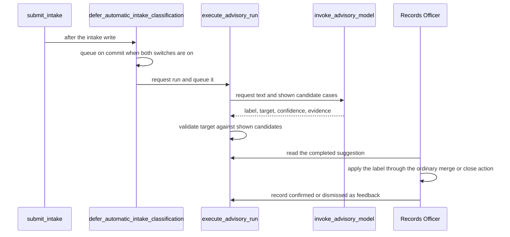
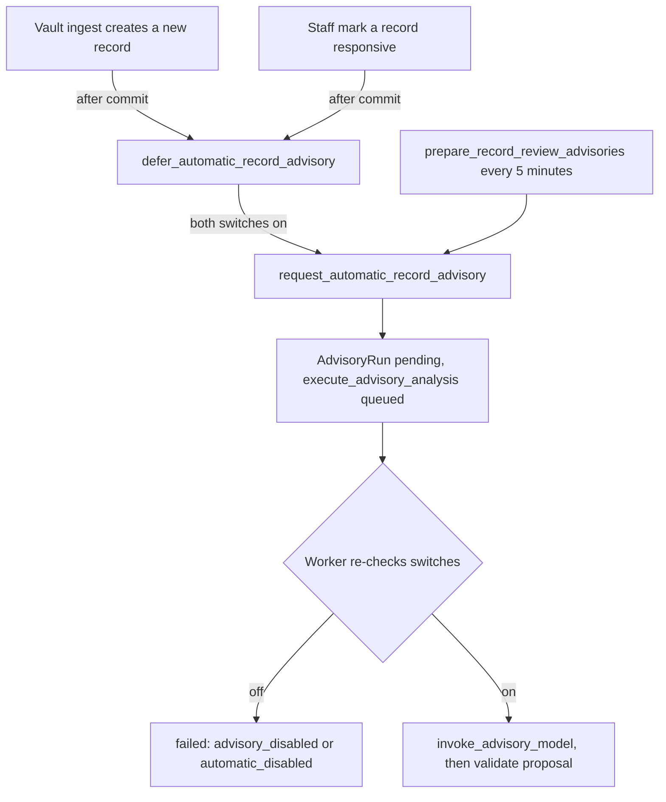

# Advisory AI Proposals

The application uses Amazon Bedrock (the Converse API, in the district's AWS
account) for five bounded proposals. Every proposal is advisory. The
authoritative source is the operations document
[`docs/advisory-ai.md`](../../docs/advisory-ai.md), which also holds the
approval prerequisites. This page explains the code shape and the invariants a
change must keep.

| Kind | What the model proposes | Where it starts |
|---|---|---|
| `request_intent` | Summary, mandatory search anchors, alternative terms, record-system slugs, clarification questions, complexity flags, a date range, and up to four narrowing options | `request_request_intent_advisory`, or the automatic intake path |
| `case_title` | One title of at most 80 characters, and nothing else | `request_case_title_advisory` |
| `intake_classification` | One label (`new_request`, `follow_up`, `duplicate_of`, `related_to`, `non_request`, or `spam`), a target case number only for the first three, a confidence, and evidence | `request_intake_classification` (officer) or `defer_automatic_intake_classification` (intake) |
| `record_responsiveness` | `responsive`, `non_responsive`, or `uncertain`, with confidence, terms, and rationale | `request_record_responsiveness_advisory` and the automatic review path |
| `record_redactions` | Page-specific candidate spans and an active exemption identifier, for a human-confirmed responsive PDF | `request_record_redaction_advisory` |

## Boundary

Model output is untrusted data. The worker validates it against the
`_validate_proposal` rules and the bounded field shapes. It also checks each
span and exemption against the vocabularies it issued. Unknown or inactive
identifiers, unexpected fields, invalid confidence, and unsearchable PDFs fail
closed.

- **Request intent** never narrows a request. A narrowing option is display-only
  drafting material for the officer's scope conversation. The advisory never
  drafts, queues, or sends the letter that offers it.
- **Case title** is shown to Records Officers only, in the case Subject column,
  and marked as AI-suggested. It reads no attachments and is offered no record
  systems or exemption taxonomy, so a completed run starts nothing.
- **Intake classification** suggests what a new case is, for a Records Officer
  to confirm or dismiss. `_intake_candidates` offers the model only earlier cases
  of the same matter kind, received within 180 days, up to 120 of them, plus up to
  20 from the same requester, each with its immutable fields and a bounded
  description. Kinds never mix. `_validate_proposal` refuses a target number that
  was not among the candidates, and refuses a target on a label that names no
  case. The label merges, closes, and sends nothing. The officer applies it
  through the ordinary merge, close, or add-to-case action in
  [requests](requests.md), then records the answer as an `AdvisoryFeedback` row
  (`confirmed` or `dismissed`, one per run). Only a Records Officer may request
  the run manually, and no automatic run has an accountable actor. The staff card
  is `frontend/src/case/IntakeClassificationCard.tsx`, which passes the label to
  the ordinary dialog and does not act on it.
- **Responsiveness and redaction** remain proposals. A named reviewer must still
  confirm each responsiveness recommendation. Each redaction candidate needs an
  individual accept, edit, or reject decision with an active exemption citation.
  There is no accept-all path. The model never supplies coordinates. The worker
  derives normalized boxes from the retained PDF, and an accepted candidate goes
  through the normal redaction service. Second review and raster burn-in still
  apply.

*Intake classification: the model proposes, the officer applies the label through the ordinary action and records the answer.*

## Persistence and provenance

`AdvisoryRun` in [`apps/records/models.py`](../../apps/records/models.py) keeps
each run's trigger (`manual` or `automatic`), the requester, the model
identifier, the target, the input SHA-256, the truncation flag, and a bounded
proposal or failure code. Database constraints enforce that `applied` is always
false (`records_advisory_never_applied`) and that a manual run has a named staff
requester (`records_manual_advisory_requires_requester`). Run state is
`pending`, `running`, `complete`, or `failed`. `RedactionProposal` and
`RedactionProposalDecision` are append-only. A decision links the proposal to the
resulting `Redaction` when accepted. `AdvisoryFeedback` is the append-only,
one-per-run record of what a person did with an intake classification: the
outcome, the final label they judged, and a reason. It is what lets agreement
between the model and officers be measured later. It does not record the merge or
close that followed, which stays in the ordinary request history.

Input is fingerprinted from the full attachment manifest. A scan verdict or an
attachment change therefore cannot reuse a stale result. Attachments reach
Bedrock only after the ClamAV boundary reports them clean, and the worker
verifies their byte count and SHA-256 first. Bedrock receives neutral labels, not
requester filenames.

## Automatic runs

The worker starts automatic runs only where a switch allows it. Each switch is an
app setting in the [configuration registry](../architecture/configuration.md),
and each requires `PRR_AI_ADVISORY_ENABLED`:

- `PRR_AI_AUTOMATIC_RECORD_REVIEW_ENABLED`. A new Vault record queues a
  responsiveness proposal. Vault ingest calls `defer_automatic_record_advisory()`,
  which queues the work only after the ingest transaction commits. A human
  `responsive` confirmation in `review_record()` defers a `record_redactions`
  run the same way. `request_automatic_record_advisory()` is the single
  entry point for both, and it reuses an identical completed run. Only the
  `record_responsiveness` and `record_redactions` kinds are accepted.
  `prepare_record_review_advisories` runs every five minutes to backfill missed
  work in bounded batches, and bounded retry stops after three substantive
  automatic failures. Planned pauses (`advisory_disabled`, `automatic_disabled`)
  do not consume that retry budget.
- `PRR_AI_AUTOMATIC_REQUEST_INTENT_ENABLED`. A new request prepares its intent
  proposal after intake commits and after every attachment has a final malware
  verdict. A completed proposal that maps to an active Vault-backed system queues
  an entire-organization count. See [Collection and Vault](collection-and-vault.md).
- `PRR_AI_AUTOMATIC_CASE_TITLES_ENABLED`. Every new case gets a title run after
  intake commits. It does not wait on scanning, since it reads no files.
- `PRR_AI_AUTOMATIC_INTAKE_CLASSIFICATION_ENABLED`. Each new case is classified
  after its intake write commits. `intake.py` calls
  `defer_automatic_intake_classification()`, which queues nothing unless this
  switch and `PRR_AI_ADVISORY_ENABLED` are both on. A failure to queue is logged
  without request text, and the case simply has no label.

Every switch defaults off. None is an environment variable. The Application
Admin sets it on Configuration > District settings with a written reason, and the
change takes effect without a redeploy.

*Automatic advisory triggers: every path re-checks the switches in the worker before any model call.*

## Backfilling case titles

Automatic titles apply only to new cases. The `backfill_case_titles` management
command in [`apps/records/management/commands/backfill_case_titles.py`](../../apps/records/management/commands/backfill_case_titles.py)
is the one-time pass for existing cases. It queues the same automatic
`case_title` run through `request_automatic_case_title_advisory()` and nothing
else. It sends no correspondence, changes no status or deadline, and writes
nothing to the request.

- **Dry run by default.** Without `--commit` it only reports each case it would
  queue. With `--commit` it refuses unless `PRR_AI_ADVISORY_ENABLED` and
  `PRR_AI_AUTOMATIC_CASE_TITLES_ENABLED` are both on.
- **Scope.** Open cases only, unless `--all` is passed. `--limit` bounds one pass.
  `--batch-size` and `--pause` throttle how fast runs reach the provider.
- **Idempotent.** The command skips cases that already have a pending, running, or
  complete title run, and the service reuses an identical completed run. A second
  pass queues nothing for cases already handled.
- **Failures stay local.** A case that cannot be queued is named on stderr and the pass
  continues. The command audits `advisory.case_titles.backfilled` with its counts.

`test_backfill_case_titles.py` covers dry run, scope, idempotency, bounds, the refusal
while a switch is off, and the rule that the pass does not change the case.

## Enablement prerequisites and runtime grant

`PRR_AI_ADVISORY_ENABLED` carries the prerequisite rule `advisory_model_configured`
in [`apps/configuration/prerequisites.py`](../../apps/configuration/prerequisites.py).
The settings service applies that rule before it accepts the switch, so the switch
cannot turn on unless the provider is `bedrock`, the AWS region is valid, and the
model identifier matches the Bedrock format.

Each kind has its own model setting: `PRR_AI_MODEL_INTENT`,
`PRR_AI_MODEL_CASE_TITLE`, `PRR_AI_MODEL_RESPONSIVENESS`,
`PRR_AI_MODEL_INTAKE`, and `PRR_AI_MODEL_REDACTION`. A blank one falls back to
`PRR_AI_MODEL`. `model_for_kind()` in `advisory_ai.py` reads the setting when a run
is created and stores the identifier on that run, so the call uses the model the
run recorded. Each kind also has its own output-token budget in `MAX_OUTPUT_TOKENS`.
Only models the production Bedrock grant names can be called. Any other identifier
makes the run fail closed.

In production the runtime role receives a `bedrock:InvokeModel` grant from
[`infra/cdk/lib/advisory-bedrock.ts`](../../infra/cdk/lib/advisory-bedrock.ts),
which `prr-hosting-stack.ts` applies during the CDK release. The grant is limited to
one inference profile and to the matching foundation-model resources in the three US
regions that profile may route to. It is not a broad Bedrock permission. The model
identifier is a constant in that file, so a model change needs the district setting
and a matching CDK change, shipped through the
[AWS production release](../operations/aws-deployment.md).

## Change guidance

- Keep the advisory-only boundary. A new kind of output needs its own validation
  and a test that it cannot reach the statutory services.
- Model calls, validation, and persistence belong in `advisory_ai.py` and
  `redaction_ai.py`. Do not call Bedrock from a view or a serializer.
- The `scope conversation` and case-title copy must describe a count the officer
  typed, not one the system ran. See `test_scope_conversation`.
- Bulk review is a human decision. Never add a path that accepts a candidate
  without its own named decision.
- Use `test_advisory_ai` and `test_redaction_ai` for the worker and validator.
  `test_intake_classification` covers the intake label: candidate selection and
  its stability while later cases arrive, refusal of an unshown target, the
  post-commit deferral, the officer-only request, and feedback recorded once per
  run.
  `test_automatic_record_advisory` covers the automatic record path: the
  post-commit deferral, the worker's switch re-check, and the planned-pause
  exemption from retry limits. `test_verify_advisory_command` covers the
  verification command. Run only those modules for a narrow check.
- The `verify_advisory_ai` management command (`apps/records/management/commands/verify_advisory_ai.py`)
  checks Bedrock connectivity and the bounded-JSON contract with synthetic data. It calls
  `invoke_advisory_model()` and `_validate_proposal()` directly and writes no request or
  `AdvisoryRun`. Use it to confirm provider access, not to test case behavior.

Related: [Compliance](compliance.md) (human-only and advisory rules),
[Agent parity](../architecture/agent-parity.md) (AI actions are
catalogued as human-confirmation or human-only), [Case workspace](case-workspace.md)
(where the title and the Next due column appear).
ot to test case behavior.

Related: [Compliance](compliance.md) (human-only and advisory rules),
[Agent parity](../architecture/agent-parity.md) (AI actions are
catalogued as human-confirmation or human-only), [Case workspace](case-workspace.md)
(where the title and the Next due column appear).
