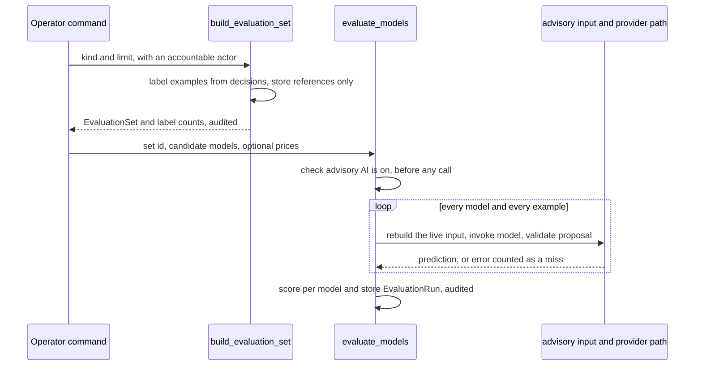

# Advisory Model Comparison and Evaluation

The evaluation harness answers one question before a model change ships: how would
each candidate advisory model have matched decisions people already made? It builds
a labelled set from production outcomes, runs every candidate through the same
advisory input and validation the live features use, and stores metrics per model.
It is measurement only. It never writes an advisory run, a proposal, a status, or a
message, and it does not change how the live advisory behaves
([advisory AI](advisory-ai.md)).

*A set is labelled once, then each model is scored on the same examples. Nothing is sent before the advisory switch check.*

## Two label sets

Labels are coarse on purpose, because the decisions they come from are coarse.

| Kind | Labels | How a label is decided |
|---|---|---|
| `intake` (advisory kind `intake_classification`) | `new`, `existing`, `not_request` | Cases not still `received` are included. An officer's recorded answer to an intake suggestion outranks the case outcome. A duplicate closure is `existing` with its merge target. A non-request closure is `existing` if an email-intake redirect moved the message, otherwise `not_request`. Any other case is `new`. Every matter kind is included, and candidates never cross kinds. |
| `responsiveness` (advisory kind `record_responsiveness`) | `responsive`, `non_responsive` | Records reviewed as responsive or withheld are `responsive`. Records reviewed as non-responsive are `non_responsive`. Records with no searchable OCR text are left out. |

`build_evaluation_set()` stores `examples` (references and labels), `label_counts`, and the
actor, and writes an `advisory.evaluation_set_built` audit row. The stored examples carry
IDs and labels only. `test_the_set_holds_references_not_text` checks that no text is stored.

## Scoring

`evaluate_models()` runs every model on every example. For each example it rebuilds the
input with `_build_advisory_input`, calls `invoke_advisory_model`, and validates the answer
with `_validate_proposal`, the same path a live run takes. A provider error, an invalid
output, or a validation error becomes the label `error`. `_score()` then produces, per model:

- `accuracy`, the share of examples where the prediction equals the label. Errors are misses.
- `safety_recall`, the share of safety-critical examples predicted as kept. For intake the
  safe labels are `new` and `existing`. For responsiveness they are `responsive`, and
  `uncertain` also counts as kept.
- `target_accuracy`, the share of `existing` examples whose predicted target case matches the recorded one.
- `confusion`, gold label by prediction.
- `input_tokens_mean`, `output_tokens_mean`, `cost_per_item_usd`, computed only when a price
  was given for that model, and `latency_p50_ms` and `latency_p95_ms` over non-error calls.
- `predictions`, one entry per example with its reference and labels only.

`EvaluationRun` stores these results, the model identifiers, and the actor, and writes an
`advisory.evaluation_completed` audit row.

## Operator commands

Both commands are in `apps/records/management/commands/` and need an accountable staff email argument.

- `build_eval_set` takes `--kind` (`intake` or `responsiveness`) and an optional `--limit`.
  It sends nothing.
- `evaluate_models` takes `--set` (an evaluation set ID), `--models` (a comma-separated list),
  and optional repeated `--price MODEL=INPUT/OUTPUT` in USD per million tokens. It sends real request
  and record text to the provider, so advisory AI must be on. It refuses an unknown set, and it
  prints one line per model with accuracy, safety recall, errors, cost, and p95 latency.

Only models that the production Bedrock grant names can run. The allow-list is in
`infra/cdk/lib/advisory-bedrock.ts`, so a candidate outside it scores every example as an error
rather than failing the command ([AWS production release](../operations/aws-deployment.md)).

## Read path

`apps/api/resources/advisory_evaluations.py` exposes `EvaluationRunViewSet` at
`/api/staff/advisory-evaluations/`. It is list-only, returns the 50 most recent runs with no pagination,
and is limited to `RECORDS_OFFICER`. The row carries the set kind, the item count, the label counts,
the model identifiers, the results, the creator, and the timestamp. The capability is
`advisory_evaluations.list` in [agent parity](../architecture/agent-parity.md), and the screen is
`frontend/src/pages/AiEvaluation.tsx` at `/oversight/ai-evaluation`
([staff frontend](../architecture/staff-frontend.md)). The screen shows runs and does not start one.
Its subtitle says runs start from `manage.py evaluate_models`.

## Change guidance

- **Where to start.** Label rules are in `_intake_examples` and `_responsiveness_examples`.
  Metric rules are in `_score`, with the safe-label sets in `_SAFE` and the intake mapping in
  `_INTAKE_COARSE`. A new label needs a matching mapping in `_predict` and in `_score`.
- **Keep the measurement boundary.** Do not let an evaluation write a run, proposal, or status.
  `test_nothing_is_sent_while_advisory_ai_is_off` and the audit assertions guard the
  send path.
- **Keep metrics honest.** A failed call must stay a miss. Uncertain responsive results must
  keep counting toward safety recall, but not accuracy (`test_uncertain_counts_toward_safety_recall_but_not_accuracy`).
- **Schema changes** need a migration (`0052_evaluation_harness` is the current one) and an
  update to the screen, which reads the stored `results` shape directly.
- **Non-goals.** This is not a live switch, and it does not choose a model for production.
  Changing the production model is a district setting plus a CDK change
  ([advisory AI](advisory-ai.md#enablement-prerequisites-and-runtime-grant)).

## Focused tests

`apps/records/tests/test_evaluation.py` is the single module. Its classes map to behaviors:

| Class | Behaviors covered |
|---|---|
| `IntakeSetTests` | `test_labels_come_from_what_people_did`, `test_an_officer_answer_outranks_the_case_outcome`, `test_the_set_holds_references_not_text` |
| `ResponsivenessSetTests` | `test_reviewed_records_with_text_are_labelled`, `test_the_limit_bounds_the_set`, `test_a_limit_below_one_is_refused`, `test_unsupported_kinds_are_refused` |
| `EvaluateModelsTests` | `test_every_model_is_scored_on_the_same_examples`, `test_uncertain_counts_toward_safety_recall_but_not_accuracy`, `test_a_failed_call_is_an_error_and_a_miss`, `test_nothing_is_sent_while_advisory_ai_is_off` |
| `IntakeEvaluationTests` | `test_target_accuracy_is_scored_for_cases_that_belong_elsewhere` |
| `CommandTests` | `test_build_then_evaluate` |
| `EvaluationApiTests` | `test_an_officer_reads_the_runs`, `test_runs_are_listed_only`, `test_a_reviewer_may_not` |

Validate with the command in the front matter. Add `apps.api.tests.test_agent_capabilities`
only when the catalog row changes.
