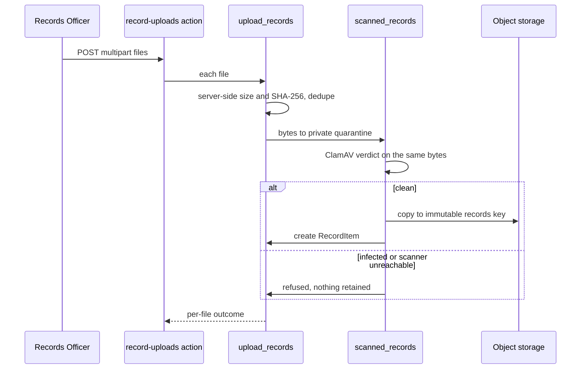
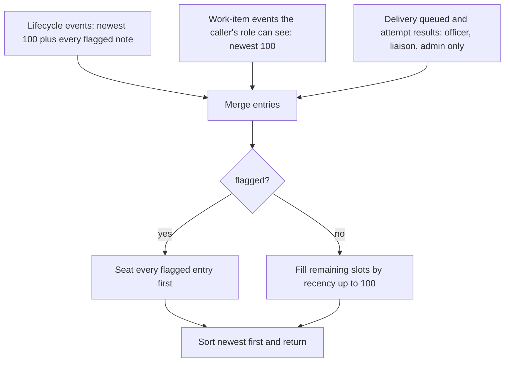

# Case Workspace Records and Notes

These are the staff-facing surfaces on a single PRR case that are not the
statutory lifecycle itself. They help an officer decide what to do next, record
what the team knows, and add candidate records. The workspace reads the same
case model and the same role scope as everything else, so each surface follows
the rules in [Request lifecycle](requests.md) and [Matter kinds](matter-kinds.md).
Staff-level how-to guidance lives in
[`docs/casework-staff-guide.md`](../../docs/casework-staff-guide.md).

## Next due

The **Next due** column answers "what is owed next, and under which rule?"
`next_response_due()` in [`apps/records/response_due.py`](../../apps/records/response_due.py)
is the canonical rule. It is annotated onto case lists by
`annotate_next_response_due`.

The basis table (`statutory`, `estimate`, `district_target`, `ferpa`, or none, by
matter kind and situation) is canonical in [requests.md](requests.md#next-response-due).
The column is a label for the rule that applies. A `district_target` is a working
target, not law. It does not change the statutory clock, the day-5 safety net,
the watchdogs, or JLARC, and every surface that shows it says so.

## Internal case notes

`CaseNote` is an append-only, attributed note in a staff member's own name.
`add_case_note()` in [`apps/records/services.py`](../../apps/records/services.py)
is the only write path. The note is internal. No letter, production manifest,
or export reads it, and `apps/records/tests/test_case_notes.py` asserts that
against the real drafting and production paths. A correction is another note.
Any role that can see a case can write a note on it, and the notes apply to every
matter kind. The REST surface is the `notes` action on `RequestsViewSet`
(`GET` and `POST` at `/api/staff/requests/<number>/notes/`), scoped by the same
`get_object` rule as the case itself.

## Record uploads (candidate records)

A Records Officer can add files they already hold to a case, such as a department
email attachment, a USB handover, or a scan of a paper file. Each becomes an
unreviewed `RecordItem` with `source_system="upload"`. It is a *candidate*, and
review decides whether it is responsive, just as for Vault records.

Upload is `POST /api/staff/requests/<number>/record-uploads/` (multipart
`files` parts). The path is in [`apps/records/record_uploads.py`](../../apps/records/record_uploads.py):

Caption: upload path. Each file gets its own outcome, so one infected file does
not discard the clean ones.

Guarantees, as documented in the module:

- **Fail closed.** Infected files and unreachable scanners both refuse the file.
  Nothing is retained "for now".
- **Server-side facts.** Size and SHA-256 come from the received bytes. The
  media type comes from the filename, never from the browser.
- **Officer only, open cases only.** Adding candidates to a closed case would
  change what a closed response rested on.
- **Custodian left blank.** `RecordItem.custodian` names where a record was
  found, not who handled it. The uploader is recorded in the audit trail.
- **Bounded input.** Count, per-file, and total-size limits are app settings
  (`PRR_RECORD_UPLOAD_MAX_COUNT`, `PRR_RECORD_UPLOAD_MAX_BYTES`,
  `PRR_RECORD_UPLOAD_TOTAL_MAX_BYTES`), read through
  [`apps/configuration`](../architecture/configuration.md).

`scanned_records.py` is the one path any loose, untrusted bytes take to become a
`RecordItem`. The same path serves the NextRequest file migration. Its order is
fixed: private quarantine, ClamAV verdict, immutable copy, quarantine delete, and
only then the row. No row can point at bytes that were not scanned.

## Staff intake and closure readiness

- `StaffIntakeSubmission` records a request taken by phone, mail, or in person.
  It is opened through the same intake pipeline as the public form, with the
  matter kind chosen by a staff actor. See `apps/api/tests/test_staff_intake.py`.
- `closure-readiness` (a `GET` action on the case) lists what still blocks
  closing a case. Closing itself goes through the closure actions and the
  lifecycle service, not through the workspace view.

## Case activity feed

`GET /api/staff/requests/<number>/activity/` is the `activity` action on
`RequestsViewSet` in [`apps/api/resources/requests.py`](../../apps/api/resources/requests.py).
It returns one newest-first timeline, serialized by `CaseActivitySerializer`
(fields `id`, `type`, `occurred_at`, `label`, `actor_username`, `detail`,
`work_item_id`, `delivery_status`, `flagged`). The staff workspace Overview shows a
slice of this feed and the Activity tab shows all of it. This is the case history
the UI renders, so a wrong label or an invented actor is wrong everywhere.

Caption: the three sources are capped separately, then the final list is cut to
100 with flagged entries seated first.

- **Labels.** A status change reads `From → To`. An event with no status on
  either side is labelled `Operational note`, not a transition, because the
  append-only history must not assert a change of legal state that never occurred
  (`test_a_note_only_event_is_not_reported_as_a_transition`).
- **Visibility.** The role checks use the staff roles from
  [Google identity and RBAC](../architecture/google-identity.md). `actor_username` and `detail` are populated for Records Officers
  only. Other roles get `null`, and a reviewer is never given a fabricated actor
  (`test_a_reviewer_is_given_no_actor_rather_than_a_fabricated_one`). Delivery rows
  are returned only to Records Officer, Liaison, and Admin callers, and
  `test_activity_is_typed_and_hides_correspondence_and_notes_from_reviewer` pins
  the reviewer view.
- **Flagged notes.** Migration notes whose text contains a `COMPLIANCE_NOTE_MARKERS`
  marker, defined in [`apps/records/legacy_timeline.py`](../../apps/records/legacy_timeline.py)
  and read through `compliance_flagged_note()`, are queried regardless of age.
  The importer backdates them to the receipt date, so a plain newest-first cut
  would drop them on any case with routine history. `test_a_flagged_note_survives_the_hundred_entry_cap`
  covers this. Routine notes are not flagged (`test_a_routine_note_is_not_flagged`).

Focused tests are in `apps/api/tests/test_case_activity.py`. The delivery and
reviewer views are in `apps/api/tests/test_case_workspace.py`, under
`test_activity_retains_each_append_only_delivery_attempt_result`.

## Time entries

`TimeEntry` in [`apps/records/models.py`](../../apps/records/models.py) records staff
minutes against one request: a date, a minute count, and a short activity label. The
entries feed the estimated staff-time line of JLARC annual reporting
([JLARC annual reporting](jlarc-reporting.md)). The REST surface is `TimeEntryViewSet`
in [`apps/api/resources/records_misc.py`](../../apps/api/resources/records_misc.py),
mounted at `/api/staff/time-entries/`, which filters by `?request=<number>`.

- **Who may write.** Records Officers, Liaisons, Reviewers, and Admins (the
  `WORKFLOW_STAFF_ROLES` set in [`apps/api/identity.py`](../../apps/api/identity.py))
  may list and create entries. Only a Records Officer may update or delete one
  (`role_permissions` on the viewset).
- **Whose entries are visible.** A caller who is neither a Records Officer nor an
  Admin sees only the entries they created (`get_queryset`).
- **Liaison scope.** A liaison may log time only to a request with a `CollectionTask`
  assigned to that liaison. `perform_create` checks this under `select_for_update`
  and refuses otherwise, so the scope check and the insert are one transaction.
- **Ownership.** The `staff` field is set from the session in `perform_create`, never
  from the request body.

The case Overview tab mounts the time-entries panel
(`frontend/src/pages/TimeEntries.tsx`, rendered from `TabContent` in
`frontend/src/case/CaseWorkspace.tsx`). It passes the case number, so the list uses
the same request scope as the API filter. The panel's list and mutations invalidate the
`time-entries` query key.

Focused tests: `apps/api/tests/test_records_misc.py` (`TimeEntryApiTests`) covers the
create and delete round trip, the list, the `?request=` scope, and update. The panel's
role-dependent rendering is in `frontend/src/pages/WorkflowSelectors.test.tsx`.

## Change guidance

- Keep the Next due table in `response_due.py` the single source of truth. Update
  its docstring table and the staff guide together if a basis changes.
- A new workspace write must check the same role scope and open-case rule as its
  neighbors. Record a test that a closed case refuses it.
- Do not route a new note, upload, or candidate into a letter or production
  without an explicit decision in an ADR.
- A new activity source must pass the same role gate as its neighbors, count
  against the 100-entry cap, and get a reviewer-view test. Do not let it expose
  an actor or detail to non-officers.
- Validate the feed with
  `PYTHON_DOTENV_DISABLED=1 python manage.py test apps.api.tests.test_case_activity apps.api.tests.test_case_workspace --settings=config.test_settings`.
  Run the full `apps` suite only when the change reaches shared lifecycle code,
  such as `services.transition()`.

Related: [Work queue](work-queue.md) (where the Inbox leads staff to a case),
[Collection and Vault](collection-and-vault.md) (the other source of candidate
records), [Advisory AI](advisory-ai.md) (the AI case title shown in the Subject
column).
