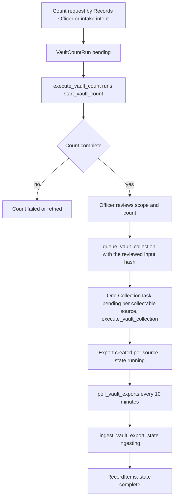
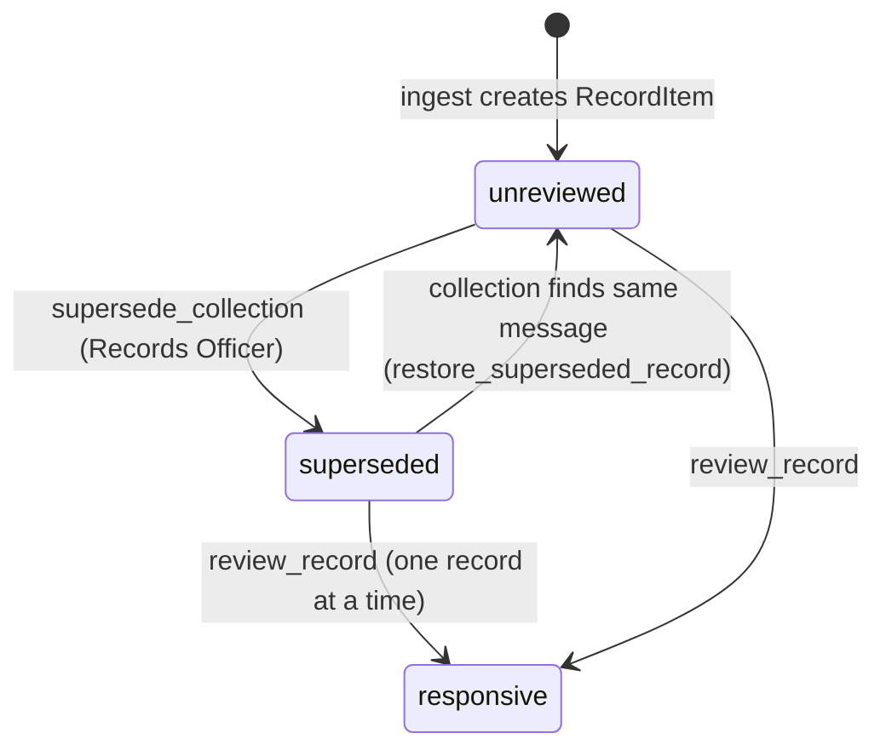
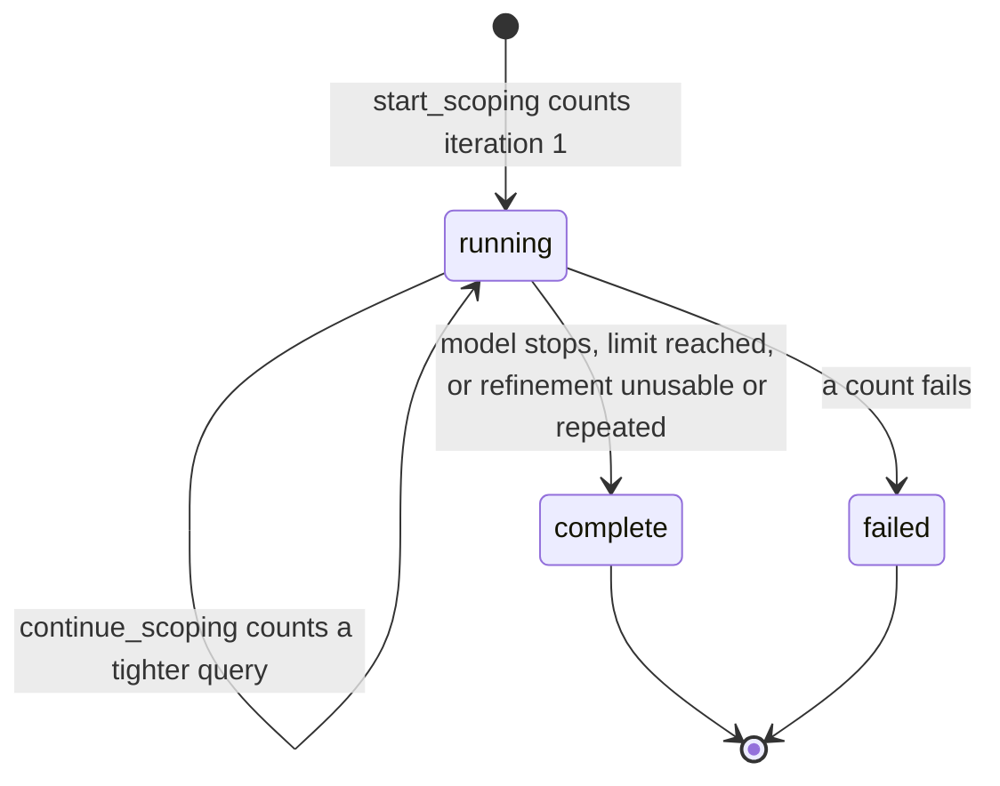

# Collection, the System Registry, and Vault Ingest

Collection is how a PRR case gathers candidate records from the district's
systems. It has three parts: a registry of systems, a per-system **collection
task**, and a Google Vault path that counts, collects, and ingests Gmail and
Drive exports. Every step is human-initiated except the count the intake
advisory may request. Records found here go to review, and review decides
responsiveness.

## The system registry and triage

`RecordSystem` is the district's registry. Each system has a custodian title,
retention profile, triage keywords, and an adequate-search checklist. It is
seeded by `manage.py seed_systems`, and a re-seed keeps district-entered
custodian and retention edits. Staff CRUD is in
[`apps/api/resources/record_systems.py`](../../apps/api/resources/record_systems.py),
which blocks deletion of a system that a collection task references.

Each system's `search_checklist` is the adequate-search procedure for that source. Triage
copies it into the collection task's instructions (`apps/records/triage.py`), and staff
alerts carry it too ([background jobs](../architecture/background-jobs.md#staff-alerts)).
Some seeded entries are off-system custodian sources with `RecordSystem.Integration.MANUAL`
and no connector. The personal-devices entry is one. Its checklist points to the human
personal-device search directive in `templates/sops/personal-device-search.md`. That SOP is
not rendered by code. Before changing registry or triage scope, read
[`docs/custodian-gap-analysis.md`](../../docs/custodian-gap-analysis.md), which
`AGENTS.md` names as required reading for that change.

Intake calls `triage.route_to_systems()` in
[`apps/records/triage.py`](../../apps/records/triage.py). It creates one manual
`CollectionTask` per matching system. An `urgent_hold` system, such as bus video,
also sends an immediate preservation alert. The footage path is separate. See
[Footage triage](footage.md).

A `CollectionTask` has a `kind` (`vault_mail`, `vault_drive`, `vault_chat`, or `manual`), a
`state` (`pending`, `running`, `ingesting`, `complete`, or `failed`), and an
optional `assigned_to`. Changing `assigned_to` is the one explicit handoff into
the [work queue](work-queue.md). Tasks are not deleted, because they are the
working record.

## The Vault path

Google Vault is reached through the keyless, delegated identity in
[`apps/integrations/vault/client.py`](../../apps/integrations/vault/client.py).
The module docstring lists the flow: matter, hold, export, poll, and download.
Django owns every decision around it.

Caption: the Vault path. The count from an intake intent can start without a named
officer. With `PRR_TRUST_SCOPE_MODE=auto`, a finished automatic scoping session can also
start the collection (`queue_automatic_vault_collection`) without one; see
[iterative scoping](#iterative-scoping-from-intake-intent). Each source (Gmail, Drive,
Chat) has its own task and export. The count and collection sections below give the
per-source rules.

### Count

`VaultCountRun` in [`apps/records/models.py`](../../apps/records/models.py)
keeps the provenance of a count: scope, custodian emails, date range, input
SHA-256, trigger (`manual` or `automatic`), and the Vault matter. `request_vault_count()`
creates it. `start_vault_count()` and `advance_vault_count()` in
[`apps/records/vault_counts.py`](../../apps/records/vault_counts.py) run it.
`vault_count_enabled()` reports whether the delegated identity is configured. The
count does no more than estimate. It creates no hold, export, collection task, or
requester message.

A count covers every source in `VaultCountRun.sources`, in the order Gmail, Drive, Chat
(`run_sources()`, with `vault.SOURCES` in [`apps/integrations/vault/client.py`](../../apps/integrations/vault/client.py)).
A run with an empty `sources` list is a Gmail-only count, which is what every count before
migration `0062_vault_drive_and_chat` is.

- **Gmail** uses `matters.count`, started by `start_vault_count()`.
- **Drive and Chat** cannot use `matters.count`, which Vault rejects for those corpora.
  They use a count-only export (`vault.ensure_count_export()`). Its total is read from the
  export's statistics once it completes, and the export is then deleted. A count-only export
  is never downloaded. The reason is recorded in the client's module docstring.
- **Per-source state** lives in `VaultCountRun.source_counts`: `counting`, `counted`, or
  `unavailable`, each with a plain-language reason. A source still running after
  `COUNT_EXPORT_TIMEOUT` (four hours) is reported unavailable. A rate-limited export is
  retried. The run completes once every source is counted or unavailable
  (`_complete_if_settled()`), and it stores the sum as `total_count`.
- **Staff view.** `source_count_summary()` gives one row per source with no provider
  identifiers. `apps/api/vault_counts.py` exposes it as `source_counts`, and `collectable`
  is true only for a complete run with at least one collectable source.
- **District-wide scope.** Vault's entire-organization method is Gmail-only. A Drive or Chat
  count of "all district accounts" needs the staff organizational unit set in
  `PRR_VAULT_STAFF_ORG_UNIT_ID` (`source_query()` builds an org-unit query and raises
  `StaffOrgUnitMissing` without one). The unit is copied onto the run as `org_unit_id`. Without
  it, Drive and Chat show as unavailable with a reason, and only Gmail is searched.

The staff API serializers in [`apps/api/vault_counts.py`](../../apps/api/vault_counts.py)
enforce the scope rule before a count is requested. `VaultCountRequestSerializer`
requires at least one custodian account for an `accounts` scope and forbids custodian
accounts for an `entire_org` scope, and it rejects a date range that ends before it starts.
`VaultCountRunSerializer` is read-only and exposes the run's provenance and the linked
collection task's state and retry eligibility. Its focused test is
`apps/api/tests/test_vault_counts.py`.

### Query construction

`vault_query_from_intent()` in `apps/records/vault_counts.py` assembles the Vault query
text from a proposal's terms. Each required term is quoted and joined with AND. The
alternative terms become one parenthesized OR group, and any term that repeats a required
term is dropped. The staff UI builds the same string with `proposedVaultQuery()` in
[`frontend/src/vaultQuery.ts`](../../frontend/src/vaultQuery.ts), so the officer's Count
button and the automatic intake count scope the same search. Both suites read one shared
case file, `frontend/src/vaultQueryCases.json`. A change to either side that is not
mirrored fails `VaultQueryFromIntentTests` in `apps/records/tests/test_scope_conversation.py`
or `frontend/src/vaultQuery.test.ts`. The UI side of the contract is described in
[staff frontend](../architecture/staff-frontend.md#helpers-that-mirror-server-contracts).

When the officer types a count into a letter, `scopeCountNotice()` in
`frontend/src/scopeCountNotice.ts` compares it with the latest Vault count. It warns
when the two differ, or when a count is still running. It never blocks sending, because
the district chose to leave that judgment with the officer. Its test is
`frontend/src/scopeCountNotice.test.ts`.

A finished count can also trigger a system draft. With `PRR_AI_AUTOMATIC_SCOPE_LETTER_ENABLED` on, the
`prepare-scope-letters` job drafts the informational scope letter from the latest count before any
records are pulled. The draft is never sent, and collection still needs the human gate below. See
[correspondence](correspondence.md#scope-conversation-letter).

### Collection

`queue_vault_collection()` in
[`apps/records/vault_collections.py`](../../apps/records/vault_collections.py) is
the human gate. It requires, in order:

1. Vault configured.
2. No open deposit gate for the collection scope (`assert_deposit_gate_clear`; see
   [fees and deposits](fees-and-deposits.md#deposit-gates)).
3. A `COMPLETE` count with its matter evidence.
4. An `expected_input_sha256` equal to the count's hash. If the scope changed
   after review, it refuses.
5. At least one collectable source. `collectable_sources()` drops a source that counted
   exactly zero, and drops Drive or Chat on a district-wide count with no org unit. A
   source that is unavailable or still counting stays in, because a missing count is not
   evidence that nothing is there. If every source counted zero, the refusal says so.
6. A current Records Officer (for a person-started collection).

It creates one `CollectionTask` per collectable source, each with its own `kind`
(`SOURCE_KINDS` maps `mail`, `drive`, and `chat` to `vault_mail`, `vault_drive`, and
`vault_chat`). Every task shares the count's terms, custodians, and date range. A repeated
call creates nothing new. A task that failed before its export can be requeued alone. A
failed task whose export already exists, or whose count was superseded, refuses a new
collection, and the officer must count again. The task's instructions say that an
entire-organization scope does not claim an organization-wide hold. Named custodians are
refined later for a targeted hold.

Holds follow the source and the trigger. A Gmail collection always places its hold. A Drive
or Chat collection places a hold only when a person starts it. An automatic Drive or Chat
collection creates the export without a new hold (`start_vault_collection()`, and
`test_an_automatic_chat_collection_adds_no_hold` in
`apps/records/tests/test_vault_source_collections.py`).

### Export polling and ingest

The `poll_vault_exports` beat task (every 10 minutes) advances running exports
and reconciles stale ingest claims. `ingest_vault_export` in
[`apps/records/vault_ingest.py`](../../apps/records/vault_ingest.py) is resumable:

- `VaultIngestRun` holds a lease token and heartbeat. A stale claim is
  reconciled, not duplicated.
- **Per source.** Gmail and Chat exports are MBOX messages and take the message path, so a
  Chat message is stored with `source_system` `google_vault_chat`. A Drive export is a set
  of files. `_process_drive_file()` ingests each one as a candidate record and keeps the
  original bytes. The largest object an export may contain is `PRR_VAULT_EXPORT_MAX_BYTES`.
  An export with a bigger object stops with a reported error rather than ingesting part of
  it. Ingested Drive and Chat records enter review like Gmail records.
- `VaultExportObject` records each file of the export with its sizes and digests.
  Archives are bounded (member count and expanded bytes), and messages are capped.
- Each message is retained as raw bytes before any conversion. `VaultMessageArtifact`
  holds the digest and the quarantine and scan state.
  `convert_message_to_searchable_pdf()` renders the message to a text PDF and
  OCRs it, and the result becomes a `RecordItem`.
- Duplicate messages are detected with `_message_duplicate()`.
- Custodian facts come from the export's metadata CSV. `vault_metadata.py`
  reads it so that one message names every account it was delivered to.
  `RecordItemCustodian` stores those rows. Each message's parsed header facts and
  body digest are stored by `parse_email_metadata`, and the review tags derived from
  them are in [record facts and tags](record-facts-and-tags.md).

A completed ingest starts the record-review advisories described in
[Advisory AI](advisory-ai.md). Those are proposals only.

## Superseding an over-broad collection

A Vault export can bring in far more than the request asked for. The Records Officer
can take that collection's undecided records out of review without deleting them.
`supersede_collection()` in
[`apps/records/collection_supersession.py`](../../apps/records/collection_supersession.py)
does the work. The staff endpoint is `POST /api/staff/collection-tasks/{id}/supersede/`
(`CollectionTaskViewSet.supersede` in
[`apps/api/resources/collection_tasks.py`](../../apps/api/resources/collection_tasks.py)).
Its capability entry, `collection_tasks.supersede`, is `high` risk and requires human
confirmation, so an agent can only propose it. See [agent parity](../architecture/agent-parity.md).
On the Collect stage, `CollectionCards` in `frontend/src/case/CollectionCards.tsx` shows the action
only on a `complete` Vault collection (Gmail, Drive, or Chat) to a Records Officer. It
needs a reason of at least 20 characters, and its confirmation states how many unreviewed records
leave review before the call is made ([staff frontend](../architecture/staff-frontend.md#case-stages-and-views)).

Caption: `superseded` is a `RecordItem.ReviewState`. Reviewed records do not enter it.

The rules, all enforced in `supersede_collection()`:

- Only a current Records Officer may supersede, and the reason must be at least
  `MIN_SUPERSESSION_REASON` (20) characters after trimming.
- Only records of that task still `unreviewed` change. A record a reviewer already decided is
  left alone. Nothing is deleted, and the records keep their custody chain.
- Each change writes one `record.reviewed` audit row per record. A
  `CollectionSupersession` row records the reason, the actor, and the count. The
  `CollectionSupersession` model is append-only (`AppendOnlyModelMixin`). A
  `collection.superseded` audit row and a requester-hidden `StatusEvent` follow, and work
  reconciliation is scheduled for the affected records.
- A second call on the same task changes nothing and writes no new supersession row.

Superseded records leave the working set in these places:

- The record-item list hides them unless `review_state=superseded` is requested. Detail
  endpoints still return them (`apps/api/resources/records_misc.py`).
- `bulk_review_records` refuses them, because each must be reconsidered on purpose.
  `review_record` can still decide one at a time (`apps/records/review.py`).
- Installment packaging refuses them (`apps/records/production.py`). See
  [installments and release](installments-and-release.md).

When a later collection finds the same message, Vault ingest calls
`restore_superseded_record()` from `_mark_duplicate()` in
[`apps/records/vault_ingest.py`](../../apps/records/vault_ingest.py). The record returns to
`unreviewed` under the new task, its reviewer fields are cleared, and the restore is audited
as `record.restored_by_collection`. A narrower re-collection therefore cannot quietly hide a
message that it still considers relevant.

Focused test: `apps/records/tests/test_collection_supersession.py`.
`SupersedeCollectionServiceTests` covers scope, append-only evidence, the no-op retry, the reason
and role gates, release refusal, and bulk-review refusal. `SupersedeCollectionApiTests`
covers the endpoint status codes and the list and retrieval behavior. The test
`test_a_recollected_message_returns_to_review` in `RecollectionRestoresSupersededRecordsTests`
covers the restore path.

Minimal validation: `PYTHON_DOTENV_DISABLED=1 python manage.py test apps.records.tests.test_collection_supersession --settings=config.test_settings`.

## Iterative scoping from intake intent

`apps/records/scoping.py` turns an intake intent proposal into a Vault scope that a
person can review before any hold or export. Its module docstring states the rule:
scoping counts only. It never holds, exports, writes a status, or reaches a requester.

With `PRR_AI_AUTOMATIC_REQUEST_INTENT_ENABLED` on, a completed automatic intent proposal
that maps a request to an active Vault-backed system calls `start_scoping()`. The
session is a `ScopingSession` with a `max_iterations` copied from
`PRR_INTENT_MAX_COUNT_ITERATIONS`, and its first `ScopeIteration` is counted through
`_queue_iteration()` with `trigger=automatic`:

- The scope is the named district mailboxes (an `accounts` scope) when the proposal names
  any, and the whole organization otherwise. Custodians outside the configured district
  domain are dropped before counting.
- When a count completes, `continue_scoping()` reads the total and the busiest custodian
  accounts, then asks the advisory model either to stop or to propose a tighter query.
  A usable refinement becomes the next iteration, and the loop repeats.
- The session stops for one of these reasons, recorded in `stop_reason`: the model says
  stop; the iteration limit is reached; the refinement is unusable or repeats an earlier
  scope; the model is unavailable, so the last count stands; or a count fails, which
  marks the session `failed`. The last completed count is the proposed scope.
- An officer can start a fresh run with `rerun_scoping()`. It needs a reason of at least
  10 characters and runs even when nothing changed. Its trigger is `manual`.

Caption: a session's end is the only state change. A `complete` session with
`PRR_TRUST_SCOPE_MODE=auto` may also schedule a collection, described below.

### Collection from the approved scope

Two paths start a Vault collection from a scope:

- **Officer-approved.** The Records Officer starts `queue_vault_collection()` from the
  Collection tab, or calls `rescope()`. Re-scoping requires a reason of at least
  `MIN_SUPERSESSION_REASON` characters and a finished current collection. It queues the
  new collection first, which checks the reviewed count hash, and then supersedes the
  previous collection's unreviewed records (see
  [superseding an over-broad collection](#superseding-an-over-broad-collection)).
- **Automatic, only in trust-scope `auto` mode.** `PRR_TRUST_SCOPE_MODE` defaults to
  `suggest`. When it is `auto`, `_finish()` schedules `_collect_automatically()` after
  commit for a finished automatic session. That calls
  `queue_automatic_vault_collection()` on the final completed count, but only when the
  count has at least one collectable source and the request has no Vault collection yet.
  The collection is recorded with `trigger=automatic` and no actor. The deposit gate, the
  per-source hold rule, and the export into review are the same as for an officer's
  collection. An officer's re-run never collects by itself.

AGENTS.md rule 11 records the district decision and its volume risk. Its sentence "Unattended
Vault actions are exactly two" covers the count and this collection path. See
[advisory AI](advisory-ai.md) for the switches that start the intent proposal.

Focused tests:

- `apps/records/tests/test_scoping.py`: `test_the_agent_reads_the_breakdown_tightens_then_stops`,
  `test_the_iteration_limit_stops_without_asking_the_model`,
  `test_a_refinement_with_no_subject_terms_is_unusable`,
  `test_a_refinement_that_repeats_a_scope_stops`, `test_a_failed_count_fails_the_session`,
  `test_rerun_needs_a_reason_and_runs_even_when_nothing_changed`, and
  `test_scoping_only_counts`.
- `apps/records/tests/test_approve_and_collect.py`: `test_a_finished_automatic_session_collects_its_final_scope`,
  `test_suggest_mode_collects_nothing`, `test_auto_mode_never_collects_from_an_officers_rerun`,
  `test_auto_mode_never_adds_a_second_collection`, `test_auto_mode_skips_a_zero_count`, and
  `test_rescope_supersedes_the_old_collection_and_collects_the_new_scope`.
- Multi-source behavior: `apps/records/tests/test_scoping.py::test_automatic_counts_search_gmail_drive_and_chat`
  (the automatic count covers all three sources), `test_vault_source_collections.py`
  (`QueueTests` for one task per source, zero-count skipping, every-source-zero refusal,
  district-wide without an org unit, and requeue of only the failed handoff; `StartTests`
  for hold rules), and `test_approve_and_collect.py::test_auto_mode_counts_a_drive_task_as_an_existing_collection`.

Minimal validation: `PYTHON_DOTENV_DISABLED=1 python manage.py test apps.records.tests.test_scoping apps.records.tests.test_approve_and_collect --settings=config.test_settings`.

## Change guidance

- Any new Vault operation must sit behind the same count, review hash, and officer
  gate. Do not widen either unattended path (the automatic count or the `auto` collection) to
  another operation; AGENTS.md rule 11 lists both.
- Keep the expected-hash check. It is what stops a collection from running on a
  scope a person did not review.
- For ingest changes, keep retention before conversion, and keep
  `ingest_vault_export` idempotent under re-runs.
- Use `apps.records.tests.test_vault_*` for ingest behavior. Use
  `apps/api/tests/test_vault_counts.py` for the staff API contract.
- Supersession changes must keep the evidence append-only and keep the restore path in
  `_mark_duplicate()`. Run `apps.records.tests.test_collection_supersession` with them.

Related: [Requests](requests.md) (the case that owns these tasks),
[Work queue](work-queue.md) (collection and record-review work items),
[Compliance](compliance.md) (human-only and count-only rules).
