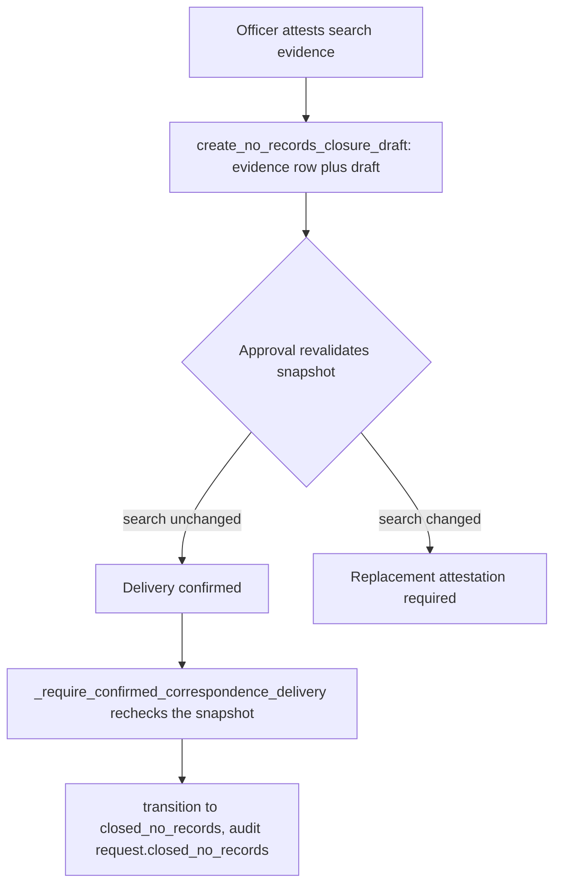

# Compliance Guarantees

Compliance is the product. Deadline math, exemption handling, and the audit
trail are legal artifacts, enforced at the database level and by tests. The
rules below apply to `public_records` matters. Each rule states which matter
kinds it covers, as [matter-kinds.md](matter-kinds.md) requires. The thirteen
non-negotiable rules that `AGENTS.md` indexes are written in full in
[`docs/compliance-rules.md`](../../docs/compliance-rules.md); this page explains how
the code enforces them.

`AGENTS.md` is kept as a short map and must keep each rule's operative prohibition.
No single test pins the whole file any more: the earlier AGENTS.md line-ceiling and
rule-anchor test (`test_agent_context_files`) is no longer in the repository. The
checks that remain are narrower. `apps/api/tests/test_hosted_mcp.py`
(`test_source_docs_do_not_describe_the_whole_mcp_surface_as_readonly`) asserts the
hosted-MCP wording that rule 11 and `docs/compliance-rules.md` must keep, and
`apps/records/tests/test_compliance.py` (`test_no_automated_path_exists`) guards the
human-only rule. After you edit `AGENTS.md` or the rules document, run
`PYTHON_DOTENV_DISABLED=1 python manage.py test apps.api.tests.test_hosted_mcp apps.records.tests.test_compliance --settings=config.test_settings`.

## Guarantee table

| Guarantee | Mechanism | Source |
|---|---|---|
| 5-business-day response clock (RCW 42.56.520) | WA holidays, district closures, after-hours rollover, counting from the day after receipt | [`deadlines.py`](../../apps/records/deadlines.py) |
| Single lifecycle path | All transitions via `services.transition()` | [`services.py`](../../apps/records/services.py) |
| Every redaction cites an exemption | `Redaction.exemption` is a non-nullable FK | [`models.py`](../../apps/records/models.py) |
| Append-only audit and status history | No update or delete paths for `AuditLog`, `StatusEvent`, and other append-only models | [`apps/audit/`](../../apps/audit/), [`apps/append_only.py`](../../apps/append_only.py) |
| Human-only statutory actions | AST-guarded tests over the letter and task modules | [`test_compliance.py`](../../apps/records/tests/test_compliance.py) |
| Footage: auto-hold always, auto-deny never | Triage holds cameras; denial drafts require a human | [`triage.py`](../../apps/records/triage.py) |
| Matter kind fixed at intake | ORM and database immutability | [`models.py`](../../apps/records/models.py), [matter-kinds.md](matter-kinds.md) |
| Requester PII minimized | Email and description required; name, phone, and address optional | [`intake.py`](../../apps/records/intake.py), [`public_views.py`](../../apps/records/public_views.py) |
| Intake attachments secured | Quarantine, content hash, ClamAV scan; clean downloads limited to Records Officers with short-lived URLs | [`attachments.py`](../../apps/records/attachments.py), [`intake_attachments.py`](../../apps/api/resources/intake_attachments.py) |
| Request text immutable | `description` is never edited after intake | [`services.py`](../../apps/records/services.py) |

## Deadline engine

Implements **RCW 42.56.520**: respond within five business days of receipt.
Applies to `public_records` matters only (`deadlines.py` and
`test_matter_kinds`).

### Business-day rules

Source: [`apps/records/deadlines.py`](../../apps/records/deadlines.py)

1. **WA holiday calendar**, including Juneteenth from 2021.
2. **District closures** from the app-managed `DISTRICT_HOLIDAYS` setting
   (see [configuration.md](../architecture/configuration.md)).
3. **After-hours rollover**: receipts after close of business roll to the next day.
4. **Counting rule**: days are counted starting the day after receipt (RCW 1.12.040).

### Verification

Tests use real calendar dates. They cover holiday exclusions, leap years, and
close-of-business rollover. Deadline changes must keep those tests passing.
Do not change `TIME_ZONE`, since deadline math depends on it.

- `apps/records/tests/test_deadlines.py` holds the example-based cases with real
  WA dates.
- `apps/records/tests/test_deadlines_properties.py` states the same compliance as
  Hypothesis invariants. It patches `deadlines._district_closures`, runs on
  `SimpleTestCase` with no database, and is `derandomize=True` with 75 examples, so
  a failure reproduces on the same commit. Do not switch it to random seeding,
  because `FLAKY.md` quarantine decisions depend on a failure reproducing.
- Focused command:
  `PYTHON_DOTENV_DISABLED=1 python manage.py test apps.records.tests.test_deadlines apps.records.tests.test_deadlines_properties --settings=config.test_settings`.

### Next response due

The staff case list shows the next owed date, which may be an estimate,
a district target, a FERPA date, or nothing. The statutory clock is spent once
a first response is delivered. See
[requests.md](requests.md#next-response-due).

## Exemption taxonomy

Run `manage.py seed_exemptions` to seed the RCW 42.56 and FERPA exemption
categories. Every `Redaction` requires a non-nullable `exemption` FK to an
`ExemptionCitation`, which lets the RCW 42.56.210(3) withholding log be
generated from database rows. Exemption proposals from advisory AI must
select an active citation and still need a named human to accept them
([advisory-ai.md](advisory-ai.md)).

Staff maintain the taxonomy through `ExemptionViewSet` in
[`apps/api/resources/exemptions.py`](../../apps/api/resources/exemptions.py).
Records officers and administrators create and edit citations, and only
administrators delete one. A citation becomes legal evidence once any withheld item,
redaction, redaction proposal, or denial basis references it, and
`ExemptionCitation.is_in_use()` in `apps/records/models.py` reports that state. From
then on its meaning is frozen: the citation text, short name, description, and
second-review flag cannot change, and the row cannot be deleted. Deactivating a
citation (`active`) remains available and is audited, and changed wording requires a
replacement citation. The API serializer, the model `save()`, the queryset `update()`
path, and the database itself (which raises an integrity error for a bare queryset
rewrite) each refuse the rewrite, so no single layer carries the rule. Focused tests in `apps/api/tests/test_exemptions.py`:
`test_used_citation_meaning_cannot_be_rewritten_through_api`,
`test_used_citation_meaning_cannot_be_rewritten_through_model_save`,
`test_database_rejects_bare_queryset_rewrite_of_used_citation`,
`test_used_withholding_citation_cannot_be_deleted_at_api_or_model_layer`, and
`test_active_state_change_remains_available_and_is_audited`.

## Human-only actions and AST guards

Certain statutory actions must never run automatically. The test suite enforces
this by parsing the source of the letter and task modules for calls.

| Function or action | Guard | Reason |
|---|---|---|
| `letters.revise_estimate()` | AST check; requires a substantive reason; no background task may call it | Automated estimate revisions are a Yousoufian penalty aggravator |
| `triage.exclude_camera()` | AST check; human actor plus reason of at least 10 characters | A camera exclusion needs an accountable reason |
| `services.record_external_initial_response()` | AST-guarded in `test_compliance` | Records a first response sent outside this system; sends nothing |
| `scope_clarification` letter | `scope-ast-guard`; its clarification form tolls the clock | Choosing the form is a judgment with an accountable name on it |
| Submission receipt | `receipt-ast-guard`; non-statutory; cannot set `initial_response_delivered` | Keeps the receipt from acting as a statutory response |

The main enforcement test is `test_no_automated_path_exists` in
[`apps/records/tests/test_compliance.py`](../../apps/records/tests/test_compliance.py).
The same file holds the companion guards (`fee-ast-guard`,
`matter-kind-ast-guard`, and `case-title-ast-guard`).

Staff and token actors reach `exclude-camera` through
`apps/api/handoffs.py`, which returns `human_approval_required` to token callers
before any object lookup. See [agent-parity.md](../architecture/agent-parity.md).

### The safety-net asymmetry

**The only automated statutory requester-facing letter is the day-5
acknowledgment safety net** (`tasks.auto_acknowledge_safety_net`). Its switch,
`AUTO_ACK_SAFETY_NET`, is an app-managed setting. An Application Admin changes
it with a written reason, and the change takes effect without a redeploy.
Turning it off means no automatic day-5 acknowledgment, and a late
acknowledgment is strict liability under RCW 42.56.520.

Late acknowledgment is strict liability, so it may be automated. Automated
estimate-kicking is a penalty aggravator, so it may not be. Never invert this.
Estimate revisions always require a human.

The safety net is the backstop. The officer-facing plan that sets out the
four-step acknowledgment ladder, and the states that decide when the net is
expected to act, are in [five-day initial response plan](initial-response.md).

## No-records closure evidence

A request may close as `closed_no_records` only after a human attests to a documented search.
The attestation is an `AdequateSearchAttestation` row, a legal artifact that the requester's
closure letter must match. `apps/correspondence/services.py` owns it:
`create_no_records_closure_draft` writes the evidence and its draft, and
`require_adequate_search_snapshot` revalidates the evidence whenever it is approved or
delivered.

| Determination | What it asserts | Extra requirement |
|---|---|---|
| `no_responsive_records` | The search found no responsive record | Search evidence only |
| `outside_retention` | The records existed but are past their retention window | Retention reference and all four obvious-lead checks: incident hold, prior exports, email and drive copies, other copies |
| `not_maintained` | The request asks for information rather than an existing record, and the District does not maintain a record answering it | None beyond the search. The code cites WAC 44-14-04003(6) and calls this a no-record determination, not an exemption |

Creation refuses unless these hold, and the database repeats the key checks as constraints:

- The request is open and is not waiting on a clarification.
- Every collection task is complete, and no record is responsive or withheld. A record that is
  not yet reviewed also blocks it.
- The search completion timestamp is offset-aware and falls between receipt and now.
- The adequacy reason is 20 to 2000 characters, and the counsel approval reference is at least
  10 characters.

The evidence pins a digest of the collection-task state at attestation. If the search changes
afterward, the closure fails revalidation, and the officer must create a replacement attestation.
The old row is kept. The API limits the draft action to the Records Officer role and to session
users (`apps/api/resources/correspondence.py`).

Caption: the closure reaches `closed_no_records` only through confirmed delivery. A generic
status transition cannot bypass it (`test_generic_status_transition_cannot_bypass_delivered_search_closure`).

Focused tests are in `apps/correspondence/tests/test_no_records_closure.py`. Its
`test_creation_requires_officer_completed_tasks_counsel_and_detailed_steps`,
`test_out_of_retention_requires_expired_preservation_and_all_obvious_leads`, and
`test_confirmed_delivery_closes_as_no_records_not_denied_and_is_idempotent` cover the gates.
`test_changed_search_can_be_re_attested_without_rewriting_old_evidence` covers replacement, and
`test_not_maintained_determination_carries_the_wac_creation_language` covers that determination.
The no-records closure wording is versioned in `correspondence` templates
(see [requester correspondence](correspondence.md#template-registry)).

## Audit trail

- **`StatusEvent`**: immutable timeline entries, one per status change.
- **`AuditLog`**: general audit log with no update or delete paths. The
  read-only audit API is in `apps/api/resources/audit.py`. The model's `AppendOnlyModelMixin` and
  queryset guards (`apps/append_only.py`) reject in-application rewrites. Migration
  `apps/audit/migrations/0002_auditlog_append_only_trigger.py` adds a PostgreSQL trigger on
  `audit_auditlog` that rejects `UPDATE` and `DELETE`. SQLite gets only an update trigger, used by
  tests. `manage.py export_audit_log` streams the whole ledger as canonical JSON Lines, and the
  [application backup](../operations/backups.md) writes that export as its independent audit copy.
- **IP and actor tracking**: actions are logged with actor and target.
- **Corrections** are new append-only rows, not edits. This also applies to
  `CaseNote`, `InitialResponseAttestation`, and `FerpaIdentityVerification`.

## Penalty exposure

RCW 42.56.550 provides for attorney fees, a discretionary penalty of up to
$100 per day, and an agency burden of proving an estimate reasonable.
*Yousoufian v. Sims* (168 Wn.2d 444, 2010) treats unjustified fixed promises
and automated estimate-kicking as aggravators, and good-faith delays as
mitigators. The human-only guards and deadline watchdogs exist to limit this
exposure.

## Related concepts

- [requests.md](requests.md): request lifecycle and status transitions
- [matter-kinds.md](matter-kinds.md): which law a matter answers to
- [footage.md](footage.md): camera footage preservation-first policy
- [correspondence.md](correspondence.md): letter kinds and send gates
- [../architecture/overview.md](../architecture/overview.md): architecture
