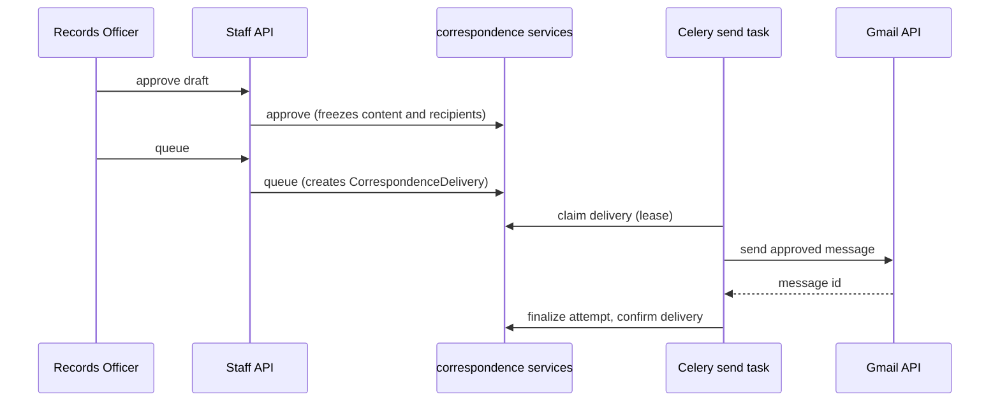
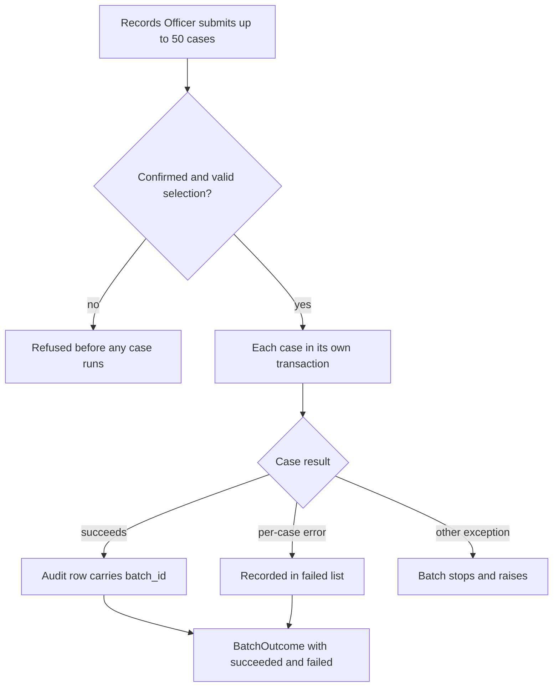
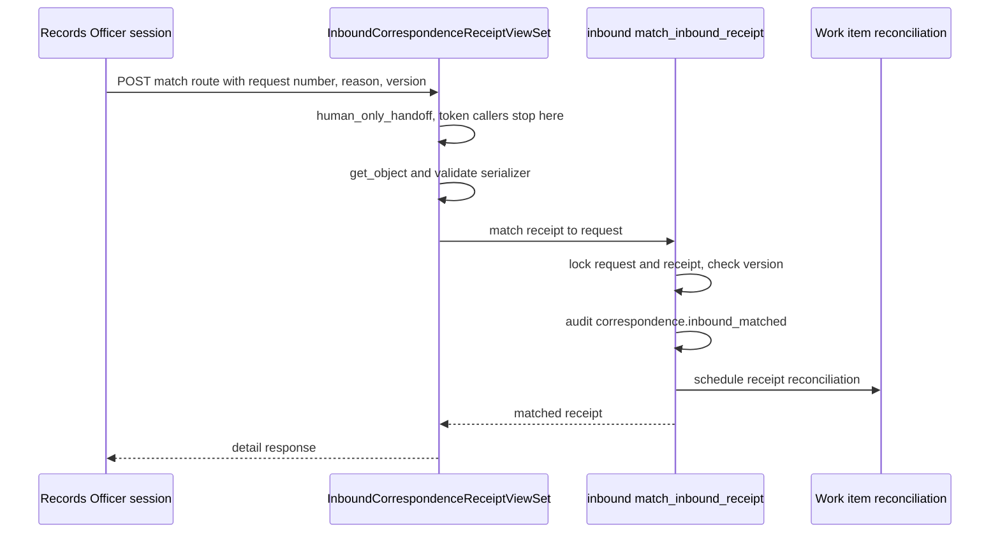

# Requester Correspondence

The correspondence domain manages requester-facing communications with legal
record integrity. It separates immutable recipient-visible content from
delivery jobs and from request lifecycle effects.

**Key principle**: Django owns every decision and durable record that affects
the requester or the District's legal position. Transport edges are mechanical.

Source: [`apps/correspondence/`](../../apps/correspondence/),
[`docs/correspondence.md`](../../docs/correspondence.md) (full architecture),
[`docs/gmail-transport.md`](../../docs/gmail-transport.md) (transport operations).

## Domain records

| Record | Responsibility |
|---|---|
| `Correspondence` | One inbound or outbound communication with draft content, immutable approved content, a deterministic Message-ID, a reply token, provider identifiers, and any resulting `StatusEvent` |
| `CorrespondenceRecipient` | Exact To, Cc, and Bcc snapshot, frozen when the parent leaves draft |
| `CorrespondenceDenialCitation` | Exemption citation for a full-exemption denial, with immutable wording |
| `AdequateSearchAttestation` (in `apps/records/models.py`) | Append-only search evidence behind a `no_records_closure` message, one per message. Its services live in this domain. See [compliance](compliance.md#no-records-closure-evidence) |
| `CorrespondenceDelivery` | Single transport job for an outbound message; retries reuse this row |
| `CorrespondenceDeliveryAttempt` | One lease, send, and result attempt; finalized once, never changed |
| `CorrespondenceDeliveryNotification` | Append-only RFC 3464 delivery-status outcome |
| `InboundCorrespondenceReceipt` | Idempotent receipt of inbound mail, with parsing, matching, and quarantine state |
| `InboundQuarantineWriteReservation` | Immutable evidence committed before object-storage I/O |
| `InboundQuarantineTransportAlias` | Hashed idempotency identity for conflict detection |
| `ClarificationCycle` | Legal clarification state, separate from its messages |
| `GmailSyncState` | One inbound checkpoint per mailbox and environment |

`PublicRecordsRequest` remains the legal case record. `StatusEvent` and
`AuditLog` remain the append-only legal histories.

## Lifecycles

### Outbound

```
draft -> approved -> queued -> sent
                     |        ^
                     v        |
                  failed -> retryable/reclaimed
                     |
                     v
                 cancelled (only before successful send)
```

The correspondence row records recipient-visible state. The delivery row records
transport state (`pending`, `claimed`, `awaiting_reconciliation`, `sent`,
`failed`, `retryable`, `cancelled`).



Caption: outbound approval, queueing, and in-process send. Confirmed delivery is
what unlocks correspondence-driven request statuses.

### Inbound

```
private raw receipt -> parsed -> matched received correspondence
                         |             |
                         |             +-> request conversation
                         +-> unmatched / ambiguous candidate / quarantined
```

Subject request numbers are candidates only. An ambiguous subject never silently
attaches a message. Unmatched, candidate, ambiguous, and quarantined mail appears
in the staff Inbox as work items (see [work-queue.md](work-queue.md)).

A plain email from an unmatched sender can instead become a new intake case.
`create_request_from_unmatched_email` in
[`apps/records/email_intake.py`](../../apps/records/email_intake.py) is called by the
Gmail poller after the receipt is stored (`apps/correspondence/gmail_sync.py`). It runs the
canonical intake path, `submit_intake`, using the receipt's idempotency key, and then
attaches the email's retained files once their scan verdicts are final. Eligibility is
strict (`_eligible_unmatched_email`): a parsed, unquarantined, unmatched receipt sent to the
intake mailbox alone, from exactly one valid sender, with a non-empty body and no automated,
bulk, or list headers. Other mail stays in the Inbox for a person to review. A staff redirect
(`redirect_email_intake_receipt`) moves such a message to another case and closes the
auto-created case as a non-request, with an audit entry.

A forwarded plain email opens under the person who wrote it, not the person who
forwarded it. `original_sender()` in
[`apps/records/email_forwards.py`](../../apps/records/email_forwards.py) reads the
header blocks that mail clients write into the plain-text body (Gmail, Outlook, and
Apple Mail layouts). It returns the deepest `From` block that has a valid address,
together with that block's sent date. `_eligible_unmatched_email` then uses that
sender as the requester and the sent date as the case's received time, never later
than the mailbox's own arrival time. The whole forward remains the request
description, because the description is never edited after intake
([compliance rule 9](../../docs/compliance-rules.md)). The forwarder is recorded in a
`request.email_forward_attributed` audit entry, with the mailbox arrival time and the
original sent time. A message that has no parseable header block keeps the mailbox
sender and receives no attribution. Focused tests:
`apps/records/tests/test_email_forwards.py` (`test_nested_gmail_forward_uses_the_deepest_sender_and_date`,
`test_forward_without_a_header_block_is_not_attributed`) and
`apps/correspondence/tests/test_internal_gmail_poller.py`
(`test_forwarded_request_opens_under_the_original_sender_and_date`). The
`reparse_quarantined_inbound` command reuses `original_sender()` in its dry run, so it
can name the original sender before any case is opened.

### Delivery status notifications (RFC 3464)

Delivery-status notifications follow the same private raw-receipt path but are
not requester replies. Django matches only the embedded Message-ID to the
stable outbound delivery. It never falls back to reply token, thread, or subject
matching. Failed or delayed DSNs create delivery-exception work.

## Enforced invariants

Schema migrations and domain services enforce:

- Outbound and inbound direction and status combinations cannot mix.
- Approved-or-later content has complete snapshots.
- Only the safety-net acknowledgment may be marked `automated`.
- Content and recipient snapshots cannot be rewritten after approval.
- One delivery job per correspondence; sent jobs have exactly one successful attempt.
- Inbound receipts are unique within provider scope.
- Attachments cannot leave quarantine until the scan state is clean.
- Only one unresolved clarification cycle per request.

Domain services also enforce:

- Only one unresolved requester-lifecycle delivery per request.
- No serializer or view implements correspondence business rules directly.
- Human-only approval, queueing, and inbound receipt actions re-read the actor's staff
  identity and role under a lock before they write. The helper is
  `require_current_human_staff()` in `apps/correspondence/authorization.py`; see
  [google identity](../architecture/google-identity.md#locked-authority-checks).
- A matter's governing law limits which letters it may send. `_create_draft`
  refuses every draft for a `litigation_discovery` matter, and refuses PRA
  statutory kinds for a `ferpa_parent` matter (`PRA_STATUTORY_CORRESPONDENCE_KINDS`
  in `apps/correspondence/services.py`). See [matter-kinds.md](matter-kinds.md).

## Denial exemption citations

A full-exemption denial is the only correspondence whose legal basis is recorded row
by row. `CorrespondenceDenialCitation` links the draft to a protected exemption
citation and snapshots its wording, short name, description, and second-review flag.
A later taxonomy edit therefore cannot rewrite the basis of a denial that was already
approved or sent. `apps/correspondence/denial_basis.py` owns the rules:

- **Draft.** `denial_basis_evidence()` requires at least one active citation. It fails
  when a snapshot no longer matches the current taxonomy, and when a citation requires
  second review, because denial approval does not yet support persisted second-review
  evidence.
- **Approval.** `apps/correspondence/services.py` writes the frozen evidence into the
  `correspondence.approved` audit detail. That detail holds a SHA-256 of the canonical
  snapshot, the citation count and list, the snapshot itself, and the approved body hash.
- **Body.** `require_recipient_visible_denial_citations()` requires every frozen
  citation to appear as a complete string in the recipient-visible body. Case and
  whitespace are normalized, but a match that is only part of a longer citation does not
  count.
- **Revalidation.** `require_approved_denial_basis_snapshot()` rebuilds the evidence
  from the through-rows under lock and compares it with the approval record. The
  service calls it before queueing and before the send claim. Any drift (body edit,
  citation row change, or taxonomy change) fails closed, so nothing is sent.

Focused tests: `apps/correspondence/tests/test_services.py` for approval and queueing
(`test_denial_approval_requires_each_complete_citation_in_body`,
`test_denial_body_citation_match_normalizes_case_and_whitespace`,
`test_denial_basis_is_frozen_at_approval_and_revalidated_before_queue`);
`apps/correspondence/tests/test_outbound_delivery.py` for the send claim
(`test_claim_fails_closed_when_denial_basis_differs_from_approval`,
`test_send_claim_revalidates_live_denial_citation_activity`,
`test_claim_rejects_approved_denial_body_drift_even_with_citation`); and
`apps/correspondence/tests/test_denial_basis_migrations.py` for the schema. Minimal
validation: `PYTHON_DOTENV_DISABLED=1 python manage.py test apps.correspondence.tests.test_denial_basis_migrations apps.correspondence.tests.test_services --settings=config.test_settings`.

## Submission receipt

The submission receipt is the one courtesy message that confirms a request arrived. It is
explicitly non-statutory. It never sets `initial_response_delivered`, never transitions the
request, and cannot satisfy or defer the day-5 response. [Compliance](compliance.md#human-only-actions-and-ast-guards)
lists the AST guard (`receipt-ast-guard`) that pins this, and [initial response](initial-response.md)
owns the statutory clock it must not touch.

Two paths create one:

- **Automated, on intake.** For the portal and email channels, `apps/records/intake.py` calls
  `queue_submission_receipt(prr)` after the request's files are stored. An
  `OutboundTransportDisabled` error is swallowed, so the transport kill switch never turns an
  accepted legal request into a failed intake. `queue_submission_receipt` in
  [`apps/correspondence/services.py`](../../apps/correspondence/services.py) takes the request row
  lock, reuses an existing receipt delivery, and refuses with a human-review error when a receipt
  exists without a delivery. Otherwise it drafts through `create_submission_receipt_draft`,
  approves and queues the draft as `automated=True`, and requires automated outbound to be
  enabled ([Gmail transport](#gmail-transport)).
- **Staff, by hand.** `create_officer_submission_receipt_draft` backs the
  `drafts/submission-receipt` action on the correspondence viewset (capability
  `correspondence.draft_submission_receipt`). Automated requester mail is off by default, so this
  is the usual route. It carries the same non-statutory guarantees.

Only one live receipt may exist per request. The service enforces that under the request lock,
and the partial unique constraint `correspondence_one_submission_receipt_per_request`
(migration `0024`) backs it. Tests: `apps/correspondence/tests/test_submission_receipt.py`
(queue once, reuse, refusal with an existing receipt), `test_outbound_concurrency.py`
(`test_simultaneous_submission_receipt_queue_creates_one_delivery`),
`apps/correspondence/tests/test_rendering.py` (`test_submission_receipt_is_plainly_nonstatutory`),
`apps/records/tests/test_public_intake.py` (`test_public_submission_receipt_delivers_exactly_once`),
and the staff path in `apps/api/tests/test_officer_receipt_and_templates.py`.

Minimal validation: `PYTHON_DOTENV_DISABLED=1 python manage.py test apps.correspondence.tests.test_submission_receipt apps.correspondence.tests.test_rendering --settings=config.test_settings`.

## Template registry

Templates live under `templates/correspondence/<identifier>/v<version>.txt`.
[`apps/correspondence/rendering.py`](../../apps/correspondence/rendering.py) renders only
the explicit `TEMPLATES` allowlist in `render_versioned_template()`: an identifier and
version pair that is not registered raises a validation error, so a template file cannot
be rendered by naming it. The same module validates the subject line (non-empty, no control
characters, at most 998 characters) and normalizes the body. Its focused test is
`apps/correspondence/tests/test_rendering.py`.
Legal language changes add a new version, and historical versions remain
available to reproduce approved snapshots. Current identifiers are
`acknowledgment` (v2), `clarification_request` (v1), `completion_closure` (v1),
`estimate_revision` (v2), `fee_estimate` (v1), `installment_notice` (v3),
`no_records_closure` (v2), `nonpayment_closure` (v1), `scope_clarification` (v1),
`submission_receipt` (v1), and `third_party_notice` (v1). Template wording is
also governed by counsel review and by `apps/correspondence/guardrails.py`,
which warns on a template before it is saved with the consequence of the wording
(a warning, not a refusal). Staff edit and activate the district's wording through
[message templates](message-templates.md), which covers the activation lifecycle and the
`check_message_templates` drift check after a rule change.

## Domain services

[`apps/correspondence/services.py`](../../apps/correspondence/services.py) is the
only supported mutation boundary:

- Draft creation and editing with optimistic locking
- Exact preview, approval, queueing, cancellation, and retry
- Safety-net acknowledgment path
- Delivery-success effects, which apply estimates and status only after confirmation
- Human clarification resolution

The inbound service ([`inbound.py`](../../apps/correspondence/inbound.py)) owns
MIME parsing and attachment quarantine, deterministic matching, manual match
corrections, and clarification-response association.

## Scope conversation letter

The `scope_clarification` kind tells a requester that a request matched a count of
records and offers narrowing options. It has two forms, and the form decides its legal
effect. `SCOPE_CLARIFICATION_FORMS` in `apps/correspondence/services.py` allows only
`informational` and `clarification`.

- **Informational** leaves the request exactly as it was. Its approved text says the
  response period keeps running.
- **Clarification** (`TOLLING_SCOPE_CLARIFICATION_FORM`) is the RCW 42.56.520(3)
  clarification request. Once its delivery is confirmed, the request enters the
  tolled clarification status (status rules are in [requests](requests.md)). The gate is in `apps/records/services.py`, which accepts
  either a plain clarification request or a clarification-form scope letter as the
  delivery evidence. An informational scope letter is refused at that gate, so it can never
  toll the clock.

Drafting is human-only. `create_scope_clarification_draft()` is restricted to Records
Officers, and the staff endpoint `drafts/scope-clarification` returns a
`human_only_handoff` for agents. The capability `correspondence.draft_scope_clarification`
is registered in [agent parity](../architecture/agent-parity.md). The
[compliance](compliance.md#human-only-actions-and-ast-guards) guard table lists the
letter as an accountable judgment.

The input contract is validated before any text is rendered. The request must give a
non-negative whole-number count and a plain-language summary of 10 to 500 characters. It may
offer at most `MAX_NARROWING_OPTIONS` (4) options, each with one to ten terms and a rationale.
The response date is structured. The fee line appears only after a fee schedule is adopted.
Rendering uses the `scope_clarification` template (`templates/correspondence/scope_clarification/v1.txt`),
and the draft is then governed like any other correspondence (approval, queueing, and
send).

Only one clarification conversation may be outstanding for a case. `CLARIFICATION_CYCLE_KINDS`
treats this letter and the plain clarification request as members of the same cycle.

Focused tests in `apps/correspondence/tests/test_scope_clarification.py`:
`test_the_form_must_be_chosen_explicitly`, `test_more_than_four_options_is_a_menu_not_a_conversation`,
`test_only_a_records_officer_may_draft_it`, `test_the_clarification_form_tolls_the_statutory_clock`,
`test_the_informational_form_leaves_the_request_exactly_as_it_was`,
`test_an_informational_letter_cannot_be_used_to_toll_the_clock`, and
`test_only_one_clarification_conversation_may_be_outstanding`. Minimal validation:
`PYTHON_DOTENV_DISABLED=1 python manage.py test apps.correspondence.tests.test_scope_clarification --settings=config.test_settings`.

## Batch drafting and sending

A Records Officer can draft or send up to 50 cases from one form (`BATCH_MAX_CASES`).
Both operations live in `services.py` and are Records Officer only. Each requires
`confirmed=True`, rejects an empty or duplicated selection, and returns a `BatchOutcome`
that lists every case as succeeded or failed, so no case is skipped silently.

- `batch_create_closure_drafts()` drafts one notice per case. Only `COMPLETION_CLOSURE` and
  `GENERAL` are batch-draftable (`BATCH_DRAFTABLE_KINDS`). Each case is rendered against its
  own request in its own transaction and audited as `correspondence.batch_drafted`. Nothing
  is approved or sent.
- `batch_approve_and_send()` approves and releases existing drafts of the kinds in
  `BATCH_SENDABLE_KINDS`. A denial or a no-records closure refuses the whole batch, because
  each is decided one case at a time. A batch holds at most one message per case. Each case
  calls the same `approve_and_send()` path, so it keeps its own delivery row, idempotency
  key, and audit row (`correspondence.batch_approve_and_send`, which carries the shared
  `batch_id`).

Drafting is kept as a separate step so an officer reads every draft before anything is sent.
A non-payment closure is not batch-draftable because the amount owed differs by case; one
amount typed once would be sent to every case. A per-case `ValidationError`,
`PermissionDenied`, or `DatabaseError` (`BATCH_CASE_FAILURES`) lands in the `failed` list and
the other cases continue. Any other exception stops the batch. A delivered message cannot be
rolled back, so one failing case does not undo the rest.



Caption: the batch control flow. Validation covers the whole selection before the loop runs,
and only the three per-case error types are isolated.

The staff endpoints are `POST /api/staff/correspondence/batch/closure-drafts/` and
`POST /api/staff/correspondence/batch/approve-and-send/` (`apps/api/resources/correspondence.py`).
Both are registered as `human_only` capabilities (`correspondence.batch_draft_closures`,
`correspondence.batch_approve_and_send`), so a token caller receives a human-approval handoff
before any work runs. Focused tests are `apps/correspondence/tests/test_batch_correspondence.py`
(cap, confirmation, duplicates, denial refusal, per-case isolation) and the batch tests in
`apps/api/tests/test_correspondence.py` (`test_batch_drafts_then_sends_and_refuses_a_denial`,
`test_batch_endpoints_refuse_an_agent_token`). Minimal validation:
`PYTHON_DOTENV_DISABLED=1 python manage.py test apps.correspondence.tests.test_batch_correspondence --settings=config.test_settings`.

## Gmail transport

Correspondence is delivered in-process through the Gmail API. The provider client is
[`apps/integrations/gmail/client.py`](../../apps/integrations/gmail/client.py). Outbound
sends run in `send_queued_delivery` in [`apps/correspondence/tasks.py`](../../apps/correspondence/tasks.py),
which builds the RFC822 message with `apps/correspondence/transport.py`. Inbound polling
and reconciliation run in [`apps/correspondence/gmail_sync.py`](../../apps/correspondence/gmail_sync.py).

- **Outbound**: Celery claims approved correspondence and sends it through Gmail.
  Outbound sending requires `PRR_CORRESPONDENCE_OUTBOUND_ENABLED`, and automated
  correspondence additionally requires `PRR_CORRESPONDENCE_AUTOMATED_OUTBOUND_ENABLED`.
  Both are app-managed and default off ([configuration.md](../architecture/configuration.md)).
- **Inbound**: The minute-scheduled `poll-inbound-gmail` task reads
  `users.history.list` from the mailbox checkpoint and hands each raw message to
  the receiving layer. Polling is gated by `PRR_GMAIL_INBOUND_POLL_ENABLED`, off
  by default. A replayed checkpoint cannot create a second receipt or request,
  because provider-message uniqueness and the payload digest are the correctness
  boundary. Production Compose commands on the AWS host go through the
  [host Compose wrapper](../operations/deployment.md#host-compose-wrapper), which keeps the
  Gmail activation overlay applied; the deployment page records an unresolved conflict about
  what that overlay controls.
- **Failure isolation**: A failed message is audited as
  `gmail.inbound_message_failed`, alerts staff ([staff alerts](../architecture/background-jobs.md#staff-alerts)),
  and does not block the rest of the batch. A provider failure leaves the checkpoint unchanged.
- **Reconciliation**: The history feed never reports mail a filter skipped past
  the inbox. Hourly `reconcile-inbound-gmail` (at :45) lists unprocessed messages
  in the inbound lookback window, receives them, and audits
  `gmail.inbound_reconciliation_recovered`.
- **Catch-up**: Mail older than the lookback is received only by a named officer
  with `manage.py catch_up_inbound_mailbox`. It is a dry run by default. `--commit
  --message-id <id>` receives a named message, and `--triage-only` puts it in the
  Inbox without opening a case.
- **Verification**: `manage.py verify_gmail` (`apps/integrations/gmail/management/commands/verify_gmail.py`)
  reports credentials, delegation, scopes, and the mailbox profile through
  `client.verify_configuration()` without sending mail. The [Gmail transport runbook](../../docs/gmail-transport.md)
  requires it to pass before the transport switches are enabled. A `GmailUnavailable`
  failure becomes a `CommandError` that carries the remediation text.
- **Triage alerts**: Inbound items that wait too long for triage produce one daily
  `[INBOX TRIAGE]` alert (`apps/work_queue/triage_alerts.py`).
- **Mail channel guard**: Gmail is the only application mail path. In production
  `EMAIL_BACKEND` is `config.mail_backends.ProductionDenyEmailBackend`, which raises
  on any generic Django send instead of discarding it. Development uses Django's
  console backend. The rule is pinned by `test_production_has_no_parallel_django_smtp_transport`
  and `test_application_code_cannot_bypass_gmail_with_django_mail` in
  `apps/api/tests/test_security_boundaries.py`.
- **Authoritative fields**: Gmail `message.id`, `threadId`, and `internalDate`
  (epoch milliseconds converted to UTC RFC 3339).

Provider timestamps are the authoritative communication instants. They drive
correspondence state, acknowledgment timing, estimate revisions, and Pacific-date
tolling effects.

Both Gmail directions run as named, non-interactive transport principals with exact
scope and no API token. They are described in
[integration identities](../architecture/integration-identities.md).
`apps/correspondence/transport.py` holds the outbound half: `system_transport_principal()`
loads the migration-provisioned sender and refuses it unless its scope is exact, and
`build_delivery_message()` renders the RFC822 message from one frozen `SEND` claim. Recipient
addresses come from that claim, not from the live draft.

Operational procedures for enabling, verifying, and recovering mail are in
[`docs/gmail-transport.md`](../../docs/gmail-transport.md), not in this page.

## Inbound receiving and MIME hardening

Inbound mail is treated as hostile input. [`apps/correspondence/receiving.py`](../../apps/correspondence/receiving.py)
(`receive_inbound_message`) is the single orchestrator. The Gmail sync layer calls it for each
listed message (`_ingest_listed` in [`gmail_sync.py`](../../apps/correspondence/gmail_sync.py)),
and it does three things in order:

1. **Reserve.** `_reserve_and_store` writes an `InboundQuarantineWriteReservation` with an
   application-generated storage key, and `_claim_transport_aliases` records the transport
   identity, all before any object-storage I/O. A reservation is leased
   (`_PROCESSING_LEASE_SECONDS`, one hour) so a stale sweep cannot take a live reservation
   during parsing.
2. **Store raw evidence, then parse.** The raw RFC822 bytes are stored before
   `parse_inbound_message` runs. A malformed or rejected message is retained and quarantined
   with a safe reason rather than discarded, and the Gmail checkpoint is not advanced past it.
3. **Commit idempotently.** `_receive_reserved_atomic` creates the receipt and, for parsed mail,
   the immutable `Correspondence`. An exact replay returns the completed receipt without
   repeating I/O. The same `Idempotency-Key` with different evidence raises
   `InboundIdempotencyConflict`. The same provider message with different evidence raises
   `InboundProviderMessageConflict`. `_payload_digest` is the comparison key.

[`apps/correspondence/mime.py`](../../apps/correspondence/mime.py) (`parse_inbound_message`)
is side-effect-free. It reads its bounds from `InboundMimeLimits`, which
`receiving._mime_limits()` fills from the `PRR_CORRESPONDENCE_INBOUND_*` and
`PRR_CORRESPONDENCE_ATTACHMENT_*` settings. Its rules, in order:

- Raw structure is preflighted before the MIME parser runs. Header counts, line length, part
  count and depth, boundaries, base64 and quoted-printable expansion, and encoded RFC822 parts
  are all bounded there (`_preflight_raw_structure`, `_preflight_multipart_children`).
- Attachment types come from server sniffing (`_sniff_content_type`), not the sender's label.
  OOXML types come from the `[Content_Types].xml` manifest and the main part, with entry and
  expansion limits (`_ooxml_content_type`, `_zip_eocd_metadata`). Filenames lose controls and
  paths (`_sanitize_filename`).
- Body selection prefers plain text. HTML is converted to text with ignored tags stripped, and
  no URL is fetched (`_select_body`, `_html_to_text`).
- A delivery-status report is classified only when it is the top-level report type
  (`_parse_delivery_status_report`). Its recipient fields and enhanced status codes are
  validated, and its embedded Message-ID is the only key used for matching (see
  [delivery status notifications](#delivery-status-notifications-rfc-3464)).

Focused tests: `apps/correspondence/tests/test_mime_security.py` (preflight bounds, sniffing,
OOXML, HTML, and related-part rules), `test_mime_delivery_status.py` (DSN normalization and
rejection), `test_inbound_receiving.py` (raw storage before parse, idempotent replay, conflicts,
and attachment scan enqueue after commit), and `test_inbound_quarantine_reservations.py`
(reservation leases and cleanup). Concurrency is covered in `test_inbound_concurrency.py`.

Minimal validation: `PYTHON_DOTENV_DISABLED=1 python manage.py test apps.correspondence.tests.test_mime_security apps.correspondence.tests.test_inbound_receiving --settings=config.test_settings`.
Run the concurrency suite only when the lock order or the reservation logic changes, because
its tests use real database locks.

## Inbound review queue and manual association

Retained inbound mail that automatic matching did not attach is worked by Records Officers
through `/api/staff/inbound-correspondence-receipts/`. The viewset is
`InboundCorrespondenceReceiptViewSet` in
[`apps/api/resources/inbound_correspondence.py`](../../apps/api/resources/inbound_correspondence.py).
The staff page is `frontend/src/pages/InboundCorrespondenceReview.tsx`, shown from the Inbox. The
queue is for people who must decide where retained evidence belongs. It never matches mail by
itself.

- **Officer-only, explicit queue.** `role_permissions` limits list, retrieve, match, rematch,
  redirect, and clarification association to `OFFICER_ONLY`. `list` requires `queue=unmatched`
  or `queue=quarantined`. A missing queue returns `queue_required`, and any other value returns
  `invalid_queue`. No all-receipts view exists.
- **PII-minimal rows.** List rows carry the sender and subject for triage, attachment counts,
  sanitized reason codes, and the open work item's id and version. The body, envelope, provider
  identifiers, storage keys, and idempotency keys appear only in the detail view. Its headers
  come from an allowlist (`SAFE_RECEIVED_HEADERS`). Reason codes pass through allowlists
  (`_safe_reason_code`), so an unrecognized value becomes a generic code.
- **Queue membership.** `unmatched` shows receipts whose status is unmatched, candidate, or
  ambiguous, and that are not quarantined. `quarantined` shows receipts that are quarantined by
  flag or status, or that have a quarantined attachment. Either queue drops a receipt whose
  work item an officer already decided (`_with_work_items`). The decision stays on the work
  item under Inbox "No action".
- **Human-only actions.** `match`, `rematch`, `redirect`, and `associate-clarification` call
  `human_only_handoff` before any lookup, so a token caller receives a `human_approval_required`
  handoff. A session officer sends `request_number`, a `reason` (the serializer requires at least
  ten characters), and `expected_version`. A stale version returns `version_conflict` (409), and a
  domain refusal returns `validation_error` (400).
- **Domain functions lock and audit.** The view delegates to `apps/correspondence/inbound.py`,
  never to ORM writes.
  - `match_inbound_receipt` locks the request and receipt, then refuses delivery-status evidence,
    already-matched receipts, and receipts that are unparsed or quarantined. It audits
    `correspondence.inbound_matched` and schedules work-item reconciliation.
  - `rematch_inbound_receipt` locks the previous and target requests, the clarification cycles
    bound to the message, and the receipt, in that order. It refuses a rematch to the same
    request and audits `correspondence.inbound_rematched`.
  - `associate_clarification_response` links one already-matched message to one open
    clarification cycle on the same request. It applies only while the request is in
    clarification and the message timestamp falls inside the cycle's open window. It does not
    resolve the cycle, and it audits `correspondence.clarification_response_associated`.
  - `redirect` calls `email_intake.redirect_email_intake_receipt`, which moves an automatically
    opened email case's message to an existing request and closes the leftover case as not a
    records request ([requests](requests.md)).
- **Evidence is not rewritten.** A rematch changes only the association. The retained message and
  its attachments stay as stored.



Caption: the manual match path. The token-caller handoff returns before any lookup or lock.

Change guidance: a new queue or action goes into `role_permissions` and the view, and it needs
a `human_only` capability in `apps/api/capabilities.py` in the same change (rule 10, see
[agent parity](../architecture/agent-parity.md)). Put new fields in the detail serializer unless
the officer needs them to triage. Keep the write in the locked domain function, not the view.

Focused tests, in `apps/api/tests/test_inbound_correspondence_receipts.py`:
`test_queue_is_records_officer_only_and_requires_an_explicit_queue` (role gate and queue
selection), `test_unmatched_queue_includes_candidates_with_sender_and_subject_only` (list
minimization), `test_a_dismissed_receipt_leaves_the_needs_a_case_queue`,
`test_quarantine_queue_exposes_only_sanitized_reason_codes`,
`test_detail_is_officer_only_and_excludes_transport_secrets`,
`test_match_delegates_exactly_to_the_locked_domain_service`,
`test_rematch_delegates_and_stale_version_is_a_conflict`,
`test_officer_explicitly_associates_a_matched_reply_with_open_cycle`,
`test_match_is_human_only_for_officer_tokens`, and
`test_readonly_agent_is_denied_sensitive_queue_detail`. Redirect behavior is in
`apps/api/tests/test_email_intake_redirect.py`. Minimal validation:
`PYTHON_DOTENV_DISABLED=1 python manage.py test apps.api.tests.test_inbound_correspondence_receipts --settings=config.test_settings`.

## Operations and readiness

`apps/correspondence/operations.py` builds the fixed-shape health views for this domain.
`operations_snapshot()` reports counts, ages, and sanitized failure categories for stuck
deliveries. `gmail_inbound_status_snapshot()` reports poller health from the mailbox checkpoint
without exposing the mailbox address. `readiness_snapshot()` returns only fixed check codes,
and it fails closed when the inbound system principal is unsafe, when Gmail is disabled, or
when Redis, object storage, or ClamAV probes fail.

The operator-facing entry points are the `check_correspondence_readiness` and
`gmail_inbound_status` management commands. The JSON mode exits nonzero when the system is not
ready. The casework fixture and performance commands (`seed_casework_test_fixture`,
`measure_casework_performance`) run only against a disposable, explicitly named test database.
That gate is `validate_disposable_database()` in
[`performance_safety.py`](../../apps/correspondence/performance_safety.py).

Staff reach these snapshots through `CorrespondenceOperationsViewSet` in
[`apps/api/resources/correspondence_operations.py`](../../apps/api/resources/correspondence_operations.py):
`GET /api/staff/correspondence-operations/` returns `operations_snapshot()` and
`GET /api/staff/correspondence-operations/readiness/` returns `readiness_snapshot()`. Both
are limited to Records Officer and Admin roles (`OPERATIONS_ROLES`), and the viewset sets
`allow_readonly_agent = False`. The viewset adds no logic of its own, so the fixed
codes and the fail-closed behavior described above apply to the API response unchanged.

Focused tests: `apps/api/tests/test_correspondence_operations.py` (the API contract and
role gates), `apps/correspondence/tests/test_operations.py` (snapshot counts, readiness codes,
probe bounds), and `apps/correspondence/tests/test_casework_performance_command.py` (the
disposable-database gate). Minimal validation: `PYTHON_DOTENV_DISABLED=1 python manage.py test apps.correspondence.tests.test_operations --settings=config.test_settings`.

## Staff REST API

Correspondence drafting, approval, and queueing endpoints live under
`/api/staff/correspondence/` (`apps/api/resources/correspondence.py`).

Key routes:

- `POST /api/staff/correspondence/drafts/estimate-revision/`: draft-only estimate revision
- `POST /api/staff/correspondence/drafts/clarification/`, `.../acknowledgment/`,
  `.../installment/`, `.../closure/`, and `.../denial/`: draft creation for each kind
- `POST /api/staff/correspondence/batch/closure-drafts/` and `.../batch/approve-and-send/`:
  the batch actions described in [batch drafting and sending](#batch-drafting-and-sending)
- Approval and queueing are separate interactive Records Officer actions
- Only confirmed delivery applies an estimate to request state

Inbound review queues are served from `apps/api/resources/inbound_correspondence.py`.
Manual match and rematch actions delegate to the locked inbound domain.

Staff and attributed agents use the same surface through capability rules. Agents
may prepare drafts but may not approve, queue, or send them
([agent-parity.md](../architecture/agent-parity.md)). See also
[mcp.md](../integrations/mcp.md) and the [staff command-line client](../integrations/cli.md),
which exposes the same draft kinds from a terminal.

## Related concepts

- [requests.md](requests.md): lifecycle effects of confirmed correspondence
- [compliance.md](compliance.md): human-only letter rules and the safety net
- [matter-kinds.md](matter-kinds.md): per-kind letter restrictions
- [work-queue.md](work-queue.md): inbound and delivery-exception work items
- [agent parity](../architecture/agent-parity.md): the capability rows that make batch and send actions human-only
