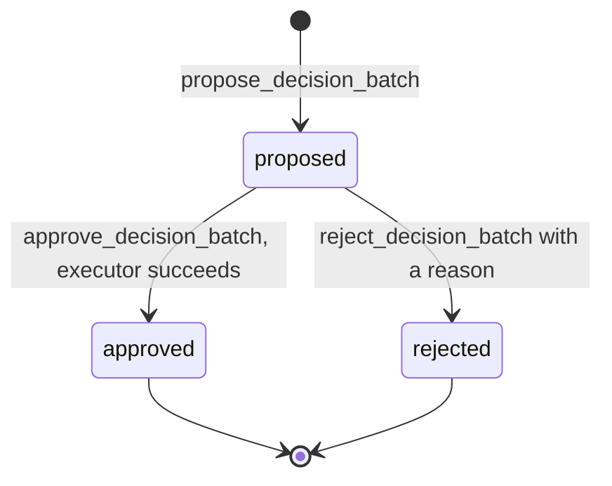
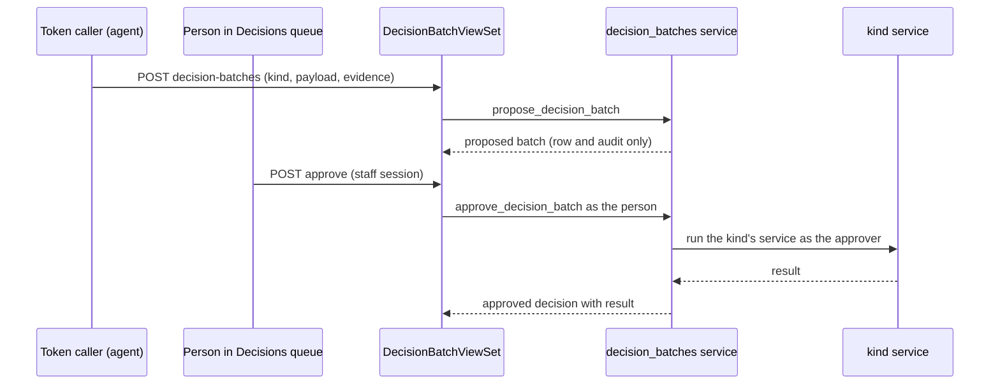

# Decision Batches

A decision batch is a set of staff decisions that an agent or colleague proposes, with
the evidence for them, so that a person can approve or reject the whole set. The proposal
is only a record. Approval runs the same service the staff UI runs for that outcome, as
the approving person. This is the mechanism behind the rule that a token caller may
propose a decision but never make one; see [agent parity](../architecture/agent-parity.md)
for how the handoff reaches a token caller.

The service module is `apps/records/decision_batches.py`. Its docstring states the
contract: `propose_decision_batch` changes nothing but the new row and its audit, so an
attributed personal token may call it, while `approve_decision_batch` and
`reject_decision_batch` are the human decision made in the staff application.

## Batch kinds

Each kind has a payload shape, a role gate (`_KIND_ROLES`), and an approval executor
(`_execute`). The payload is validated by one function per kind in `_VALIDATORS`.

| Kind (`DecisionBatch.Kind`) | Payload | Who may propose and decide | Approval runs |
|---|---|---|---|
| `review` | `record_item_ids` (1 to 500, all on one request) and `state` (`responsive` or `non_responsive`) | Reviewer or Records Officer | `review.bulk_review_records` |
| `supersede` | `collection_task_id` and a substantive `reason` | Records Officer | `collection_supersession.supersede_collection` |
| `scope_and_collect` | `count_run_id`, `expected_input_sha256`, optional `rescope_reason` | Records Officer | `vault_collections.queue_vault_collection`, or `scoping.rescope` when `rescope_reason` is set |
| `redaction_group` | `request_number`, an active `exemption_id`, and `pattern` | Reviewer or Records Officer | `redaction_batches.create_redaction_batch`, which opens the sampled check and accepts nothing |
| `intake_label` | `request_number`, `label` (`duplicate_of` or `non_request` only), `reason`, and `target_case_number` for `duplicate_of` | Records Officer | `services.merge_requests` or `services.close_email_non_request`; neither sends requester mail |

`review` batches approve as an ordinary bulk decision. They are not the sampled judgment
of the [trust ladder](trust-ladder.md), which is a separate batch type with its own rules.
A `redaction_group` approval only opens the sampled check. The reviewer's sample judgments
then decide the group, as described in [trust ladder](trust-ladder.md#redaction-proposal-groups).

## Lifecycle

`propose_decision_batch(kind, payload, actor=..., evidence_summary=...)` checks, in order:
the kind is known, the evidence is non-empty and at most 4,000 characters, the actor holds
the kind's role (`_require_kind_role`), and the per-kind validator accepts the payload. It
then writes a `DecisionBatch` row and a `decision_batch.proposed` audit entry.

`approve_decision_batch(batch_id, actor=...)` checks that the batch is undecided and that
the actor holds the kind's role. It runs the executor inside a transaction that locks the
batch row, then writes a `DecisionBatchDecision` with outcome `approved`, the executor's
`result`, and a `decision_batch.approved` audit entry. A `PermissionDenied` raised by an
underlying service becomes a `ValidationError`, so a refused service writes no decision.
`scope_and_collect` is the exception: its services commit and then dispatch a worker, so
it runs outside the outer transaction. Its services are idempotent for a repeated approval
of the same count.

`reject_decision_batch` needs a reason of at least 10 characters. It writes a `rejected`
decision and changes nothing else.

Caption: a batch's state is derived from its single decision row. An approval that the
executor refuses leaves the batch `proposed`, with no decision row written.

Caption: the agent's request ends at the proposal. The approval is a separate request made by a person.

## Staff API, capabilities, and visibility

`DecisionBatchViewSet` in [`apps/api/resources/decision_batches.py`](../../apps/api/resources/decision_batches.py)
is registered as `decision-batches` under `/api/staff/decision-batches/`. It supports list,
retrieve, create (propose), and two actions, `approve` and `reject`.

- **Visibility.** `get_queryset` returns only the kinds the caller's roles may decide, so a
  reviewer does not see intake-label or supersede batches. The `state` filter accepts
  `proposed`, `approved`, or `rejected`, and `request` filters by case number.
- **Token callers.** `approve` and `reject` return `human_only_handoff` for a token caller
  instead of acting. The capability rows in [`apps/api/capabilities.py`](../../apps/api/capabilities.py)
  are `decision_batches.list`, `decision_batches.retrieve`, `decision_batches.propose`
  (risk `low`, with `accountable_human_actor`), `decision_batches.approve` (`human_only`, risk
  `high`), and `decision_batches.reject` (`human_only`, risk `moderate`).
- **Errors.** `DjangoValidationError` maps to 400 and `PermissionDenied` to 403.

## MCP tools (hosted endpoint only)

The hosted [MCP server](../integrations/mcp.md) exposes two tools for this surface:
`psd_prr_decision_batch_get` reads one batch by id, or lists batches by `request_number` and
`state`, and `psd_prr_decision_batch_propose` stores a proposal with a payload for the chosen
kind. Proposing requires an attributed personal token. No MCP tool approves or rejects a
batch. The propose tool's docstring repeats the payload shape that
`apps/records/decision_batches.py` validates, so the two must change together.

## Staff UI

`frontend/src/pages/Decisions.tsx` is the Decisions queue at `/decisions`. The navigation entry
in `frontend/src/nav.ts` is limited to `records_officer` and `reviewer`. Each batch shows its
evidence, its records by filename, and the approve and reject actions. A `KIND_TABS` map links
each kind to the case tab that holds its evidence. See [staff frontend](../architecture/staff-frontend.md).

## Invariants

- **Proposals are append-only.** `DecisionBatch` and `DecisionBatchDecision` use the
  append-only model mixin, and the decision is a one-to-one row, so a batch has at most one decision.
- **A batch is decided once.** `_undecided` and the locked `_decide` both refuse a second decision.
- **Approval is the approver's act.** The executor runs as the approving person, so that
  service's own rules still apply: role checks, redaction second review, and required reasons.
- **Role gates apply at both steps.** The proposer and the approver each need the kind's role.
  A token caller may propose, but it cannot approve.
- **Only state-changing intake labels.** `duplicate_of` and `non_request` are the only labels
  that can be proposed. Other labels are recorded as intake feedback instead.
- **No requester mail from a batch.** The intake-label executors send no requester correspondence (rule 6).

Each kind is a thin proposal over a service owned by another page. The owning rules stay
there: bulk review in [record review](record-review-and-handling.md), collection, scope,
and supersession in [collection and Vault](collection-and-vault.md), and merge and closure
in [requests](requests.md). A batch adds the proposal, the approver's role check, and the
audit trail around them.

## Where to start and what to test

- Change a kind's payload or gate: `_KIND_ROLES`, the `_validate_*` function for that kind,
  and its branch in `_execute`. Then update the MCP propose docstring and the capability row.
- Change the approval mechanics: `approve_decision_batch`, `_decide`, and `reject_decision_batch`.
- Focused tests in `apps/records/tests/test_decision_batches.py`:
  `test_a_proposal_records_kind_items_proposer_and_evidence`,
  `test_proposals_and_decisions_are_append_only`,
  `test_a_batch_is_decided_once`, `test_a_refused_service_records_no_decision`,
  `test_the_approver_must_hold_the_kind_role`, `test_approving_a_scope_and_collect_batch_starts_the_collection`,
  `test_approving_a_duplicate_label_merges_the_cases`,
  `test_an_intake_label_without_a_state_change_is_refused`,
  `test_approving_a_redaction_group_opens_its_sampled_qa_batch`,
  `test_a_token_caller_proposes_and_reads_but_cannot_decide`.
- MCP tests in `apps/api/tests/test_mcp_decision_batch_tools.py`:
  `test_proposing_needs_a_personal_token`, `test_a_proposal_posts_and_says_a_person_decides`,
  `test_a_proposal_result_drops_record_filenames`, `test_a_batch_read_drops_record_filenames`.
- Minimal validation: `PYTHON_DOTENV_DISABLED=1 python manage.py test apps.records.tests.test_decision_batches --settings=config.test_settings`.
  For MCP changes add `apps.api.tests.test_mcp_decision_batch_tools`.

Adding a new kind crosses several layers: the model choice, a validator, an executor branch,
a role entry, the Decisions UI labels and tabs, the MCP propose `Literal`, and the capability
wording. Treat that as a design change and read the service page the new kind would call first.
