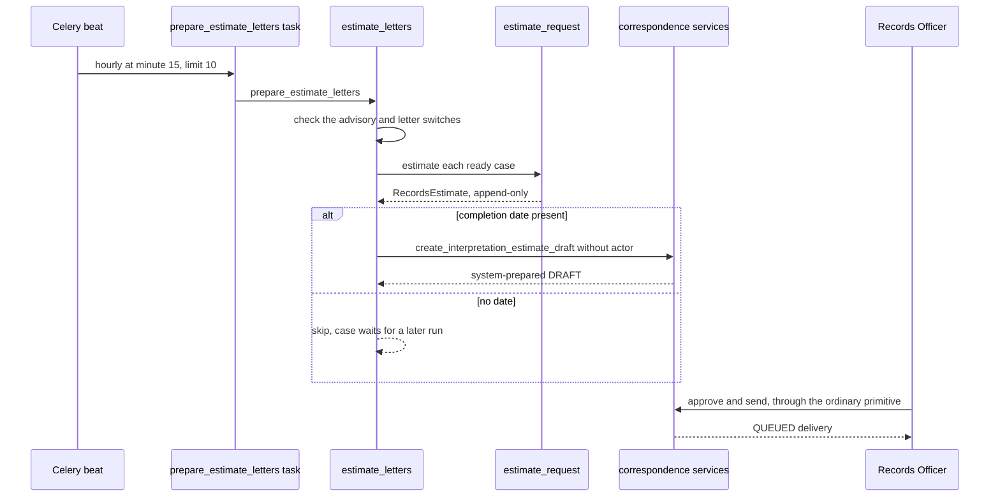

# Records Estimates and Interpretation Letter

A count is not an estimate. The estimate engine answers three questions for a
`public_records` request: how many responsive records there are likely to be,
what the copying charge would be, and when review could finish. It stores the
answer and every input behind it. A separate drafter turns the stored estimate
into an interpretation-and-estimate letter, which only a Records Officer can send.

## Components

| Concept | Public API | Implementation | Tests |
|---|---|---|---|
| Estimate computation and evidence | `estimate_request()` | `apps/records/estimates.py`, model `RecordsEstimate` in `apps/records/models.py` | `apps/records/tests/test_estimates.py` |
| Automatic letter selection and drafting | `prepare_estimate_letters()` | `apps/records/estimate_letters.py`, task `apps.records.tasks.prepare_estimate_letters` | `apps/correspondence/tests/test_interpretation_estimate_letter.py`, `apps/records/tests/test_compliance.py` |
| Letter draft and delivery effect | `create_interpretation_estimate_draft()` | `apps/correspondence/services.py`, kind `INTERPRETATION_ESTIMATE` | `apps/correspondence/tests/test_interpretation_estimate_letter.py` |
| Staff read of the waiting letter | `GET /api/staff/requests/{number}/estimate-letter/` | `RequestsViewSet.estimate_letter` in `apps/api/resources/requests.py`, capability `requests.estimate_letter.read` in `apps/api/capabilities.py` | `apps/correspondence/tests/test_interpretation_estimate_letter.py` |
| Case-header approval card | `EstimateLetterCard` | `frontend/src/case/EstimateLetterCard.tsx` | `frontend/src/case/EstimateLetterCard.test.tsx` |

## The estimate

`estimate_request(request, *, actor=None, as_of=None, deposit_percent=10)` refuses
any matter that is not `public_records` (rule 13), and refuses a deposit above ten
percent. It answers three questions:

- **Responsive count.** Reviewed responsive records and withheld records are
  certain. Each unreviewed record is grouped by its standing AI suggestion from
  `annotate_latest_suggestion()`. Each group is scaled by the district-wide
  agreement rate from `latest_decisions()` in `apps/records/agreement.py`. The
  low and high values are the 95% Wilson interval for that rate (`wilson_interval`).
  A group with no measured decisions spans zero to all of its records. Records with
  no suggestion use the overall measured rate, or 0.5 with no history. Superseded
  and duplicate records are excluded.
- **Fee.** The fee schedule adopted on `as_of` (`current_fee_schedule` in
  `apps/records/fees.py`) is applied to the records that would be released:
  responsive and not withheld. Files are billed in bundles of four, plus a per-GB
  line, and the scanned-page line is zero because the records are already
  electronic. The deposit is `deposit_percent` of the expected fee, capped at ten
  percent under RCW 42.56.120. With no adopted schedule the fee is `None` and the
  result says so. It does not guess one.
- **Completion date.** Throughput is the number of `record.reviewed` audit rows in
  the last 20 business days (`THROUGHPUT_WINDOW_BUSINESS_DAYS`), divided by 20. The
  backlog is every unreviewed record in open cases received earlier, plus this
  case's own unreviewed records. The date is `add_business_days()` of the backlog
  divided by throughput. Without any review in the window there is no date.

The result is stored as an append-only `RecordsEstimate` (`inputs` and `result`
JSON) and audited as `records.estimate_computed`. The completion note always says
the date covers review only, not redaction or release.

## The interpretation letter

`prepare_estimate_letters()` runs hourly at minute 15 with a limit of 10. Celery
beat schedules it as `prepare-estimate-letters` in `config/celery.py`, and the
[background jobs](../architecture/background-jobs.md) page owns the schedule. It returns
zero unless both `PRR_AI_ADVISORY_ENABLED` and
`PRR_AI_AUTOMATIC_ESTIMATE_LETTER_ENABLED` are on.

`ready_requests()` selects open `public_records` cases that have a completed
request-intent run, at least one non-superseded record, and no unreviewed record
lacking an AI suggestion. A case is skipped while it has an interpretation letter
that is not cancelled, and once an estimate has already been computed today.

For each ready case, the drafter computes an estimate and creates a draft only when
the estimate has a completion date. Without one, the estimate is kept, and the case
waits for a later run. The draft is created with no actor, which makes it
*system-prepared*. The only legal way for it to reach a requester is an officer's
approval. A `ValidationError` for one case is logged and does not stop the batch.

The system-prepared draft is the one case where the system creates a requester
letter at all. It is never sent automatically.
`SYSTEM_PREPARED_DRAFT_KINDS` in `apps/correspondence/services.py` lists only
`INTERPRETATION_ESTIMATE`, and a database constraint enforces the same rule. The
[compliance](compliance.md#the-safety-net-asymmetry) page covers the wider rule.

Caption: the estimate is computed and drafted automatically, and approval is always
a human action.

## Approval and delivery

A draft is created with `create_interpretation_estimate_draft()`. The
interpretation comes from the latest complete request-intent summary. The count,
the charge, and the completion date come from the stored `RecordsEstimate`. The
draft is rejected when the request is closed or the clarification is open, when the
estimate belongs to a different request, when it has no completion date, when no
intent summary exists, or when another interpretation letter is still draft, approved,
or queued.

The Records Officer reads the waiting letter through the case-header card, which calls
`GET /api/staff/requests/{number}/estimate-letter/`. The card sends it with the ordinary
`correspondence` approve-and-send primitive. Only a confirmed delivery applies the date:
it creates an `EstimateRevision`, not automated, whose reason names the
`RecordsEstimate` id. That revision moves `estimated_completion` and adds a
requester-visible status event. Computing the estimate does not change
`estimated_completion`. Before approval, a Records Officer may reword only the
interpretation.

## Invariants

- `estimate_request()` changes no status, no `estimated_completion`, and sends nothing.
  `estimated_completion` moves only through the `EstimateRevision` that a confirmed
  delivery creates.
- A system-prepared draft is never approved or queued by the system. The AST guard
  `test_a_system_prepared_letter_is_drafted_never_sent` checks the drafter for calls to
  approval, queueing, transition, or fee functions.
- Only `public_records` matters get an RCW 42.56 estimate or letter (rule 13).
- The fee and the deposit follow the adopted schedule and the ten-percent cap.
- `RecordsEstimate` rows cannot be updated or deleted (`AppendOnlyModelMixin`).

## Where estimates meet other concepts

- The case's statutory next-due date uses the human-set `estimated_completion`, not
  `RecordsEstimate`. See [requests](requests.md#next-response-due) and
  [correspondence](correspondence.md#template-registry).
- The agreement rates used for the responsive range come from the AI-human
  agreement records in [advisory AI](advisory-ai.md#ai-human-agreement).
- The letter's kind is one of the RCW 42.56 letters in
  [matter kinds](matter-kinds.md#letters-by-kind).
- Human estimate revisions follow the separate `letters.revise_estimate()` path
  described in [compliance](compliance.md#human-only-actions-and-ast-guards).

## Behavior test matrix

| Behavior | Narrowest test |
|---|---|
| No evidence gives the widest range; measured agreement narrows it | `test_estimates`: `test_no_evidence_is_the_whole_range`, `test_measured_agreement_narrows_the_range` |
| Reviewed records are certain; unreviewed records span their group | `test_estimates`: `test_reviewed_records_are_certain_and_unreviewed_span_their_group` |
| Superseded and duplicate records are not counted | `test_estimates`: `test_superseded_and_duplicate_records_are_not_counted` |
| Fee bills only released records; withheld records count but are not billed | `test_estimates`: `test_fee_lines_use_the_adopted_rates_for_released_records_only`, `test_withheld_records_count_as_responsive_but_are_not_billed` |
| No adopted schedule means no fee | `test_estimates`: `test_no_adopted_schedule_means_no_fee_rather_than_a_guess` |
| Deposit never exceeds ten percent | `test_estimates`: `test_the_deposit_never_exceeds_ten_percent` |
| No measured throughput means no date | `test_estimates`: `test_no_measured_throughput_gives_no_date` |
| Every input is stored and audited | `test_estimates`: `test_every_input_is_stored_and_audited` |
| Only a `public_records` request gets an estimate | `test_estimates`: `test_only_a_public_records_request_gets_an_rcw_estimate` |
| Drafter never approves, queues, or sends | `test_interpretation_estimate_letter`: `test_the_system_drafts_but_never_approves_or_queues`; `test_compliance`: `test_a_system_prepared_letter_is_drafted_never_sent` |
| Only the interpretation is rewordable by an officer | `test_interpretation_estimate_letter`: `test_an_officer_may_reword_only_the_interpretation` |
| Missing intent summary, date, or an outstanding letter blocks drafting | `test_interpretation_estimate_letter`: `test_it_needs_an_intent_summary_a_date_and_no_letter_outstanding`, `test_without_an_intent_summary_there_is_nothing_to_interpret` |
| Ready-case selection: one draft per case; unclassified or other-kind cases skipped; undated estimate waits | `test_interpretation_estimate_letter`: `test_a_ready_case_gets_one_draft_and_only_one`, `test_unclassified_records_or_another_matter_kind_are_not_ready`, `test_an_undated_estimate_is_kept_and_the_case_waits_for_tomorrow` |
| Switches off draft nothing | `test_interpretation_estimate_letter`: `test_off_drafts_nothing` |
| Delivery records the stated date as estimate evidence | `test_interpretation_estimate_letter`: `test_delivery_records_the_stated_date_as_estimate_evidence` |
| Staff read endpoint: officer reads, reviewer refused | `test_interpretation_estimate_letter`: `test_an_officer_reads_the_waiting_letter_and_a_reviewer_may_not` |

There is no separate API test file for the estimate-letter endpoint. Its direct test lives
in `apps/correspondence/tests/test_interpretation_estimate_letter.py`.

## Change navigation

- Start with `apps/records/estimates.py`, then `estimate_letters.py`, then
  `create_interpretation_estimate_draft()` in `apps/correspondence/services.py`.
- Changing the fee or deposit math touches `estimates._fee()` and the fee helpers in
  [fees and deposits](fees-and-deposits.md). Both need tests with a real adopted schedule.
- Changing the switch or the cadence touches `config/celery.py`, `apps/configuration/registry.py`,
  and [background jobs](../architecture/background-jobs.md).
- Focused validation:
  `PYTHON_DOTENV_DISABLED=1 python manage.py test apps.records.tests.test_estimates apps.correspondence.tests.test_interpretation_estimate_letter --settings=config.test_settings`.
  Add `apps.records.tests.test_compliance` when the drafter or the AST guard changes.
  For the UI card, run `cd frontend && bun run test -- src/case/EstimateLetterCard.test.tsx`.
- Broader checks are normally unnecessary for these files. Run the full Django suite only when
  `services.transition()` or the correspondence approval path changes.
