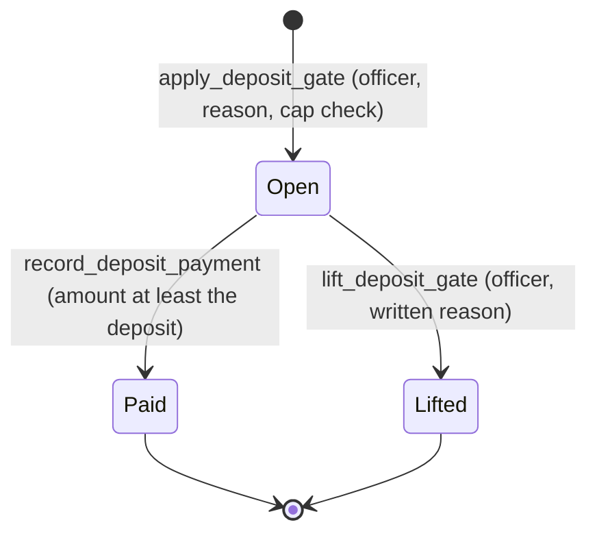

# Fee Schedules, Waiver Floors, and Deposit Gates

The District may charge for copies and electronic production under RCW 42.56.120, and it
may ask for a deposit before it spends staff time on a request. This domain turns those
decisions into append-only evidence. `apps/records/fees.py` owns the arithmetic and the
gates. Each decision that matters is made by a named Records Officer, and each decision
writes an audit row.

Installment-level fee assessment and release are described in
[installments and release](installments-and-release.md#fees-and-deposit-gates). Collection
gating is described in [collection and Vault](collection-and-vault.md). Deposits and
unpaid fees also appear as Records Officer work in the [work queue](work-queue.md). The
statutory and human-only rules that frame these decisions are in [compliance](compliance.md).

## Four separate concepts

| Concept | Model | What it records | Who decides |
|---|---|---|---|
| Fee schedule | `FeeSchedule` | Per-page, per-file, and electronic rates, with the counsel and adoption references | Records Officer, after counsel review |
| Waiver floor | `FeeWaiverFloor` | The amount below which an assessment prompts a waiver decision | Records Officer, after counsel review |
| Fee assessment and payment | `FeeAssessment`, `FeePayment` | The charge for one installment and the payments against it | Computed by the service; revisions are appended |
| Deposit gate | `FeeDepositGate` | A hold on collection or production until a deposit is paid or lifted | Records Officer |

These are independent. A floor never changes a schedule, and a gate never changes an
assessment. Keep them that way when adding behavior. Closed cases take no new gate and
are not surfaced for unpaid fees; case status rules are in [requests](requests.md).

## Fee schedules

`activate_fee_schedule` is the only path that creates a schedule. It requires a current
Records Officer, a name, a counsel approval reference, and a formal adoption reference.
Its `basis` is either the statutory default or an actual-cost statement, and the two
differ:

- A `statutory_default` schedule may not exceed the caps in `STATUTORY_CAPS`: $0.15 per
  photocopy page, $0.10 per scanned page, $0.05 per electronic file bundle, $0.10 per
  electronic gigabyte, and a flat fee of at most $2.00.
- An `actual_cost` schedule requires a published actual-cost statement reference of at
  least eight characters.
- A replacement schedule cannot take effect before the schedule it supersedes.

`current_fee_schedule(on_date=...)` returns the latest schedule whose effective date has
arrived. Schedules are append-only, so a correction is a new schedule, not an edit.

## Waiver floor

`activate_fee_waiver_floor` adopts an amount with a counsel reference. The model says
it is intentionally kept in the database rather than in a setting, so the counsel
reference stays with the number. `assessment_is_below_waiver_floor` returns true only
when an open assessment is strictly below the adopted amount. The prompt is advice.
The waiver itself is a named human decision recorded on the assessment. A floor with no
adoption prompts nothing.

## Deposit gates

A deposit gate is the officer's decision to hold one kind of work on one case until the
requester pays. The scope is `collection` or `production` (`FeeDepositGate.Scope`).



Caption: an open gate is any row with neither `satisfied_at` nor `lifted_at` set.
`open_deposit_gate` reads that rule, and `assert_deposit_gate_clear` raises a
`ValidationError` while one is open for the scope being checked.

`apply_deposit_gate` checks, under a row lock on the case:

1. The case is not closed, the scope is valid, and an adopted schedule exists.
2. The deposit is greater than zero and no more than ten percent of the estimated charge.
   The cap is rounded **down** to the cent, because rounding up would exceed the
   ten-percent limit in RCW 42.56.120(2).
3. The reason is substantive (at least ten characters).
4. The request date is not in the future and not before the public records request was received.
5. No open gate already holds that scope.

`record_deposit_payment` requires a full payment. A partial deposit does not release the
work. `lift_deposit_gate` releases the work without payment, on a written reason. The
code has no automatic lift path, and the staff capability for lifting is `human_only`
(see [agent parity](../architecture/agent-parity.md)).

Where the gate is checked:

- Production: `prepare_installment` and `release_installment` in
  `apps/records/production.py` call `assert_deposit_gate_clear` with the production scope.
- Collection: `queue_vault_collection` in `apps/records/vault_collections.py` and the
  collection-task API in `apps/api/resources/collection_tasks.py` check the collection scope.
  A production deposit does not hold collection work (`test_a_production_deposit_does_not_hold_collection_work`).

## Unpaid-fee attention

`unpaid_fee_attention_requests` lists open cases with an unpaid deposit gate, or an
unpaid, unreleased installment assessment, when the item is more than 30 days old
(`UNPAID_FEE_ATTENTION_DAYS`). Closed cases are excluded.

The daily Celery task `unpaid_fee_watchdog` (scheduled in `config/celery.py`) reconciles
one `fee_unpaid` work item per listed case through
`apps/work_queue/source_reconciliation.py`. It also retires work items on cases that no
longer owe anything. It creates no letter, sends nothing, and closes nothing. The
non-payment closure it leads to is a Records Officer decision, see
[work queue](work-queue.md) and [compliance](compliance.md).

## Staff API

Routes are registered in `apps/api/resources/records_misc.py` (`fee-schedules`,
`fee-deposit-gates`, `fee-waiver-floors`). The capability registry in
`apps/api/capabilities.py` records each operation and its policy. Do not add an
endpoint without a registered capability, because `test_agent_capabilities` fails on drift.

| Capability | Route | Execution policy |
|---|---|---|
| `fee_deposit_gates.apply` | `POST /api/staff/fee-deposit-gates/` | human confirmation |
| `fee_deposit_gates.record_payment` | `POST /api/staff/fee-deposit-gates/{id}/record-payment/` | human confirmation |
| `fee_deposit_gates.lift` | `POST /api/staff/fee-deposit-gates/{id}/lift/` | human only |
| `fee_waiver_floors.activate` | `POST /api/staff/fee-waiver-floors/` | human confirmation |

## Change guidance

- Keep the statutory caps in `STATUTORY_CAPS` and the deposit cap in `DEPOSIT_PERCENT_CAP`
  in step with the statute. Changing either is a legal change that needs counsel review.
- Any new gate or hold must name the work it blocks, as `assert_deposit_gate_clear` does,
  and must not block unrelated scopes.
- Do not add a path that waives, lifts, or closes automatically. The watchdog only surfaces
  work, and the tests check that it closes nothing.
- A new fee field on an installment belongs in the append-only evidence models, not in a
  mutable projection.

## Focused validation

```bash
PYTHON_DOTENV_DISABLED=1 python manage.py test apps.records.tests.test_fees --settings=config.test_settings
```

Within `test_fees.py`, the classes map to the concepts above:

- `FeeFrameworkTests`: schedule activation, statutory caps, assessment arithmetic, and payment evidence.
- `FeeWaiverFloorTests`: floor adoption and the waiver prompt.
- `FeeDepositGateTests`: gate creation, the ten-percent cap, scope isolation, payment, and lifting.
- `DepositGateHoldsRealWorkTests`: production and collection refusal while a deposit is open.
- `UnpaidFeeAttentionTests`: the 30-day window, closed-case exclusion, and watchdog behavior.

For the staff API surface and capability drift, add
`apps.api.tests.test_records_misc apps.api.tests.test_agent_capabilities`. These are
conditional: run them when a route or capability changes, not for a service-only edit.
