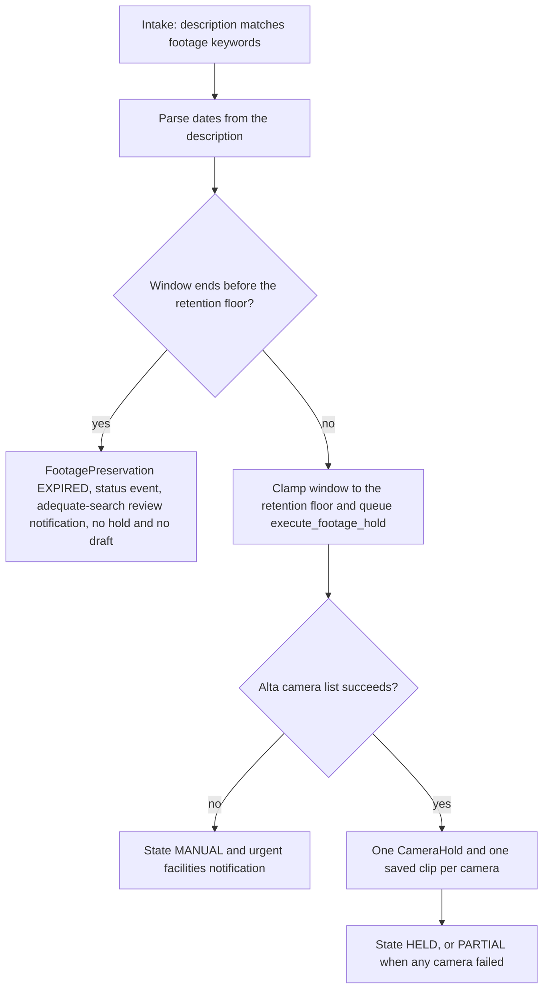

# Camera Footage Triage

Surveillance camera footage requests get preservation-first handling: **automatic
hold, never automatic denial.** The policy lives in the module docstring of
[`apps/records/triage.py`](../../apps/records/triage.py) and is enforced by the
tests named below. Denial and adequate-search rules are described in
[compliance](compliance.md).

## Core principle

Intake triage detects a footage request and holds every camera that may still
have footage. If the requested window is entirely outside the retention period,
no hold is created and no response is drafted. The request routes to a human who
completes the adequate-search checklist. The rationale stated in the source is that a
late hold destroys evidence, and an automatic denial performs no search.

## Detection

`is_footage_request()` matches `FOOTAGE_KEYWORDS` in the request description, as whole
words and case-insensitively: `footage`, `video`, `camera`, `cctv`, `surveillance`,
`recording`, and `recorded`. `triage_footage()` is called at intake. It returns
`None` for a non-footage request.

`extract_dates()` reads ISO dates, `M/D/YYYY`, and `Month D, YYYY` from the
description. The window is the earliest parsed date through the latest, covering
whole days in the district's timezone.

## Retention window decision

The retention period is the app-managed `CAMERA_RETENTION_DAYS` setting. It defaults to
10 days and is read once through `runtime.get()` ([configuration](../architecture/configuration.md)),
so the recorded decision and the applied rule use the same value. The triage
code defines a retention floor of now minus that many days.

Caption: the intake decision and hold outcomes in `triage_footage()` and `execute_footage_hold`.

- **Dates parsed and inside retention.** The window is clamped to the retention floor,
  and `execute_footage_hold` is queued.
- **No parseable date.** The window is the full retention period through now. The
  note records that a human must refine it. Preservation-first applies.
- **Window entirely outside retention.** The preservation moves to `EXPIRED`, a
  status event states that human review is required and that no response has been drafted
  or queued, and `notify_adequate_search_review` alerts staff. `test_expired_window_queues_review_never_denies`
  and `test_expired_footage_routes_to_adequate_search_without_denial_language` lock
  this behavior.

Triage is idempotent. The one-to-one `FootagePreservation` row for a request is the
durable boundary, so an existing row is returned on retry.

## Avigilon Alta hold execution

`execute_footage_hold` in [`apps/records/tasks.py`](../../apps/records/tasks.py) runs
the broad hold. Its module docstring states that narrowing is a human decision.

| Step | Client call (`apps/integrations/avigilon/client.py`) | Outcome |
|---|---|---|
| List cameras | `list_cameras()` | An `AltaError` sets the preservation to `MANUAL` and sends an urgent facilities notification. Staff have exact instructions, so preservation is never silent. |
| One hold per camera | `create_clip_hold(camera_id, start, end, label)` | A saved clip labelled with the request number. A failure is isolated to that camera (`FAILED`), and the rest continue. |
| Roll-up | none | `HELD` when every camera succeeded, `PARTIAL` otherwise. |

The client also exposes `delete_clip(clip_id)`, used only by the exclusion path, and
`checks()`. The `verify_alta` management command runs `checks()` as a connectivity smoke test,
and reports camera count and a sample. It is the first thing to run after the district
API token is configured. Endpoints marked `VERIFY` in the client may need path fixes.

## Camera exclusion (human only)

`exclude_camera(camera_hold, reason, *, actor=None)` in `triage.py` is the only way to
release one camera. It is `@transaction.atomic` and:

1. requires current Records Officer authority (`_require_current_records_officer`);
2. strips the reason and rejects one shorter than 10 characters, or longer than the
   `exclusion_reason` field allows;
3. marks the `CameraHold` as released, with `excluded_at`, `excluded_by`, and the reason;
4. writes a `footage.camera_excluded` audit row;
5. schedules the Alta clip deletion on commit. A failed deletion writes
   `footage.camera_release_failed` and does not undo the exclusion.

The staff endpoint is `POST /api/staff/preservations/<id>/exclude-camera/`, with
`camera_hold_id` and `reason`. For token callers, `human_only_handoff` returns an
approval handoff before any row is read, under capability `preservations.exclude_camera`
([agent parity](../architecture/agent-parity.md)). `test_no_automated_exclusion_path` in
`test_footage.py` parses the AST of `tasks.py` to assert that no task calls
`exclude_camera`.

## Staff alerts

The adequate-search review and manual-hold alerts go through
`apps/records/notifications.py` (`notify_adequate_search_review`,
`notify_footage_manual_hold`). They are gated and deduplicated like other internal
alerts; see [background jobs and staff alerts](../architecture/background-jobs.md#staff-alerts).

## Models and state

| Model | Purpose |
|---|---|
| `FootagePreservation` | One per request: window, detected-dates note, and state (`pending`, `held`, `partial`, `manual`, `expired`, `released`) |
| `CameraHold` | One per camera: clip ID, state, exclusion evidence, or per-camera error |

Footage holds attach to requests through the same intake path as other matters.
See [requests](requests.md) for the intake pipeline that calls triage.

## Change guidance

- Do not add a path that denies footage or excludes a camera automatically. The
  AST guard will fail, and that failure is intentional.
- Retention and window logic changes belong in `triage.py`. Keep the decision and the
  recorded note reading the same retention value.
- Changes to Alta calls go in `apps/integrations/avigilon/client.py`. Keep the
  `AltaError` handling that drives the manual fallback.
- Focused checks: `apps.records.tests.test_footage` for triage and holds, and
  `apps.api.tests.test_preservations` for the exclusion endpoint. Add
  `apps.records.tests.test_feature_audit_regressions` when you touch the expired-window
  language.
- Escalate to the full suite when a change alters the shared `runtime.get()` contract
  or the notification gates.

Related: [compliance](compliance.md) (human-only guards and the adequate-search rule),
[configuration](../architecture/configuration.md) (where `CAMERA_RETENTION_DAYS` lives),
[Google identity](../architecture/google-identity.md) (Records Officer authority checks).
