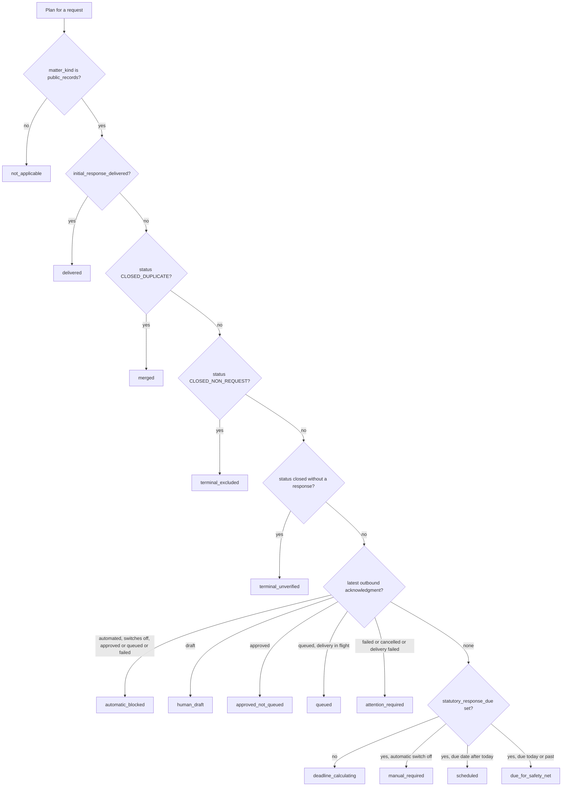

# Five-Day Initial Response Plan

Every public records request owes a first response within five business days of receipt
(RCW 42.56.520). The system does not store that obligation as a status. It derives an
**initial-response plan** on each read: a state, a due date, a next action for the
officer, and an ordered four-step ladder. The same plan drives the case header, the
Messages tracker, the Inbox rows, and the request detail. Deadline arithmetic lives in
[requests](requests.md#next-response-due) and [compliance](compliance.md#deadline-engine).
This page covers the plan itself.

## The four-step ladder

`INITIAL_RESPONSE_STEPS` in [`apps/api/resources/requests.py`](../../apps/api/resources/requests.py)
lists the steps: prepare the acknowledgment draft, the Records Officer approves the exact
wording, queue it for delivery, and the mail provider confirms delivery. The module comment
states the rule: nothing before the last step satisfies RCW 42.56.520.
`_INITIAL_RESPONSE_GUIDANCE` maps each plan state to the index of the current step and the
officer's next action. `initial_response_guidance()` turns that into `done`, `current`, and
`pending` per step. A state index equal to the step count means every step is complete.
A state index of `-1` means no step is done and none can be taken, which is how
`terminal_unverified`, `merged`, and `not_applicable` render. They never look finished.

## How the state is decided

`compute_initial_response_plan()` in the same module decides the state. Its branches run in
this order, and the first match wins:

Caption: the branch order matters. A closed case with no response on record is caught
before any acknowledgment branch, and a delivered response wins over every closed status.

Delivery evidence comes from four places, and any one of them makes the response delivered:
the request's `acknowledgment_sent_at`, a legacy NextRequest import
(`legacy_initial_response_at`), an `InitialResponseAttestation` recorded through
`record_external_initial_response()` in [`apps/records/services.py`](../../apps/records/services.py),
or an `ACKNOWLEDGED` or `CLARIFICATION` status event. The property
`initial_response_delivered` in [`apps/records/models.py`](../../apps/records/models.py)
reads them. The inverse query, `awaiting_initial_response()`, is the same predicate that the
safety-net worker selects on.

## The day-5 safety net reads the same predicate

`auto_acknowledge_safety_net` in [`apps/records/tasks.py`](../../apps/records/tasks.py) runs
hourly at :30 (`config/celery.py`). It selects public-records requests that are still
awaiting a first response, whose due date is today or earlier, and that are not in a terminal
status. For each one it calls `queue_automated_acknowledgment()` in
[`apps/correspondence/services.py`](../../apps/correspondence/services.py). Queueing is not
delivery: the request stays unanswered until the provider confirms. The safety net stops
when the `AUTO_ACK_SAFETY_NET` switch is off, and it fails the run rather than skipping
silently when the settings store cannot be read. The asymmetry that makes this the only
automated statutory letter is explained in [compliance](compliance.md#the-safety-net-asymmetry).

When a page of cases is rendered, the list path resolves `awaiting_initial_response()` once
and passes the answer in as `initial_response_delivered`. A row therefore cannot claim a
response was delivered for a case the safety net still considers unanswered.

## Where the plan is surfaced

- **Request detail:** `PublicRecordsRequestDetailSerializer` in `apps/api/resources/requests.py`
  returns `initial_response_plan` (`get_initial_response_plan`).
- **Case header and Messages tracker:** the case workspace reads `statutory_response` built
  from the same plan, including `next_action` and `steps`.
- **Inbox and message lists:** `apps/api/resources/correspondence.py` attaches
  `statutory_response_state` to each message, using the batch-resolved inputs.
- **Staff screens:** `frontend/src/statutory.ts` owns the wording. `STATUTORY_RESPONSE_LABELS`
  names a state for a header, `STATUTORY_ROW_LABELS` says what is outstanding for a row, and
  `statutoryRowTone()` colors it. Amber is the default for an owed response. Red marks a
  closed case with no response, and neutral marks a merged duplicate or a case excluded from
  the statute. `outstandingStatutoryStep()` returns `null` for `delivered`, `terminal_excluded`,
  and `terminal_unverified`, and when the current step is the mail provider's `deliver`
  step. The UI therefore never asks an officer to act on a step the provider owns. The
  frontend chooses which step to show but does not decide delivery; the server remains the
  source of truth ([staff frontend](../architecture/staff-frontend.md#helpers-that-mirror-server-contracts)).

## Invariants

- A draft, an approval, and a queued message never satisfy the response. Only `delivered`
  does. The guidance text for the draft, approval, and queued states says so explicitly.
- `terminal_unverified` is the exposure state. It is reported for a closed request with no
  first response on record, and it is never displayed as a settled case. Only
  `CLOSED_NON_REQUEST` (`terminal_excluded`) is settled, because staff decided in writing that
  no records request existed.
- A `merged` duplicate owes nothing itself. The obligation moves to the case of record, and
  the plan says so.
- Litigation and FERPA matters report `not_applicable`. They never enter the safety net
  ([matter kinds](matter-kinds.md#what-each-kind-does)).
- The plan is computed on read and writes nothing. Persisting or caching a plan would let it
  disagree with the delivery evidence.

## Change guidance

- **New plan state.** Add the branch in `compute_initial_response_plan()` at the right
  precedence, add its index and guidance to `_INITIAL_RESPONSE_GUIDANCE`, then add the label
  and tone to `frontend/src/statutory.ts`. A row state missing from `STATUTORY_ROW_LABELS`
  renders its raw key (`statutoryRowLabel`), so add the entry rather than rely on that.
- **New delivery evidence.** Extend `initial_response_delivered` and
  `awaiting_initial_response()` together. They must agree, and
  `test_batched_awaiting_set_agrees_with_the_per_request_property` in
  `apps/records/tests/test_compliance.py` checks that they do.
- **Do not** derive "delivered" in a serializer, a template, or the frontend.
- **Focused tests.** `apps/api/tests/test_requests.py` (`RequestsDetailTests`) covers the
  scheduled, due, manual-only, held-automatic, and terminal states.
  `apps/records/tests/test_migrated_case_status_audit.py` covers the terminal and
  `terminal_unverified` branches. `apps/api/tests/test_officer_receipt_and_templates.py`
  (`GuidedStatutoryResponseTests`, `AwaitingStatutoryResponseQueueTests`) covers the guided
  steps and the queue. `apps/records/tests/test_external_initial_response.py` covers recording
  an external first response. On the frontend, `CorrespondencePanel.test.tsx` and
  `RequestDetail.test.tsx` cover the ladder and the delivered state.
- **Escalation.** A change that alters when the safety net fires, or the rule for
  `automatic_blocked`, is a compliance change. Read [compliance](compliance.md) first and
  run the compliance tests as well.
