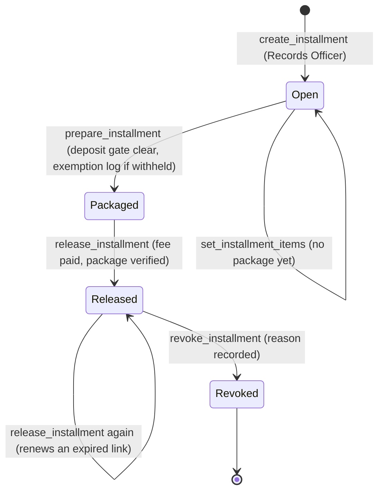
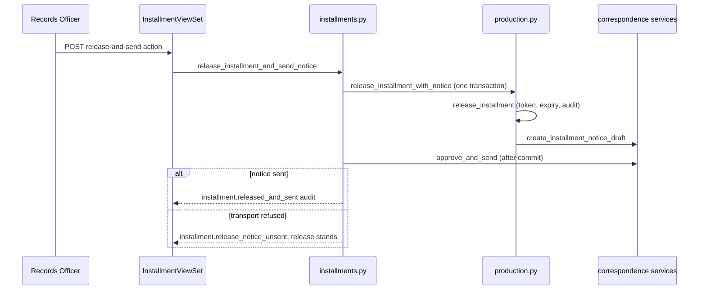
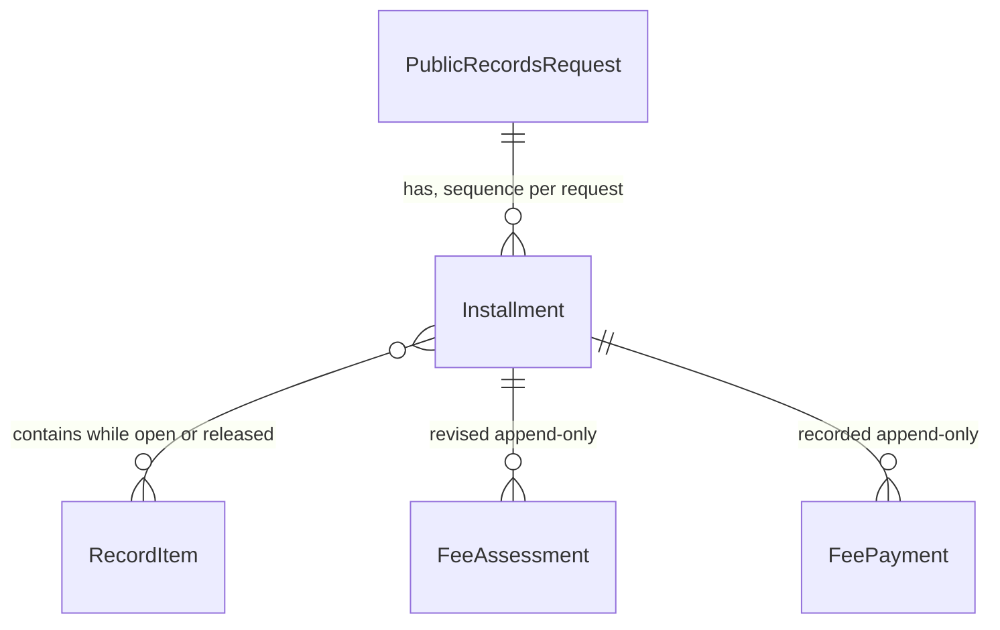

# Installments and Release

An **installment** is the unit in which a Public Records Act request is delivered to a
requester. It is a numbered batch of release-ready record items from one request, packaged
into one immutable ZIP, released behind a scoped and expiring link, and announced by a
notice. The legal rules are not stored in this page: the deadline, exemption, and
notice-content rules live in [compliance](compliance.md), and the requester notice contract
lives in [correspondence](correspondence.md). This page explains how the installment
lifecycle enforces them.

## Lifecycle

Each stage is a separate action with its own guard. Membership moves only while the
installment is open; packaging freezes the contents; release is the only step that makes
bytes reachable by the requester.



- **Create** (`create_installment`, `apps/records/installments.py`) takes selected record
  items. Each must be release-ready, belong to the same request, and not already sit in a
  live installment. A closed request cannot open an installment. The size cap is read once
  from the `PRR_INSTALLMENT_MAX_ITEMS` setting.
- **Membership** (`set_installment_items`) replaces the full set in one action, and only
  while no package has been prepared and the installment is unreleased. Revoking an
  installment frees its records so they can be packaged into a replacement.
- **Exemption log** (`apps/records/exemption_logs.py`, `generate_exemption_log`) is required
  before packaging when an installment holds withheld or redacted items. It is a generated,
  immutable PDF keyed to the installment's manifest. If the manifest changes afterward, the
  installment must be recreated.
- **Prepare** (`apps/records/production.py`, `prepare_installment`) builds the ZIP. It uses
  each record's approved artifact (the original, or the redacted copy when one exists), a
  manifest, and the exemption log. It records the package SHA-256, size, manifest hash,
  preparer, and time. A repeat on an unchanged installment returns the existing package;
  a changed one is refused.
- **Release** (`release_installment`, `apps/records/production.py`) requires a verified
  package, a paid fee when one is assessed, and an open request. It sets a fresh
  `download_token` and a `download_expires_at`. Releasing an already-released installment
  does not re-deliver records; it renews the link only once the old one has expired.
- **Notice** (`release_installment_with_notice`) drafts an `installment_notice` correspondence
  in the same transaction as the release. An existing notice with a different release
  snapshot blocks the call.
- **Revoke** (`revoke_installment`) withdraws requester access with a recorded reason. The
  artifact and audit trail stay in place, and a revoked installment can never be released
  again.

## The one-action release

`release_installment_and_send_notice` (`apps/records/installments.py`) is the Releases-tab
action. It runs release and notice drafting in one transaction, then approves and sends the
notice after that commits. If sending fails, the release stands. The code writes an
`installment.release_notice_unsent` audit entry and raises `InstallmentNoticeUnsent`, so the
caller can tell a release that happened with an unsent notice from one that never happened.
Pressing the action again once the cause is fixed sends the notice without re-releasing.



## Fees and deposit gates

Installment fees are computed by `apps/records/fees.py`, not by this module.
`assess_installment_fee` and `record_fee_payment` write append-only `FeeAssessment` and
`FeePayment` rows that point at the installment. Two gates connect fees to delivery:

- `prepare_installment` and `release_installment` call `assert_deposit_gate_clear`, so an
  open deposit gate blocks production work.
- `release_installment` requires `fee_paid_at` when the installment carries a nonzero
  `fee_amount`.

The fee schedule, the waiver floor, the ten-percent deposit cap, and the unpaid-fee
watchdog are covered in [fees and deposits](fees-and-deposits.md).

## Requester download pages

Requesters reach a released installment through a token URL. Two routes in `config/urls.py`
serve it:

- `requests/<request_number>/installments/<sequence>/download/<token>/`
  (`InstallmentDownloadPageView`, `apps/records/requester_downloads.py`) explains the contents,
  expiry, and contact, and asks for an access code when one is set.
- `.../download/<token>/package/` (`InstallmentPackageView`) streams the ZIP.

The download page is a plain HTML document rendered by Django's template engine, not by
DRF. `InstallmentDownloadPageView` renders `templates/requester/installment_download.html`
for a usable installment. It renders `templates/requester/installment_unavailable.html` with
HTTP 404 and reason `missing` when the token, request number, or sequence does not resolve to
a released, paid installment (`_resolve`). It renders the same template with HTTP 410 for a
revoked or expired installment (`_unavailable_reason`). Both templates extend
`templates/requester/installment_base.html`.

A token that is malformed, unknown, unreleased, or unpaid is treated as missing and gets the
same response. A revoked or expired installment gets an explicit unavailable page. Before the
package is streamed, the bytes are read back and checked against the stored size and SHA-256.
A failed check is audited as `installment.download_blocked` and nothing is served.

When an access code is set, the package view reads it from a POST only. A wrong code is
audited as `installment.download_code_rejected`. Codes are stored as hashes. Requester
downloads are limited by three per-address and per-installment throttles defined in
`apps/records/throttles.py`. Those limits protect the guess surface and are not an
authorization mechanism.

Possession of the token is the only authority on these pages. Staff authorization is not
involved, and the pages disclose nothing the token holder could not already infer.

## Data model



The release notice is not a foreign key. It refers to the installment through its draft
metadata (`installment_id`), which the correspondence layer validates against the release
snapshot.

`Installment` (`apps/records/models.py`) carries package fields (`package_storage_key`,
`package_sha256`, `package_size`, `package_manifest_sha256`, `package_prepared_at`),
exemption-log fields, release fields (`released_at`, `download_token`,
`download_expires_at`, `download_count`), fee fields (`fee_amount`, `fee_paid_at`), access-code
fields, and revocation fields. Database check constraints require each group to be complete
together: a package, a revocation, or an access code cannot be half set. Object keys follow
`productions/<request>/<installment>/` and `exemption-logs/<request>/<installment>/`
(`apps/records/storage.py`).

## Staff API and capabilities

`InstallmentViewSet` in `apps/api/resources/records_misc.py` exposes list, retrieve, create,
`set-items`, `assess-fee`, `record-payment`, `prepare`, `generate-exemption-log`, `release`,
`release-and-send`, `revoke`, `set-access-code`, and `clear-access-code`. Each write action
maps to an `installments.*` entry in the capability catalog (`apps/api/capabilities.py`).
Release-and-send and revoke are `human_only`, and plain release is `human_confirmation`. The
parity contract is in [agent parity](../architecture/agent-parity.md).

## Invariants

- Only a current Records Officer may create, prepare, release, revoke, or set access codes.
- Membership changes only before packaging, and a record cannot sit in two live installments.
- A package is verified before release and before any byte reaches a requester.
- A released installment cannot be re-released after revocation, and revocation never deletes
  the artifact or audit trail.
- The notice is drafted in the same transaction as the release. Delivery failure does not
  undo the release.
- Every release, revocation, access-code change, and download attempt is audited.
- Nothing here reads the FERPA identity verification row. See the open item in the
  [quickstart](../quickstart.md#open-verification-items).

## Change guidance

Start with `apps/records/installments.py` for membership, revocation, and access codes, and with
`apps/records/production.py` for packaging and release. Change the requester side in
`apps/records/requester_downloads.py` and its URLs in `config/urls.py`. Keep each new
state-changing action audited, guarded by `_require_current_records_officer`, and matched by a
capability entry.

Focused tests:

- `apps/records/tests/test_installment_lifecycle.py`: create, membership, revoke, access codes,
  and the release-and-send path. Its `ReleasePathEndToEndTests` class runs the full flow.
- `apps/records/tests/test_installment_production.py`: package contents and manifest, retries,
  and release renewal.
- `apps/records/tests/test_installment_downloads.py`: requester page and package delivery,
  including the integrity check.
- `apps/records/tests/test_fees.py` and `apps/records/tests/test_exemption_logs.py`: fee
  assessment and the exemption log.
- `apps/api/tests/test_records_misc.py` (`InstallmentApiTests`) and
  `apps/api/tests/test_agent_capabilities.py`: the API and capability contract.

Minimal validation:

```bash
PYTHON_DOTENV_DISABLED=1 python manage.py test apps.records.tests.test_installment_lifecycle apps.records.tests.test_installment_production apps.records.tests.test_installment_downloads --settings=config.test_settings
```

The full `apps` suite is needed only when a change touches a shared symbol such as
`services.transition()` or the capability registry. See the
[quickstart](../quickstart.md#task-routing) for that rule.
