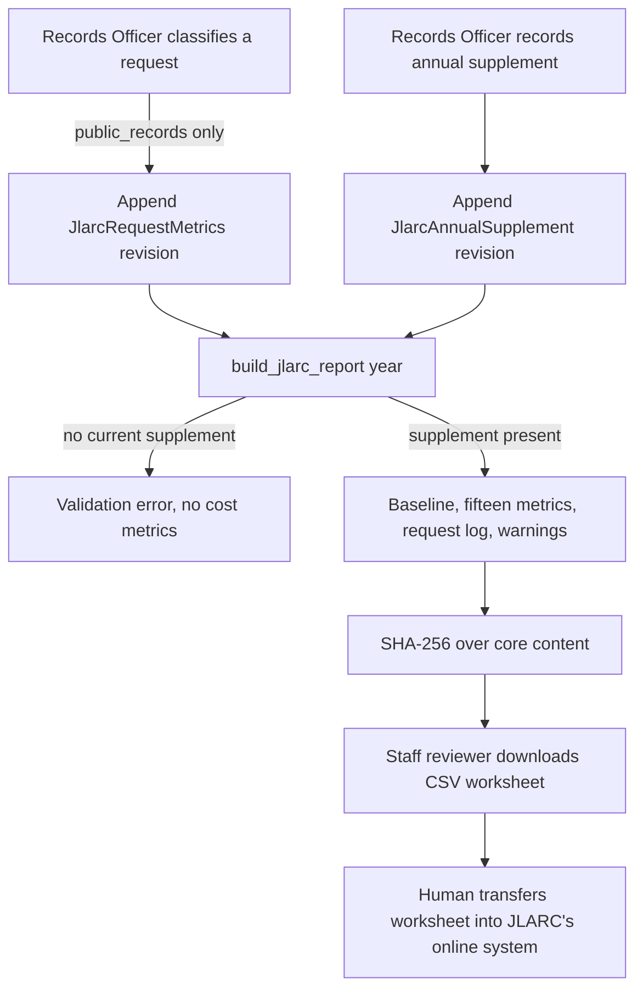

# JLARC Annual Reporting

PSD401 PRR produces the annual public-records worksheet that the district reports to the
Joint Legislative Audit and Review Committee under **RCW 40.14.026**. The module
[`apps/records/jlarc.py`](../../apps/records/jlarc.py) says what it is for in its
docstring: reproducible annual metrics and public-request log data. The worksheet is
an input to a person who transfers it into JLARC's online system. The application never
submits it.

The reporting year's numbers come from two sources. Request-level facts come from the
case records the system already keeps. Facts that no case record holds, such as Finance,
Risk, and HR costs and the district's own claim counts, come from a Records Officer's
annual supplement. Both sources are append-only, so the worksheet can be regenerated and
its digest checked.

## Why it is shaped this way

- **Statutory scope.** The statute counts public-records requests under RCW 42.56. The
  code excludes litigation and FERPA matters because they are not requests under that
  chapter ([matter kinds](matter-kinds.md)). The report's queryset is
  `PublicRecordsRequest.objects.public_records()`, and the classification guard refuses
  any other kind outright instead of storing a value a later report would have to skip.
- **No guessing.** A cost metric with no supplement raises a validation error instead of
  reporting zero. Where a number cannot be derived, the report says so in
  `quality_warnings` rather than inventing a value.
- **Human judgment and minimal data.** Classification records the requester's type only
  when it is voluntarily known, and it stores no new requester identity. The
  request log, however, copies the requester's name and email from the existing case
  record. Treat the worksheet and its CSV as sensitive, and keep the CSV response
  `no-store, private`, as the view sets it.
- **Human-only action.** Both writes are capabilities marked `human_confirmation` with
  `risk=high` in the capability catalog ([agent parity](../architecture/agent-parity.md)).
  The worksheet export is marked `human_external_transfer`.

## Inputs to a report

`build_jlarc_report(reporting_year)` builds one deterministic dictionary from:

| Source | What it contributes |
|---|---|
| `PublicRecordsRequest` (public records only, `CLOSED_DUPLICATE` excluded) | Received, open-at-start, and closed counts; the request log |
| `StatusEvent` (`CLARIFICATION`) | Requests where clarification was sought |
| `EstimateRevision` | Estimates that moved beyond the statutory due date |
| `RecordItem` withholding and `Redaction` rows | Denials in full or part and the most common citations |
| `JlarcRequestMetrics` (current revision) | Requester type, fulfillment format, scanning fact, and the produced and withheld descriptions |
| `TimeEntry` and the supplement's unallocated minutes | Estimated staff time |
| `FeePayment` and `customized_service_cost` on assessments | Expenses recovered in the application, and customized-service recovery |
| `JlarcAnnualSupplement` (current revision) | Cost, claim, litigation, retention, and recovered-expense inputs |

The report has a `baseline` block (open at start, received, closed, and carryover counts),
then `metrics` keyed `"1"` through `"15"`, each with a `label`. The metrics cover the
five-business-day closure share, estimates beyond five days, days to final disposition,
clarifications, denials, abandonments, requester type, fulfillment format, scanning, staff
time, fulfillment cost, claims filed, litigation cost, records-management cost, and recovered
expenses. The `guidance` block names `RCW 40.14.026(4)-(6)` and the metric-guidance version.
`data_sha256` is the digest of the core content, and `generated_at` is stamped outside it.

A closed request is placed in a format bucket only from evidence: its recorded
classification, its closure status (denied, withdrawn, abandoned, non-request, duplicate, or
no-records closures count as no-fulfillment), or a released installment (counted as
electronic). Anything else is listed as `unclassified` and named in a quality warning. A
`CLOSED_NO_RECORDS` closure is not counted as a denial.

## Revisions and the current row

Each write appends a new row. `revision` increments, `supersedes` links the new row to the
previous one, and the old row gets `superseded_by`. The current row is the one with no
`superseded_by`. Both models are append-only through `AppendOnlyManager` and database triggers
(migration `0025_jlarcannualsupplement_jlarcrequestmetrics`), and both carry a unique
`(request, revision)` or `(reporting_year, revision)` constraint.

Every write also appends an audit row: `jlarc.request_classified` or
`jlarc.supplement_recorded`. The supplement's audit row records the fulfillment-cost total and
the claim count, and carries the methodology note as its reason.

Caption: classification and the supplement are the only writes. Report generation reads
current revisions and never writes. Nothing leaves the application except a human-downloaded
CSV.

## Access

| Endpoint | Action | Roles |
|---|---|---|
| `GET /api/staff/jlarc-reports/{year}/` | `JlarcReportViewSet.retrieve` | records officer, reviewer, admin |
| `GET /api/staff/jlarc-reports/{year}/export-csv/` | `export_csv` | records officer, reviewer, admin |
| `POST /api/staff/jlarc-reports/{year}/supplement/` | `supplement` | records officer |
| `POST /api/staff/requests/{number}/jlarc-classification/` | `RequestsViewSet.jlarc_classification` | records officer |

The `{year}` lookup is four digits, and the supplement must fall between 2017 and the current
year. The request serializer exposes `jlarc_metrics` on a case, and only the current
snapshot appears there. The capability IDs are `jlarc_reports.retrieve`,
`jlarc_reports.export_csv`, `jlarc_reports.record_supplement`, and
`requests.classify_jlarc` in `apps/api/capabilities.py`.

## Change guidance

- **Changing a metric** means changing `build_jlarc_report` and its test together. Update
  the `metric_guidance_version` string only when the statutory guidance itself changes. It
  is a claim about which guidance the figures follow, not a build number.
- **Adding a supplement field** needs a model field and a check constraint if it is a
  cost, a migration, the `SUPPLEMENT_MONEY_FIELDS` or the input serializer, and a line in the
  capability's description. Do not make the field derivable from requests if an officer must
  supply it.
- **Adding a classification value** means changing the model `TextChoices`, the migration,
  and the report's tallies. An unclassified closed request must still surface as a warning.
- **Scope boundary.** Do not add submission, scheduling, or an automatic classification path.
  Those would cross the human-only rule in [compliance](compliance.md) and the capability
  constraints above.
- **Focused tests.** `apps/records/tests/test_jlarc.py` covers append-only classification,
  supplement revisions and officer authority, the fifteen-metric baseline with the request
  log and quality warnings, the fail-closed cost path, and the rule that a no-records closure
  is not a denial. `apps/records/tests/test_matter_kinds.py` covers the public-records-only
  count and the classification refusal. `apps/api/tests/test_jlarc.py` covers the HTTP roles
  and the CSV export.
- **Minimal validation.** `PYTHON_DOTENV_DISABLED=1 python manage.py test apps.records.tests.test_jlarc apps.api.tests.test_jlarc --settings=config.test_settings`.
  Add `apps.records.tests.test_matter_kinds` when the scope or the kind guard changes. The
  full `apps` suite is needed only when a shared capability or permission change crosses modules.

Related: [Matter kinds](matter-kinds.md) (which cases count), [Requests](requests.md)
(the lifecycle and the statuses the report reads), [Fees and deposits](fees-and-deposits.md)
(the payments behind recovered expenses), [Compliance](compliance.md) (the human-only rule),
and [Agent parity](../architecture/agent-parity.md) (the capability catalog).
