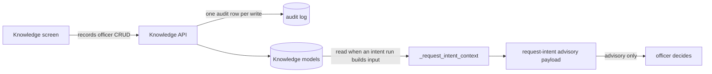

# District Knowledge Pack

The knowledge pack is what a Records Officer knows and the intent advisory cannot
work out from a request alone: who held a role and when, which senders are district
mass mail, and how each record system is actually searched. The request-intent
advisory reads it to scope a search the way the officer would. The pack is advisory
input only. It never routes a request, places a hold, starts a collection, or
reaches a requester ([compliance](compliance.md), [advisory AI](advisory-ai.md)).

The pack is maintained from the Configuration > Knowledge screen. It is a separate
store from the system registry, so editing it does not change how a request is
routed to a system ([collection and Vault](collection-and-vault.md#the-system-registry-and-triage)).

*The pack flows one way: officer edits, the intent advisory reads it, and an officer still decides every outcome.*

## Data model

All three models live in `apps/records/models.py` and were added by migration
`0051_knowledge_pack`.

| Model | Holds | Constraints and notes |
|---|---|---|
| `KnowledgeRoleAccount` | A role (free text, up to 200 characters), the district account that held it, an optional start and end date, and a note | `knowledge_role_account_range_ordered` refuses an end before a start. Either end may be open. |
| `KnowledgeNoiseSender` | A sender to exclude: kind `domain`, `address`, or `list`, a value, a note, and an `active` flag | Unique on `(kind, value)`. The value is normalized to lowercase. |
| `KnowledgeSystemNote` | The officer's search notes for one `RecordSystem` | One-to-one with the system, protected from deletion of the system. Kept apart from the registry, so re-seeding never touches it. |

A role account answers questions such as "who held this role during the dates the
request reaches", which is how the advisory identifies the mailbox to search. The
account address is a field the officer enters; it is not derived by the code.

## Staff API and audit

`apps/api/resources/knowledge.py` registers three viewsets under `/api/staff/knowledge/`
(`role-accounts/`, `noise-senders/`, `system-notes/`). `apps/api/urls.py` imports
the module and calls its `register()` like every other resource module.

- **Access.** `allowed_roles` is `RECORDS_OFFICER` only, and `allow_readonly_agent`
  is `False`. The pack names staff accounts, and editing it steers what the advisory
  proposes, so neither direction is open to a read-only identity. Every endpoint
  refuses other roles (`test_every_endpoint_refuses_anyone_but_a_records_officer`).
- **Writes.** `_AuditedKnowledgeViewSet` runs each create, update, and delete in one
  transaction with one `AuditLog` row. The action is `knowledge.role_account_created`,
  `knowledge.noise_sender_updated`, and so on, with `before` and `after` snapshots
  from `_role_account_snapshot`, `_noise_sender_snapshot`, and `_system_note_snapshot`.
- **Concurrency.** `_unique_race_as_validation` turns a database unique-constraint loss
  into the same validation error that a duplicate check would give. The rollback
  leaves no audit row.
- **Validation.** Noise-sender values are checked against their kind. A domain must be
  an exact DNS name, an address must be an email, and a list accepts its posting
  address or a domain-shaped list ID. Duplicates are checked on the normalized value.
  A system note cannot move to another system after it is created.

These writes are catalogued as `knowledge.*` rows in the capability catalog
([agent parity](../architecture/agent-parity.md)), all limited to the
`/configuration/knowledge` screen.

## How the advisory reads the pack

`_build_advisory_input` in [`apps/records/advisory_ai.py`](../../apps/records/advisory_ai.py)
builds the request-intent payload. For that kind it calls `_request_intent_context`
with the character budget left after the request description.

- **Systems first.** Every active record system contributes its `slug`, `name`, and
  `triage_keywords`. Those are the only vocabulary `record_system_slugs` may use.
- **Detail next, system by system.** Custodian title and contact, retention, the
  search checklist, and the officer's search notes are added until the next entry
  would not fit. Each text is bounded.
- **Role accounts and noise senders last.** All role accounts are candidates. Only
  active noise senders are. Each is added only if it fits.
- **Truncation.** A cut sets `truncated`, and the run records it. The fingerprint is
  taken from the full payload, so an edit to the pack gives a different input
  fingerprint and a queued run does not reuse a stale result.

Two data flows follow from this design. The custodian contact and role-account
addresses are part of what is sent to the provider when advisory AI is on. The
instruction tells the model to use the pack as the officer's own knowledge, and it
still does not authorize any action ([advisory AI boundary](advisory-ai.md#boundary)).

## Staff screen

`frontend/src/pages/Knowledge.tsx` is the Records Officer screen at
`/configuration/knowledge`. [Staff frontend](../architecture/staff-frontend.md) lists it
in `CONFIGURATION_NAV` with the `records_officer` role only. The screen calls the three
`/api/staff/knowledge/` endpoints. `Knowledge.test.tsx` checks the request paths and
methods. The server still enforces the role; the client check is only a convenience.

## Change guidance

- **Where to start.** For a new field on an entry, change the model and migration,
  then the matching serializer and snapshot function, then the screen. The snapshot
  must include the new field, or its audit row will not show the change.
- **Keep the advisory-only rule.** A new use of the pack must not reach a status,
  hold, collection, or correspondence. Add a test that the output cannot apply.
- **Keep the input budget.** A new field in the payload counts against the budget
  in `_request_intent_context`. Test the truncation path
  (`test_the_context_stays_under_the_input_ceiling_and_reports_truncation`).
- **Do not expose the pack to the agent identity.** Keep `allow_readonly_agent = False`.
- **Non-goals.** The pack is not a second system registry, and it does not replace
  the custodian data on `RecordSystem`.
- **Escalate** to the advisory boundary rules in [advisory AI](advisory-ai.md) if a
  change would let model output write the pack.

Focused checks: `apps/api/tests/test_knowledge_pack.py` for access, audit, validation,
and races, and `apps/records/tests/test_advisory_knowledge.py` for the input shape,
fingerprint, truncation, and instruction. Run both with the validation command in the
front matter.
