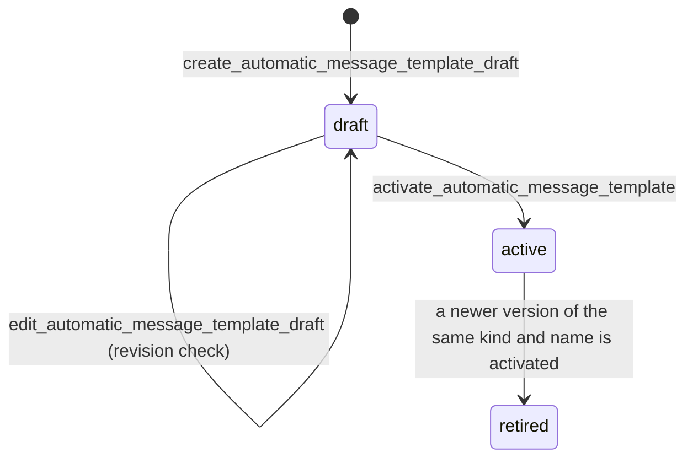

# Message Templates

Message templates are the governed source text for requester-facing
correspondence. The district owns the wording it sends, and counsel reviews it. This
page covers how that wording is authored, activated, and checked. Delivery,
approval, and the send path are in [requester correspondence](correspondence.md).

## Two families

`apps/correspondence/automatic_templates.py` defines one `TemplateSpec` per editable
kind, and every kind falls into one of two families:

- **Structured kinds** (`MANAGED_TEMPLATE_KINDS`) have a source-controlled built-in version.
  The built-in is the fallback. An activated managed version replaces it for future
  drafts of that kind. The renderer is token-only, so structural parts such as search-step
  lists and conditional paragraphs arrive as pre-rendered tokens, not template logic.
- **Free-form kinds** (`FREE_FORM_TEMPLATE_KINDS`) stay human-authored. Their template is a
  drafting starting point through `render_prefill`. It never becomes the legal snapshot.

The module docstring states the rule that governs both: editability never relaxes a legal
guarantee. `required_tokens` keeps mandatory content (request number, revised date, download
link, search evidence) from being edited away, and `required_phrases` keeps mandatory
statutory language present.

## Versioned storage and lifecycle

`AutomaticMessageTemplate` (`apps/correspondence/models.py`) stores each version with a kind,
an optional name, a `template_version`, and a `state` of `draft`, `active`, or `retired`.
Only `NAMED_TEMPLATE_KINDS` (currently `general`) may hold several named starting points. Every
other kind is a single slot.

Creating a draft assigns `template_version` as one more than the current maximum for that kind
and name. Editing is allowed only while the row is a draft. `activate_automatic_message_template`
requires an explicit confirmation, a current `expected_version` (the `revision` check), and a
reason. It retires the previous active row for the same kind and name in the same transaction,
then sets `activated_by` and `activated_at`. It writes the `automatic_template.activated` audit
event with the replaced template's id. A database uniqueness index (`one_active_per_kind`)
backs the rule, so two first-time activations cannot both win.

The fields listed in `AutomaticMessageTemplate.IMMUTABLE_AFTER_ACTIVATION` (kind, name,
version, subject and body, change reason, creator, and guardrail overrides) cannot change after
activation. The overrides are part of the record of why this wording was allowed, so they are
frozen with it. Old managed drafts keep their snapshot; new drafts use the active version.

## Token rules and syntax

`TemplateSpec` declares the allowed tokens (written `{{ name }}` in source), the required tokens,
the required values (tokens that must render non-empty), and the required phrases. Conditional
paragraphs are required in source but may legitimately render empty. `validate_template_syntax`
rejects unknown tokens and Django template syntax, since the renderer substitutes only plain
`{{ token }}` placeholders. `render_source` and `render_active` produce the text used for a draft.
A template can change wording but cannot change request state. Status changes stay in
[requests](requests.md).

## Guardrails warn, they do not silently refuse

`apps/correspondence/guardrails.py` turns a rule that a template trips into a
`GuardrailWarning` with a code, a message, and a stated consequence for the requester. The design
choice is in the module docstring: an error that names a token is a puzzle, while a consequence
("requesters will not receive a download link") is actionable.

- A template that trips a guardrail is refused with `GuardrailOverrideRequired` until an
  authorized actor confirms with a reason. The API returns this as HTTP 409 with `code`
  `guardrail_override_required` and `may_override` true. The frontend `MessageTemplates.tsx` shows
  the prompt.
- Only `OVERRIDE_ROLES` (Records Officer and Application Admin) may override. Other roles get
  `GuardrailNotOverridable`, code `guardrail_not_overridable`, and `may_override` false.
- The reason must be at least `MINIMUM_OVERRIDE_REASON` (15) characters. The acknowledged codes
  are stored on the version (`guardrail_overrides`) and the reason on the row.
- A template that cannot render at all is not a guardrail. An unknown token or unbalanced syntax
  fails outright, and no reason makes it send.

## Drift check after a rule change

Activated rows are district data, validated once against the rules in force when they were
published. A later code change to a `TemplateSpec` (for example, adding a required token) can
invalidate a stored template without any change to its row. The
`check_message_templates` command (`apps/correspondence/management/commands/check_message_templates.py`)
reports activated templates that the current specs would now reject. A past rule change made every
acknowledgment draft fail until the change was noticed, which is why the command exists. Run it
after any edit to a `TemplateSpec`. The behavior is pinned by
`test_the_check_command_surfaces_the_drift_for_review` in
`apps/correspondence/tests/test_acknowledgment_wording.py`.

## Staff API and UI

`AutomaticMessageTemplateViewSet` (`apps/api/resources/automatic_message_templates.py`) mounts at
`/api/staff/automatic-message-templates/`. Workflow staff roles may list, retrieve, and preview.
Only the Records Officer may create, update, or activate. Preview renders a PII-free sample
context. The capabilities in `apps/api/capabilities.py` (`automatic_message_templates.list`,
`.create`, `.update`, `.preview`, `.activate`) mark create, update, and activate as
`human_confirmation` actions, so an agent cannot publish wording on its own (see
[agent parity](../architecture/agent-parity.md)).

The staff screen is `frontend/src/pages/MessageTemplates.tsx`, served at
`/configuration/message-templates`. Request detail links to it.

## Change navigation

- Start at `apps/correspondence/automatic_templates.py` for a token, phrase, or kind rule
  (`TEMPLATE_SPECS`, `template_spec`, `validate_template_syntax`, `template_guardrail_warnings`).
- Start at `apps/correspondence/services.py` for lifecycle behavior
  (`create_automatic_message_template_draft`, `edit_automatic_message_template_draft`,
  `activate_automatic_message_template`).
- Start at `apps/correspondence/guardrails.py` for override policy. Do not add a bypass to
  `resolve`.
- Focused tests: `test_active_version_renders_new_acknowledgments_and_old_drafts_stay_stable`,
  `test_activated_template_content_cannot_be_edited`, and `test_several_named_general_templates_stay_active_together`
  in `apps/correspondence/tests/test_automatic_message_templates.py`; `test_removing_a_required_token_warns_with_its_consequence`
  and `test_unknown_token_is_rejected_per_kind` in `apps/correspondence/tests/test_editable_templates.py`;
  API behavior in `apps/api/tests/test_automatic_message_templates.py`.
- Minimal validation: the `PYTHON_DOTENV_DISABLED=1 python manage.py test ... --settings=config.test_settings`
  command in this page's front matter. Add `apps.correspondence.tests.test_acknowledgment_wording` when
  a `TemplateSpec` changes.
- Out of scope for routine template edits: `templates/correspondence/<identifier>/v<n>.txt` files are
  the built-in defaults and the template registry. Changing them does not change an activated district
  version, which is stored in the database. The registry is listed in [requester correspondence](correspondence.md#template-registry).
