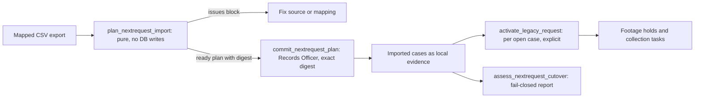

# NextRequest Migration and Legacy Import

Before the active system, requests were handled in NextRequest. This page explains the
one-time path that moves those cases into the PSD401 PRR system. It is a legal-evidence
migration, so every step fails closed and every committed row is attributable to a named
Records Officer.

The migration is a sequence of separate gates. Each gate is a different command or
service call, and none of them implies the next one.

Caption: planning, committing, and live activation are three separate authorities.
Cutover assessment reads the committed batch and reports blockers without changing it.

## Planning

`plan_nextrequest_import(source, mapping)` in
[`apps/records/nextrequest_migration.py`](../../apps/records/nextrequest_migration.py) is
pure. It:

- requires strict UTF-8 CSV, bounded in bytes, rows, and field size, with no NUL bytes;
- checks that every mapped header exists and that headers are unique;
- normalizes each row, including timestamps read in the source time zone;
- rejects duplicate source IDs within the export;
- returns a `NextRequestPlan` with `source_sha256`, `mapping_sha256`, and a `plan_sha256`
  computed over the rows and issues.

A plan with issues is not ready. The management command `nextrequest_import` is a dry run
by default. Committing requires `--commit` together with `--expected-plan-sha256` for the
reviewed digest, and it takes the operator through `--operator`.

## Committing

`commit_nextrequest_plan` runs only when the supplied digest equals the plan digest,
using a constant-time comparison. It also refuses a plan that has blocked rows, and it
refuses source IDs already imported by another plan. A committed batch is recorded in
`LegacyImportBatch`. Each imported case is a `PublicRecordsRequest` with a `Requester`, a
`LegacyRequestImport` link back to its source ID, and the statutory due date computed by
[`deadlines`](compliance.md). Repeating the same plan returns the existing batch and
creates nothing new.

Commit creates local rows only. It does not queue correspondence, notify a custodian, or
start an external hold. Historical timeline notes and response annotations are separate,
explicit steps described below.

## Activation

Imported open cases stay dormant until `activate_legacy_request` runs for one import. It:

- requires a current Records Officer;
- refuses closed cases;
- runs the same footage triage and system routing used for new intake
  ([footage](footage.md), [collection and Vault](collection-and-vault.md));
- records one `LegacyRequestActivation` and an audit entry, and returns the existing
  activation on a repeat.

The `activate_nextrequest_import` command is the operator path for this step.

## Cutover assessment

`assess_nextrequest_cutover(plan)` is a read-only, fail-closed report. It blocks when:

- the plan is not ready, or the exact plan has not been committed;
- the committed row count or source IDs differ from the reviewed plan;
- an open imported case has no activation.

It warns, and does not block, when a case retains a source estimate that must be checked
against requester correspondence, or when a case left attachments in the source system.
The `check_nextrequest_cutover` command prints this report for a source and mapping pair.

## Companion imports

- **Attachments.** `nextrequest_files.py` plans and commits a staged manifest of files
  (`nextrequest_import_files`, dry-run unless `--commit`). It expands archives within depth
  limits, rejects path-traversal members, and hashes and scans each file before it is
  stored as a record or an intake attachment (`_sha256_file`, `_scan_or_fail`).
- **Timeline notes.** `legacy_timeline.py` (`import_legacy_timeline`) plans dated history
  notes for each case. It is dry-run unless `--commit`, and the import does not change a
  request's status. When a later message contradicts a response-gap note, a correction note
  is added, and the original note stays in place.
- **Response gaps.** `annotate_legacy_response_gap` adds an explicit statement for a
  migrated case with no recorded first response. The note never asserts that nobody
  replied, and running it twice does not duplicate the note.
- **Initial-response attestation.** The `attest_external_initial_responses` command lets a
  Records Officer record a first-response date that the source system shows but the
  migration cannot reconstruct. Its statement is append-only, and it starts the
  response-target clock ([requests](requests.md)).
- **Vault search scope.** `record_vault_scope` writes the Google Vault searches that
  produced the source system's exports onto each migrated case timeline. Those searches
  survive only as export-bundle names, so the note records the named searches and the
  custodian mailboxes they covered. It says the scope is partial. Search terms and date
  bounds are not recoverable and are not invented. The command is dry-run unless `--commit`.
- **Document reconciliation.** `record_document_reconciliation` writes a per-case count of
  what the source system held against what migrated. It separates loose uploads from
  export containers that were deliberately left out, so a district can state the number
  of files it chose not to move. It is dry-run unless `--commit`.
- **Inbox cleanup.** `retire_closed_case_inbox_rows` is a one-time repair. It retires the
  requester-email Inbox rows (`INBOUND_REPLY` and `EMAIL_INTAKE` work items) still waiting
  on cases that closed before closure started retiring them. It applies the disposition
  `handle_case_inbox_items` would have applied, attributed to the `--actor` Records
  Officer. It is dry-run unless `--commit`. See [work queue](work-queue.md).
- **Status audit.** `audit_migrated_case_status` only reads. It lists migrated cases in a
  terminal status, and terminal cases with no first response on record, for a person to
  review. It changes no status and writes no `StatusEvent`. Corrections go through
  `services.transition()` as reasoned, per-case decisions ([requests](requests.md)).

## Invariants and change guidance

- Keep planning pure. Any new check belongs in `_normalize_row` or `plan_nextrequest_import`
  so it appears in the digest and blocks the commit.
- Do not add a side effect to `commit_nextrequest_plan` that contacts a requester or an
  external system. Activation is the only path to live triage.
- A new import field must be part of the normalized row and the plan digest, or a reviewed
  digest can cover data the officer never saw.
- Migrated cases are subject to the same status and audit rules as new cases. See
  [requests](requests.md) for transitions and [compliance](compliance.md) for the statutory
  boundary.

Focused tests: `apps/records/tests/test_nextrequest_migration.py` (planning, digest,
commit, activation, cutover), `apps/records/tests/test_nextrequest_files.py` (attachments),
`apps/records/tests/test_legacy_timeline.py` (timeline notes), and
`apps/records/tests/test_legacy_response_gap.py` and `test_migrated_case_status_audit.py`
(response annotations and status audit), `test_vault_scope_recovery.py` (recovered Vault
scope), `test_document_reconciliation.py` (document counts), and
`test_retire_closed_case_inbox_rows.py` (Inbox repair).

Minimal validation: `PYTHON_DOTENV_DISABLED=1 python manage.py test apps.records.tests.test_nextrequest_migration apps.records.tests.test_nextrequest_files --settings=config.test_settings`.

## Related concepts

- [Requests](requests.md): the status model that imported cases enter.
- [Compliance](compliance.md): the deadline math used to compute a statutory due date at import.
- [Record review and handling](record-review-and-handling.md): what happens to attachments after they are quarantined.
- [Background jobs](../architecture/background-jobs.md): the watchdogs that act on imported open cases after activation.
- [Operator management commands](../operations/operator-commands.md): the dry-run, commit, and activation commands that drive each step on this page.
