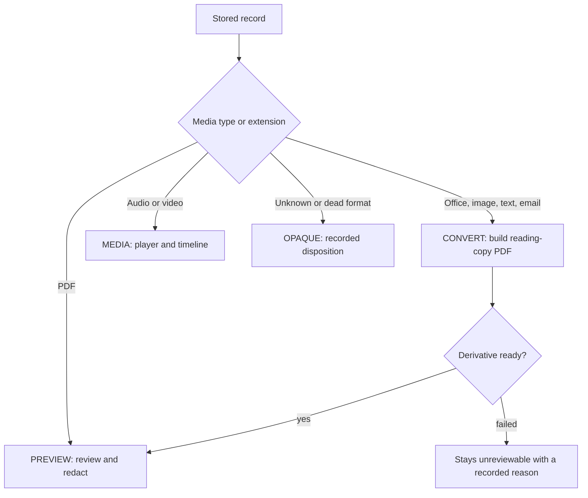
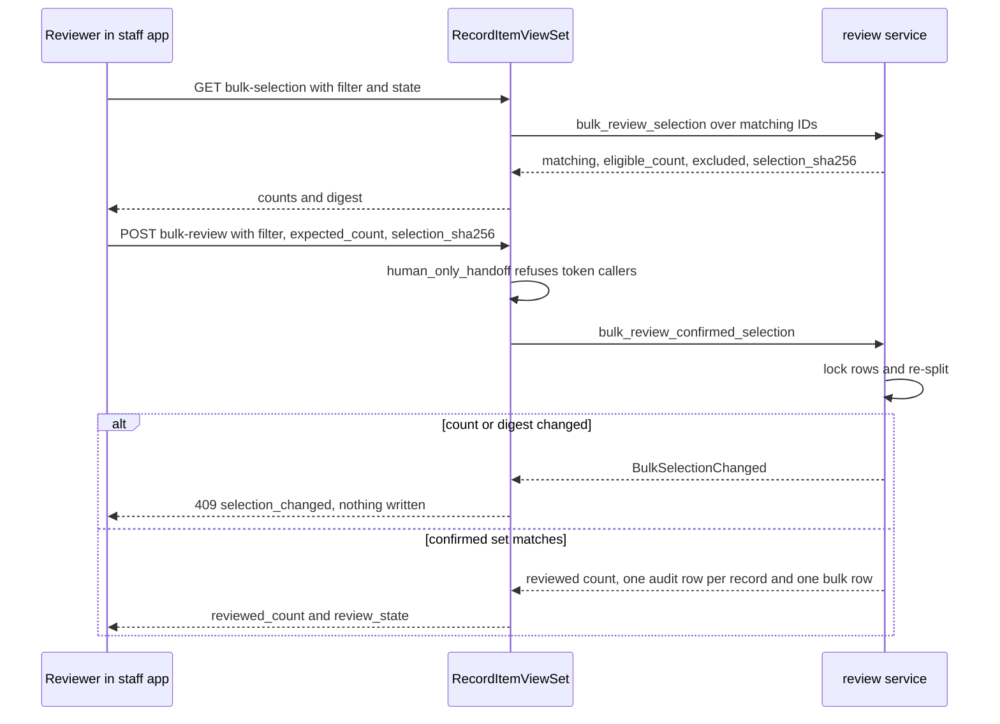

# Record Review, Handling, and Derivatives

A public records collection is not a pile of PDFs. A single request can contain Office
documents, email, phone photos, spreadsheets, camera footage, call recordings, and dead
formats. The review workspace must say what is possible for each record instead of
failing on a click. This page covers the path from a stored record to the reviewer, the
redactions a reviewer applies, and the copy the requester eventually receives.

Requester-facing release of reviewed records is covered in
[installments and release](installments-and-release.md). Advisory proposals that suggest
responsiveness or redactions are covered in [advisory AI](advisory-ai.md); they never
change review state. Email and tag facts that help a reviewer sort the queue are in
[record facts and tags](record-facts-and-tags.md).

## Handling paths

`apps/records/handling.py` is the single place that says which review path a record is on.
It reports what is possible, never what is convenient. The per-format rationale and the
reviewer-facing wording for each path are in
[`docs/record-formats.md`](../../docs/record-formats.md).

| Path | Constant | Meaning |
|---|---|---|
| Ready to review | `PREVIEW` | PDFs. Opens in the reviewer and supports redaction. |
| Needs conversion | `CONVERT` | Office, images, text, and email. A paginated rendition must exist first. |
| Audio or video | `MEDIA` | Time-based. Needs a player and timeline, not page rasters. |
| No renderer available | `OPAQUE` | No renderer can open it. A human decides from other evidence. |

`handling_for(content_type, filename)` classifies by media type. The media type wins over
a misleading extension, and the extension decides only when the media type says nothing.
Unknown types are `OPAQUE`, never assumed reviewable. `handling_for_item(item)` applies the
same rule to a `RecordItem`. Handling is derived, not stored. The staff API filters on it
with `?handling=` in the record-item list and facets actions (see
[`apps/api/resources/records_misc.py`](../../apps/api/resources/records_misc.py)).



Caption: the four handling paths and how a converted record joins the PDF review path.

## Derivatives (reading copies)

`apps/records/derivatives.py` builds a PDF reading copy for `CONVERT` records.
`build_derivative(record_item_id, ...)` runs the renderer for the record's type: image,
text, message, or Office conversion. `needs_derivative(item)` decides whether a rendition
is required. Three rules hold:

- **The original is never replaced.** It keeps its own key, digest, and length. It is the
  file produced when a record is released unredacted.
- **Failure is recorded, not swallowed.** A failed conversion stays visibly unreviewable.
  A `DerivativeFailure` carries a `permanent` flag, so an empty render is not mistaken for
  "nothing to withhold".
- **Conversion is bounded** by a size ceiling and a wall-clock limit, because the input is
  untrusted.

Video is reported as unsupported rather than rendered, and dead formats get a stated
reason. Outlook `.msg` files get guidance instead of a fake render. The Celery tasks
`build_record_derivative` and `build_pending_record_derivatives` in
[`apps/records/tasks.py`](../../apps/records/tasks.py) drive the queue. `preview.py`
(`is_previewable`, `has_ready_derivative`, `preview_pdf_metadata`) gives the reviewer a
verified PDF for the converted or original copy.

## Human review and second review

`apps/records/review.py` owns the reviewer's decisions:

- `review_record` and `bulk_review_records` set a `RecordItem` review state. `_require_reviewer`
  gates the actor. `bulk_review_records` takes an explicit list of record IDs, capped at
  `BULK_REVIEW_MAX_ITEMS` (200). It refuses records in the `superseded` state, which a
  Records Officer sets when an over-broad collection is re-scoped. Those records are decided
  one at a time through `review_record`. See
  [collection and Vault](collection-and-vault.md#superseding-an-over-broad-collection).
  Filter-driven decisions over larger sets use the preview-then-confirm flow below.
- `create_redaction` and `void_redaction` add or void a `Redaction`. Every redaction requires
  an `ExemptionCitation`; a voided redaction keeps its row.
- `approve_second_review` records the second decision. `RecordItem.second_review_required`
  (in `apps/records/models.py`) is true when a withheld item cites an exemption that
  requires second review, or when any active redaction cites one.
- `render_redacted_record` burns the redactions into a new copy of the PDF. The burned-in
  copy is what the requester receives. Releasing the original `.docx` would ship tracked
  changes and metadata that no box covers, so the reading copy is the thing redacted.

Invariants that tests enforce:

- A redacted record never falls back to original bytes at packaging time.
- Second review is required before burn-in when the exemption demands it, and the second
  reviewer must be a distinct person. See `test_ferpa_redaction_requires_distinct_second_review_before_burn_in`
  in `apps/records/tests/test_record_review.py`.
- Review and redaction evidence is read-only in the admin
  (`test_review_and_production_evidence_is_read_only_in_admin` in `test_feature_audit_regressions.py`).

## Bulk decisions over a filter

A reviewer can record one responsiveness outcome (`responsive` or `non_responsive`) for every
record a filter matches, not only for an explicit ID list. Filter mode is a two-step
preview-then-confirm flow, because the decision is written to every matching record at once.
The staff record-items screen (`frontend/src/pages/RecordItems.tsx`) fetches the preview and sends the confirmation.

- `GET /api/staff/record-items/bulk-selection/` (`RecordItemViewSet.bulk_selection`) runs
  `bulk_review_selection`. It returns the matching count, the `eligible_count` a decision
  would change, the `excluded` breakdown, and a `selection_sha256` digest of the eligible IDs.
  Its `max_items` field reports `BULK_REVIEW_FILTER_MAX_ITEMS` (10,000).
- `POST /api/staff/record-items/bulk-review/` with a `filter`, `state`, `expected_count`, and
  `selection_sha256` runs `bulk_review_confirmed_selection`. It locks the matched rows with
  `select_for_update`, re-splits them, and refuses the write with HTTP 409 and code
  `selection_changed` unless the count and digest still match what the reviewer saw.
- A request body sends either `record_item_ids` or `filter`, never both. A filter must name
  exactly one request (`request`), and only the keys in `BULK_FILTER_KEYS` are accepted.

Skipped records are counted, never overturned. A decision never changes a record that is
`withheld`, `duplicate`, or `superseded`, and a record already in the requested state is
counted as `already`. A non-responsive decision also skips a record with an active redaction
(`redacted`), because that redaction must be voided on purpose. Each changed record gets its
own `record.reviewed` audit row, and one `record.bulk_reviewed` row records the filter. Search
text is stored only as `search_sha256`.

The capability catalog marks `record_items.bulk_review` as `human_confirmation`, so a
token caller gets a human handoff rather than a write. The check runs before any selection
is computed (see [agent parity](../architecture/agent-parity.md)). The audit row is described
in [compliance](compliance.md).



Caption: the preview-then-confirm flow for a filter decision; the write happens only when the
confirmed count and digest still match.

Focused tests in `apps/api/tests/test_bulk_review_by_filter.py`, including
`test_every_matching_record_is_decided_beyond_the_explicit_cap`,
`test_a_changed_set_is_refused_and_nothing_is_written`,
`test_records_needing_their_own_judgement_are_skipped_and_counted`,
`test_a_token_caller_is_handed_off_for_a_filter_decision`, and
`test_too_many_matching_records_are_refused_before_any_lock`.

## Record clusters

The Records tab's **Group by cluster** view helps a reviewer look at related records
together. Grouping is a way to read the queue, not a decision. The cluster's **Approve cluster as ...**
action opens a sampled batch, which applies an outcome only after the reviewer judges a random
sample. See [trust ladder](trust-ladder.md). `cluster_records(records,
grouping)` in [`apps/records/clusters.py`](../../apps/records/clusters.py) takes the
filtered set and one of four groupings:

- `thread`: messages linked by `In-Reply-To` to `Message-ID` within the set. Records with
  neither header share one "Not email" cluster.
- `sender`: the mailing list (`List-Id`) when present, otherwise the sending domain.
- `tag`: one cluster per review tag. A record with two tags appears in both. Tags come from
  [record facts and tags](record-facts-and-tags.md).
- `ai_label`: the latest suggested state and its confidence band, read from the standing
  responsiveness suggestion described in [advisory AI](advisory-ai.md#ai-human-agreement).

The staff endpoint is `GET /api/staff/record-items/clusters/` (`RecordItemViewSet.clusters`
in [`apps/api/resources/records_misc.py`](../../apps/api/resources/records_misc.py)). It reads
every record the current filters match, not only the page on screen, because a cluster's
size and majority label are only true over the full set. The response reports `cluster_count`
and returns at most the largest clusters. Each cluster carries its size, up to three samples,
the majority AI suggestion, and the record IDs. An unknown `group_by` is a 400 response.
`frontend/src/case/RecordClusters.tsx` renders the view and says when the list was cut short.

Invariants:

- Clustering reads stored facts only and never changes review state, tags, or a suggestion.
- The thread grouping uses a union-find over the in-set `In-Reply-To` links, so a reply chain
  is one cluster regardless of the order records load in.
- A mailing list outranks the sender domain as the sender key.

Focused tests are in `apps/records/tests/test_review_agreement.py`:
`test_a_reply_chain_is_one_thread`, `test_a_mailing_list_outranks_the_sender_domain`,
`test_tags_and_ai_label_clusters_report_the_majority_label`,
`test_samples_are_capped_and_unknown_groupings_refused`, `test_a_reviewer_groups_a_case_by_cluster`,
and `test_an_unknown_grouping_is_a_400`.

## Opaque record dispositions

For a record that `handling_for_item` reports as `OPAQUE`, `apps/records/opaque_review.py`
offers one decision path: `record_opaque_disposition`. It exists because the two obvious
alternatives are both bad. Leaving the record unreviewed forever is one failure. Marking it
reviewed with no trace is worse, because the file then looks reviewed while nobody saw it.

The decision is allowed but expensive:

- It refuses a record that *can* be displayed. If a renderer exists, the reviewer must look
  at the contents, not describe them.
- It needs a named, authenticated actor and one `OpaqueRecordDisposition.Basis` value.
- The reasoning must be at least `MIN_OPAQUE_REASONING` characters (80). It is the whole
  evidentiary basis for deciding a record nobody could open.
- The outcome is `RESPONSIVE`, `NON_RESPONSIVE`, or `WITHHELD`. Withholding requires an
  exemption citation, as it does for a readable record.
- One disposition per record. The row is append-only (`OpaqueRecordDisposition` uses
  `AppendOnlyModelMixin`).

The staff API exposes this as the `opaque-disposition` action on record items (see
`records_misc.py`). `test_media_and_opaque_review.py` covers the refusals and the
disposition rules.

## Audio and video review

Time-based media cannot be reduced to pages, so `apps/records/media_review.py` has its own
path. The rules mirror paper review:

- Every redaction cites an exemption, and the released copy is a new derived object.
- Redaction is applied by re-encoding. Obscuring a region or muting audio is applied only to
  intervals a human marked. `create_media_redaction` validates the interval, region, and
  citation. `void_media_redaction` voids a mark with a reason.
- **Face detection is deliberately absent.** An automated blur that misses one frame would
  disclose a person, and no reviewer can verify a negative across thousands of frames.
- `render_media_redactions` refuses a record that is not media, refuses before a responsive
  verdict, refuses when nothing is marked, and refuses a redaction past the end of the media.
- `probe_media` uses external media tools. A missing tool raises `MediaToolUnavailable`, so
  nothing can be claimed about a file that was never inspected.

The API exposes `render-media-redactions` as an action, and a `media-redactions` viewset
with basename `media-redaction`.

## Change guidance

- Start in `handling.py` when a new media type or extension is added. Its tests
  (`test_handling.py`) pin the rules: the media type wins, unknown is opaque, and every path
  has a label and an actionable detail.
- Do not make a derivative replace the original, and do not let a failed render look empty.
  Keep `test_derivatives.py` passing for both.
- Keep second review and citation requirements on the reviewer side. Do not move them into
  an advisory path.
- An opaque disposition should not become a convenience for "cannot open". Keep the reasoning
  floor and the refusal for renderable records.
- Scope: a change to redaction rendering may touch installment packaging. Run
  `test_installment_production.py` as well (see [installments and release](installments-and-release.md)).

## Focused validation

```bash
PYTHON_DOTENV_DISABLED=1 python manage.py test apps.records.tests.test_handling apps.records.tests.test_derivatives apps.records.tests.test_record_review apps.records.tests.test_media_and_opaque_review --settings=config.test_settings
```

The Django runner prints complete failure output, so no output filter is needed.
