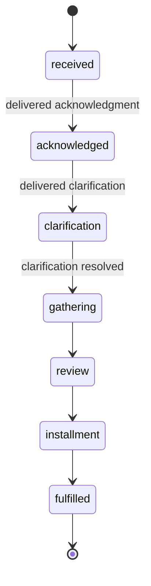
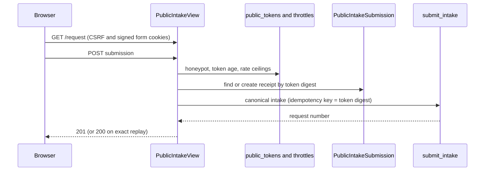

# Request Lifecycle

A request (`PublicRecordsRequest`) is the central case record. Every status
change goes through `apps/records/services.transition()`, which writes the
append-only `StatusEvent`, applies clarification tolling, recomputes the
deadline, and writes the audit row. The matter kind that governs a case is
described in [matter-kinds.md](matter-kinds.md).

## Numbering

Format: `<prefix>-YYYY-NNNN`. The prefix comes from the matter kind:
`PRR` for `public_records`, `LIT` for `litigation_discovery`, and `FER` for
`ferpa_parent`. Each prefix has an independent per-year sequence, so a number
never looks like a public records request outside the system. See
`PublicRecordsRequest._next_number()` in `apps/records/models.py`.

## Status values

`RequestStatus` in `apps/records/models.py` defines the values below.

| Status | Meaning | Gate |
|---|---|---|
| `received` | Request recorded, no first response yet | Running clock |
| `acknowledged` | First response delivered | Correspondence-driven: needs a confirmed delivery |
| `clarification` | Clarification requested; clock tolls | Correspondence-driven; exit needs evidence |
| `gathering` | Records being collected | |
| `review` | Review and redaction | |
| `installment` | Producing installments | |
| `fulfilled` | Complete response delivered | Closed |
| `denied` | Fully exempt denial | Closed; correspondence-driven |
| `closed_withdrawn`, `closed_abandoned` | Closed without fulfillment | Closed |
| `closed_non_request` | Not a records request (email intake only) | Closed; dedicated closure verifies retained intake evidence |
| `closed_no_records` | No responsive records | Closed; correspondence-driven |
| `closed_duplicate` | Merged into another case | Closed; reached only through `services.merge_requests()` |

`CLOSED_STATUSES` in `apps/records/services.py` is the closed set. A reopened
request may land only in `received`, `gathering`, `review`, or `installment`
(`REOPENABLE_TARGET_STATUSES`), never in a status that asserts a delivery that
did not happen.



Caption: the typical forward path. The code enforces additional gates in
`transition()`; this diagram does not list every allowed edge.

## The transition gate

**Never write `status` directly.** `transition()` runs under
`select_for_update()` and:

1. Refuses a closed request and validates the destination status.
2. Requires confirmed correspondence delivery for correspondence-driven statuses
   and clarification-exit evidence when leaving `clarification`.
3. Writes `StatusEvent`, applies tolling, recomputes the deadline, and audits.

`transition_manually()` is the administrative path. It refuses
`closed_non_request` (use the dedicated email closure) and `closed_duplicate`
(use the merge workflow).

## Next response due

`apps/records/response_due.py` answers "what is this case answerable by next",
which is not always a statutory obligation. The statutory clock is spent once a
first response is delivered, so a case list must not keep showing it afterward.

| Matter kind | Situation | Basis |
|---|---|---|
| `public_records` | No first response yet | `statutory` (RCW 42.56.520, five business days) |
| `public_records` | Responded, estimate recorded | `estimate` |
| `public_records` | Responded, no estimate | `district_target` (60 calendar days, a working target and not law) |
| `ferpa_parent` | Always | `ferpa` (45 calendar days, 34 CFR 99.10(b)) |
| `litigation_discovery` | Always | None |
| Any kind | Closed or terminal | None |

`next_response_due()` and `annotate_next_response_due()` produce this value. Only the
human-set `estimated_completion` feeds the `estimate` basis. The `RecordsEstimate` rows
from the [estimate engine](estimates.md) are evidence and do not set it.
The day-5 safety net, the watchdogs, and JLARC still use the statutory fields,
not this one. The step-by-step state of the first response (drafted, approved,
queued, delivered) is a separate read model, described in
[five-day initial response plan](initial-response.md).

## Deadline engine

`apps/records/deadlines.py` implements **RCW 42.56.520**: respond within five
business days of receipt.

- The WA holiday calendar includes Juneteenth. District closures are configurable.
- After-hours receipts roll over to the next business day.
- Counting starts the day after receipt (RCW 1.12.040).
- Clarification requests toll the clock. `transition()` records tolling start and
  end, and the deadline extends by the tolled span.
- `ferpa_access_due()` is calendar-day arithmetic with no holiday or tolling
  logic. It is used only for `ferpa_parent` matters.
- Timezone is `America/Los_Angeles`. Deadline changes need tests with real
  calendar dates, such as `apps/records/tests/test_deadlines.py`.

## Data model

| Model | Role |
|---|---|
| `PublicRecordsRequest` | Central case record. Carries `matter_kind`, `description` (immutable after intake), `statutory_response_due`, and `ferpa_access_due` |
| `Requester` | Minimal PII: email required; name, phone, and address optional |
| `StatusEvent` | Append-only lifecycle timeline |
| `CollectionTask`, `VaultCountRun`, `VaultIngestRun` | Collection work and Vault provenance; see [collection-and-vault.md](collection-and-vault.md) |
| `RecordItem`, `Redaction`, `ExemptionCitation` | Review items and exemption-backed redactions |
| `FootagePreservation`, `CameraHold` | Camera footage holds; see [footage.md](footage.md) |
| `Installment`, `FeeAssessment`, `FeePayment` | Production and fee records |
| `InitialResponseAttestation` | Append-only record of a first response sent outside this system |
| `FerpaIdentityVerification` | Append-only FERPA identity record, one per case |
| `CaseNote` | Append-only internal staff note; see [case-workspace.md](case-workspace.md) |
| `IntakeAttachment` | Requester file in quarantine with ClamAV status |
| `EstimateRevision` | Estimate change audit |

Work-ownership state (who owns the next action) lives in `apps/work_queue`, not
on the request. See [work-queue.md](work-queue.md).

## Intake and triage

### Public intake

`POST /api/public/requests/` (`PublicIntakeView` in `apps/records/public_views.py`)
is the only anonymous write endpoint and exposes no read surface. It accepts JSON,
multipart, or form data. `PublicIntakeSerializer` in
[`apps/records/public_serializers.py`](../../apps/records/public_serializers.py) defines the
accepted fields: only an email address is required, name, phone, address, and company are
optional, the `website` honeypot and file attachments are write-only, and the description
is capped at 100,000 characters. Before a submission is accepted, the browser must hold the
CSRF cookie and a signed, HTTP-only form token issued by `GET /request`
(`apps/records/public_tokens.py`). The token's purpose is to show that the form was
loaded from the site and was not submitted too quickly. A missing, invalid, expired,
or too-fast token and a filled honeypot field all receive the same generic `400`
body, and only the server log records which check failed.

Two rate ceilings sit in front of intake, one per client address and one global,
implemented by `PublicIntakePerIpThrottle` and `PublicIntakeGlobalThrottle` in
`apps/records/throttles.py`. Their limits are runtime settings (see
[configuration](../architecture/configuration.md)).

Submissions are idempotent per form. The form token's digest is the key of a
`PublicIntakeSubmission` receipt, and the receipt stores a digest of the canonical
payload:

| Situation | Response |
|---|---|
| First accepted submission | `201` with the request number |
| Identical replay of a completed submission | `200` with the same number |
| Same form, different content | `409` |
| Original still processing | `409` with `Retry-After` |
| Original failed | `503`, with the number when a request was already linked |

Only public records requests may arrive through the public form or the intake
mailbox (`apps/records/intake.py`). Intake then runs through the canonical
`submit_intake` pipeline with `Channel.PORTAL`. When the intake-classification switch
is on, `submit_intake` also defers a suggested label for the new case until after the
write commits. The label is advisory and changes nothing about the case, except that a
`spam` or `non_request` label in its `auto` trust mode can close an email-created case
automatically; see [advisory AI](advisory-ai.md) and
[automatic intake closure](trust-ladder.md#automatic-intake-closure).



Caption: a public submission passes the abuse checks, then becomes one idempotent
canonical intake. The anonymous caller never receives a read capability.

Focused tests for this surface are in `apps/records/tests/test_public_intake.py`:
`test_request_page_issues_csrf_and_http_only_signed_form_cookies`,
`test_honeypot_fast_and_expired_rejections_are_indistinguishable_but_logged`,
`test_per_ip_throttle_enforces_its_configured_limit`, and
`test_replaying_the_same_form_creates_exactly_one_legal_request`. Run
`PYTHON_DOTENV_DISABLED=1 python manage.py test apps.records.tests.test_public_intake --settings=config.test_settings`.

A receipt stuck in processing after an intake crash is closed by an operator with
`manage.py recover_stale_intake <receipt_id>`. The command requires `--operator`, a
`--reason`, and `--confirm` (that the intake process is no longer running). An
unlinked receipt also needs `--confirm-unlinked`. It only marks the receipt failed; it
never creates or retries a legal request.

```json
{
  "name": "Jane Requester",
  "email": "jane@example.com",
  "description": "I request all emails about X from January 2026"
}
```

### Triage routing

`apps/records/triage.py` routes each request:

1. `route_to_systems()` matches the description against `RecordSystem.triage_keywords`.
2. One manual `CollectionTask` is created per matching system.
3. `urgent_hold` systems trigger an immediate preservation email.
4. Camera-footage requests trigger `triage_footage()`, which holds cameras under
   [footage.md](footage.md).

## Staff API

Routes are registered in `apps/api/resources/requests.py` (`RequestsViewSet`,
basename `staff-request`) and are scoped by case role.

| Endpoint | Purpose |
|---|---|
| `GET /api/staff/requests/` | List requests with filters and sorting |
| `GET /api/staff/requests/<number>/` | Detail and timeline |
| `GET /api/staff/requests/<number>/workspace-summary/` | Case workspace read model |
| `GET /api/staff/requests/<number>/closure-readiness/` | Closure checks |
| `POST /api/staff/requests/<number>/transition/` | Administrative status transition |
| `POST /api/staff/requests/<number>/merge/` | Merge a duplicate case |
| `POST /api/staff/requests/<number>/reopen/` | Reopen a closed case |
| `PATCH /api/staff/requests/<number>/` | Assign or clear the case owner (`assigned_officer`); see [accountability corrections](#accountability-corrections) |
| `POST /api/staff/requests/<number>/correct-requester/` | Correct the requester identity of a forwarded submission; see [accountability corrections](#accountability-corrections) |

Estimate revisions are drafted through
`POST /api/staff/correspondence/drafts/estimate-revision/`. Only a confirmed
delivery applies the estimate to the request. See
[correspondence.md](correspondence.md). Action-level behavior and the human
handoffs are in [agent-parity.md](../architecture/agent-parity.md).

## Immutability and merges

`request.description` is never edited after intake. It is the legal record of
what was asked. Clarifications are recorded as new `StatusEvent` rows.

Two numbers for one matter are resolved only by `services.merge_requests()`. A
proposed merge reaches it only when a person approves a `duplicate_of` [decision batch](decision-batches.md).
The duplicate closes as `closed_duplicate` with `merged_into` set, its matched
email is rematched to the case of record, and the target keeps its own
`received_at` and deadline. Cases governed by different law cannot merge.

## Accountability corrections

Two officer-only writes keep who-is-accountable correct without rewriting history.
Both are human decisions. In the capability registry, case-owner assignment is
`requests.assign_owner` (moderate risk) and identity correction is
`requests.correct_requester` (`human_confirmation`, high risk); see
[agent parity](../architecture/agent-parity.md).

### Case owner

The case owner (`assigned_officer`) is the Records Officer accountable for a case. It is
separate from legal status and from work-item assignment, which lives in
[work queue](work-queue.md).

`services.assign_request_owner()` in `apps/records/services.py` is the only write path,
reached through `PATCH /api/staff/requests/<number>/`. Under lock it:

- re-checks that the actor is a current, active Records Officer, and that a new owner is
  one too (or clears the owner);
- returns unchanged when the owner is already the target, so a retry is a no-op;
- writes `request.owner_changed` with the previous and new owner in the same transaction.

It creates no `StatusEvent`, moves no clock, and sends nothing.

The assignee picker reads `GET /api/staff/staff-users/`, served by `StaffUserChoiceViewSet` in
`apps/api/resources/staff_users.py`. It is restricted to Records Officers, lists only active
staff, takes an optional `role` filter, and returns only the user id, username, and display
name, so the picker never exposes contact details. Focused tests:
`apps/api/tests/test_workflow_choices.py` and `apps/api/tests/test_case_workspace.py`
(the `role=records_officer` case).

### Requester identity

A forwarded submission, such as a district intake mailbox relaying an email or a staff
member entering a phone call, can record the forwarder as the requester. Every statutory
notice then addresses the wrong person, and the five-day response is strict liability
(RCW 42.56.520). A plain email that reaches the intake mailbox as a forward is the
exception: its case opens under the original sender and sent date, as described in
[correspondence](correspondence.md#inbound). `services.correct_requester_identity()`
corrects the identity when intake records the wrong one:

- It requires a current Records Officer, a written reason of at least ten characters, a
  non-blank name, and a valid email. It refuses an identity identical to the current one.
- It never edits the submitted `Requester` row. It creates a new row, carries the contact
  record forward (phone, mailing address, city, state, postal code, company), and repoints
  the request. `request.description` stays as intake received it.
- It resets no statutory state. A delivered acknowledgment keeps its delivery date.
- It calls `refresh_drafts_for_requester_correction()` in
  [correspondence](correspondence.md) for unsent outbound messages addressed to the
  superseded requester. Sent messages are never touched. Versioned legal templates are
  re-rendered; hand-authored bodies are repointed but flagged for a human read; an
  approved-but-unsent message is cancelled; and a message a worker has already claimed is
  reported rather than recalled.
- It writes `request.requester_corrected` with the before and after identities, and each
  affected message gets its own correspondence audit entry.

The endpoint is `POST /api/staff/requests/<number>/correct-requester/`. A refused identity
or reason returns `invalid_requester_correction` (400), and a non-officer returns
`records_officer_required` (403).

### Invariants and tests

- Only a current Records Officer may change the owner or correct the requester. Agents
  may not. Tests: `apps/records/tests/test_case_owner.py` (for example
  `test_reassign_and_clear_append_exact_evidence_without_legal_side_effects`,
  `test_current_actor_and_target_authority_are_rechecked_under_lock`), and
  `test_patch_rejects_a_case_owner_without_current_officer_authority` in
  `apps/api/tests/test_requests.py`.
- Submitted intake rows and the legal description are immutable.
  `apps/records/tests/test_requester_correction.py` covers this with
  `test_the_submitted_requester_row_is_left_untouched` and
  `test_the_legal_description_is_untouched`.
- Sent correspondence is never rewritten. The same file covers the draft, cancel, and
  recall branches with `test_the_open_draft_is_addressed_to_the_corrected_email`,
  `test_an_approved_but_unsent_message_is_cancelled`, and
  `test_a_message_already_in_delivery_is_reported_not_recalled`. The HTTP contract is in
  `apps/api/tests/test_requester_correction_api.py`.

Minimal validation: `PYTHON_DOTENV_DISABLED=1 python manage.py test apps.records.tests.test_case_owner apps.records.tests.test_requester_correction apps.api.tests.test_requester_correction_api --settings=config.test_settings`.

## Related concepts

- [matter-kinds.md](matter-kinds.md): which law a case answers to
- [compliance.md](compliance.md): deadline engine details, exemption taxonomy, human-only guards
- [case-workspace.md](case-workspace.md): staff workspace surfaces built on these records
- [work-queue.md](work-queue.md): next-action ownership, separate from legal status
- [../architecture/overview.md](../architecture/overview.md): system architecture
