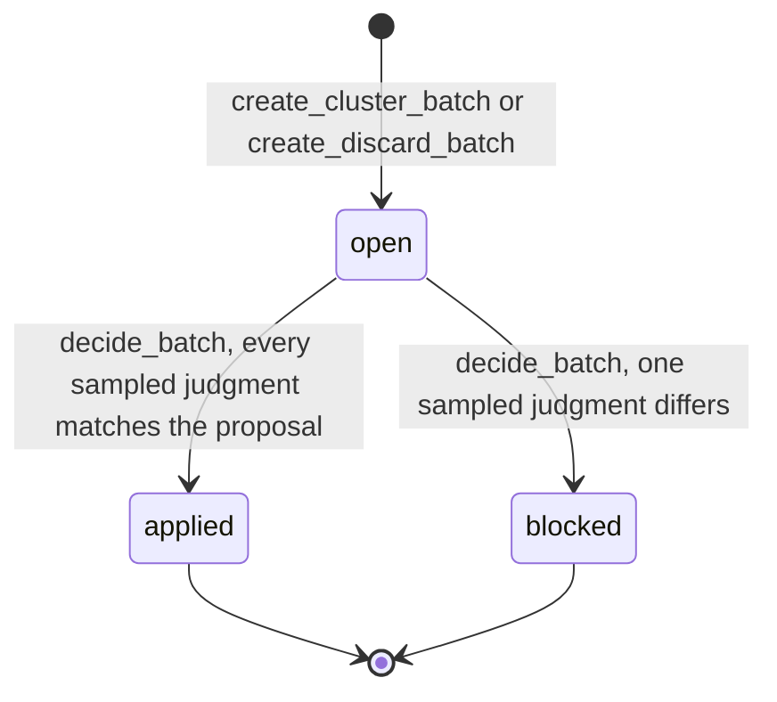
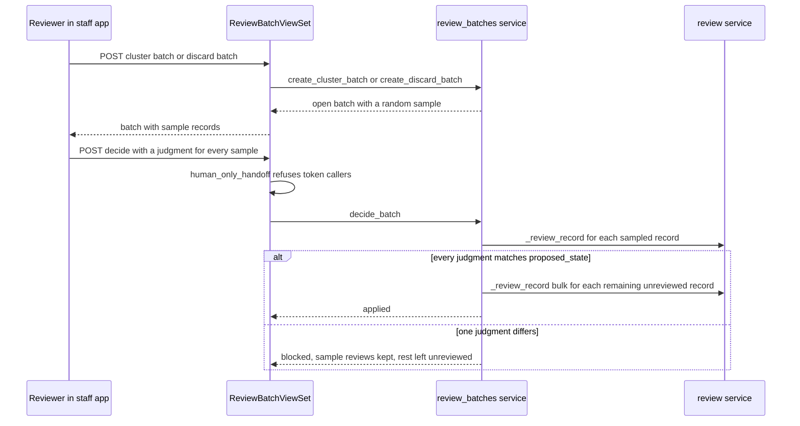

# Trust Ladder: Sampled Batch Review

The trust ladder lets a named reviewer decide many records in one action, but only after
judging a random sample of them. The Records Officer chooses the policy. A model suggestion
never applies on its own: the reviewer's judgment is what becomes the legal outcome.

## Policy settings

The policy lives in the in-app settings store ([configuration](../architecture/configuration.md)),
is admin-only, and requires a written reason on each change. The registry in
`apps/configuration/registry.py` declares the five settings:

| Setting | Values | Default |
|---|---|---|
| `PRR_TRUST_RESPONSIVE_MODE` | `suggest`, `batch` (no automatic mode) | `suggest` |
| `PRR_TRUST_NON_RESPONSIVE_MODE` | `suggest`, `batch`, `auto` | `suggest` |
| `PRR_TRUST_NON_RESPONSIVE_AUTO_MIN_CONFIDENCE` | 50-100 percent | 95 |
| `PRR_TRUST_BATCH_SAMPLE_SIZE` | 1-200 records | 10 |
| `PRR_TRUST_ELUSION_SAMPLE_SIZE` | 1-500 records | 30 |

`trust_mode(state)` in `apps/records/review_batches.py` reads the mode for one outcome, and
`policy()` returns the whole policy for the staff UI. Responsive has no automatic mode: a
stored `auto` is read as `batch`. The service reads these values when a batch opens. It does
not re-read them when a batch is decided (see [watch-outs](#watch-outs)).

## Two batch kinds

`ReviewBatch` in [`apps/records/models.py`](../../apps/records/models.py) has two kinds. Opening
either one decides nothing, and each writes a `review.batch_created` audit row.

- **Cluster approval** (`create_cluster_batch`). A reviewer proposes one outcome for the
  unreviewed records of one cluster. The service requires the mode for that outcome to be
  `batch` or `auto`, requires every record to belong to one request, and drops records that are
  not `unreviewed`. A cluster above `MAX_BATCH_RECORDS` (2000) is refused, and the reviewer must
  narrow it. The sample is drawn with `random.SystemRandom` when the batch opens.
- **Ready to discard** (`create_discard_batch`, `discard_candidates`). Only available when
  `PRR_TRUST_NON_RESPONSIVE_MODE` is `auto`. The pile is the unreviewed records whose standing
  AI suggestion is `non_responsive` at or above the confidence floor, read through
  `annotate_latest_suggestion` in [`apps/records/agreement.py`](../../apps/records/agreement.py).
  The proposed outcome is always `non_responsive`, and the sample is the elusion sample.

## Deciding a batch

`decide_batch(batch_id, actor=..., judgments=...)` runs in one transaction and locks the batch
row:

1. `_require_reviewer(actor)` passes, and the batch is still `open`.
2. The judgment keys must equal the sample set exactly, and each judgment is `responsive` or
   `non_responsive`.
3. Each sampled record that is still unreviewed is reviewed with its own judgment through
   `_review_record` in [`apps/records/review.py`](../../apps/records/review.py). Every judgment is
   an ordinary single review with its own audit row.
4. Only if every judgment equals `proposed_state` does the rest of the batch apply. Each
   remaining unreviewed record gets `_review_record(..., bulk=True)` in the reviewer's name. A
   record reviewed after the batch opened is skipped and counted, never overturned.
5. The batch stores the judgments, the outcome (`applied` or `blocked`), the applied and skipped
   counts, and the decider. `review.batch_decided` is audited, and a discard batch also records
   `elusion_responsive_found` (the number of disagreeing judgments).



Caption: a batch is decided once. `blocked` leaves the unjudged records unreviewed for per-record review.



Caption: opening a batch and deciding it are separate requests. Only the decide step can apply
an outcome, and it is the reviewer's judgment that applies it.

## Staff API and capabilities

`ReviewBatchViewSet` in [`apps/api/resources/review_batches.py`](../../apps/api/resources/review_batches.py)
is registered as `review-batches` and is discovered automatically by `apps/api/urls.py`. Only
Records Officers and Reviewers may use it (`_REVIEW_ROLES`). Service `PermissionDenied` maps to
403, and `ValidationError` maps to 400.

| Capability (`apps/api/capabilities.py`) | Endpoint | Execution |
|---|---|---|
| `review_batches.policy` | `GET /api/staff/review-batches/policy/?request=` | Read: the policy and the discard-pile count |
| `review_batches.create` | `POST /api/staff/review-batches/` | Opens a cluster batch; decides nothing |
| `review_batches.discard` | `POST /api/staff/review-batches/discard/` | Opens the Ready to discard batch; decides nothing |
| `review_batches.decide` | `POST /api/staff/review-batches/{id}/decide/` | `human_only`; a token caller gets the handoff from `human_only_handoff` |

Deciding is human-only because it is a legal judgment, the same rule that
[compliance](compliance.md) applies to other human-only actions. The capability declares the
constraints `human_legal_judgment`, `interactive_staff_session`, and `append_only_audit`. See
[agent parity](../architecture/agent-parity.md) for how a capability reaches a token caller.

Staff UI: the **Approve cluster as ...** action in
[`frontend/src/case/RecordClusters.tsx`](../../frontend/src/case/RecordClusters.tsx) opens
`BatchReviewPanel` in [`frontend/src/case/BatchReview.tsx`](../../frontend/src/case/BatchReview.tsx).
The panel lists each sampled record by file name, with a judgment selector for each. Its
**Record judgments** action stays disabled until every sample has a judgment, and a file name
calls the parent's `onOpen` handler for that record. `DiscardBatchCard` in the same file opens the Ready to discard
batch. Policy comes from `useTrustPolicy` in `frontend/src/case/trustPolicy.ts`. After a
decision the panel invalidates the record, facet, cluster, and trust-policy queries.

## Invariants

- **Responsive is never automatic.** No `auto` value exists for it, and the database refuses a
  discard batch that proposes anything but `non_responsive` (`review_batch_discard_is_non_responsive`).
  The constraint `review_batch_proposed_state_allowed` limits outcomes to the two review states.
- **Nothing is staged unless non-responsive is `auto`.** `discard_candidates` returns an empty
  set in any other mode.
- **The sample is the whole decision.** `decide_batch` accepts judgments only for the sample, and
  it applies the outcome only when every one matches the proposal. One disagreement blocks.
- **Only unreviewed records are touched.** Opening and deciding both select `unreviewed` records,
  so withheld, duplicate, superseded, and already-decided records are left as they are.
- **The AI applies nothing.** The batch never sets `AdvisoryRun.applied`. A release remains a
  separate human action; see [installments and release](installments-and-release.md).
- **Reviewer rules still hold.** Each applied record goes through the same review service as a
  single decision, so [record review](record-review-and-handling.md) rules for redaction, citation,
  and second review are unchanged.

## Behavior test matrix

All tests are in `apps/records/tests/test_review_batches.py`. Run that module for each row.

| Behavior | Test or class |
|---|---|
| Opening draws the sample from unreviewed records only | `ClusterBatchTests.test_a_sample_is_drawn_from_the_unreviewed_records` |
| Full agreement applies the outcome to every record in the reviewer's name | `ClusterBatchTests.test_full_agreement_applies_the_outcome_to_every_record_in_the_reviewers_name` |
| One disagreement blocks and records only the sample | `ClusterBatchTests.test_one_disagreement_blocks_the_batch_and_records_only_the_sample` |
| Every sampled record must be judged, and nothing else | `ClusterBatchTests.test_every_sampled_record_must_be_judged_and_nothing_else` |
| A decided batch cannot be decided again | `ClusterBatchTests.test_a_batch_is_decided_once` |
| A record reviewed after opening is skipped, not overturned | `ClusterBatchTests.test_a_record_reviewed_meanwhile_is_skipped_not_overturned` |
| Only reviewers, one request, and unreviewed records | `ClusterBatchTests.test_only_reviewers_and_one_case_and_unreviewed_records` |
| Responsive is never automatic, whatever is stored | `ClusterBatchTests.test_responsive_is_never_automatic_whatever_is_stored` |
| Suggest mode allows no batch | `ClusterBatchTests.test_suggest_mode_allows_no_batch` |
| Only high-confidence non-responsive unreviewed records are staged | `DiscardBatchTests.test_only_high_confidence_non_responsive_unreviewed_records_are_staged` |
| A clean elusion sample applies the discard | `DiscardBatchTests.test_a_clean_elusion_sample_applies_the_discard` |
| One responsive find in the elusion sample blocks the discard | `DiscardBatchTests.test_one_responsive_find_in_the_elusion_sample_blocks_the_discard` |
| Nothing is staged unless non-responsive is `auto` | `DiscardBatchTests.test_nothing_is_staged_unless_non_responsive_is_auto` |
| The database refuses a responsive discard | `DiscardBatchTests.test_the_database_refuses_a_responsive_discard` |
| A reviewer opens and decides a cluster batch over the API | `ApiTests.test_a_reviewer_opens_and_decides_a_cluster_batch` |
| An intake clerk is refused | `ApiTests.test_an_intake_clerk_may_not` |

Capability parity for `review_batches.*` is checked by `apps/api/tests/test_agent_capabilities.py`,
not by this module. The UI handling of sampled and blocked outcomes is in
`frontend/src/case/BatchReview.test.tsx`.

## Watch-outs

- `decide_batch` does not re-read the trust policy. A mode changed between opening and deciding
  does not revoke an open batch, because the policy gates opening, not the decision.
- The sample is drawn at random when the batch opens, and it is stored on the batch. Changing the
  sample size later does not redraw it.
- The elusion arithmetic is in the registry text: with no finding in 30 sampled records, the pile's
  miss rate is below about 10 percent at 95 percent confidence. Larger samples catch rarer misses.

## Change guidance

- Start in `apps/records/review_batches.py`, and keep every applied decision on the review service
  (`_review_record`). Do not write `RecordItem.review_state` directly.
- A new batch outcome or a new trust mode needs a registry entry, a capability row with its
  execution class, and a test in `test_review_batches.py`. Keep `responsive` non-automatic.
- A change to the decide endpoint must keep `human_only_handoff` ahead of the judgment check, so a
  token caller never reaches the service.
- A change that alters a staff screen needs the capability registration in the same change
  (AGENTS.md rule 10). The capability parity test fails on drift.

Minimal validation:

```bash
PYTHON_DOTENV_DISABLED=1 python manage.py test apps.records.tests.test_review_batches --settings=config.test_settings
cd frontend && bun run test -- src/case/BatchReview.test.tsx
```

Run `apps.api.tests.test_agent_capabilities` as well when a capability row changes. Run
`apps.records.tests.test_review_throughput` when the shared review service changes, because bulk
review also calls it.
