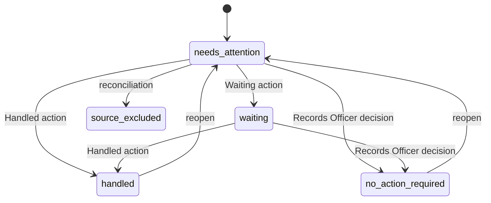

# Work Queue and Ownership

The work queue answers one operational question: **who owns the next action on
this item?** It is deliberately separate from the legal record. The governing
decision is [ADR 0003](../../docs/decisions/0003-work-queue-domain.md). A
request's `assigned_officer` stays the *case owner* (changed only through [accountability corrections](requests.md#accountability-corrections)); a `WorkItem` assignee owns
one next action and may be a different staff member whose current role allows
that kind of work. Case ownership, work assignment, personal read state, legal
status, and correspondence transport state are independent. A convenient UI
action never changes another one by implication.

## Models

| Model | Role |
|---|---|
| `WorkItem` | Current projection: `source_type`, `source_id`, `work_kind`, `assignee`, `disposition`, `version`, and no-action evidence. Unique on `(source_type, source_id, work_kind)`. |
| `WorkItemEvent` | Append-only, attributed history of created, assigned, reassigned, unassigned, dispositioned, reopened, and reconciled changes. Each event also writes an audit row. |
| `WorkItemReceipt` | One user's mutable read state for one item. Its changes append their own event and audit evidence but do not bump `WorkItem.version`. |

Source records stay authoritative. `source_type` is a bounded vocabulary:
`request`, `correspondence`, `inbound_receipt`, `collection_task`, and
`record_item`. Work kinds are defined in `WorkItem.WorkKind`. Each kind has an
allowed role set in `_ROLES_BY_WORK_KIND` in
[`services.py`](../../apps/work_queue/services.py):

- Inbound mail kinds (`inbound_reply`, `email_intake`, `inbound_unmatched`,
  `inbound_candidate`, `inbound_ambiguous`, `inbound_quarantined`) and
  `request_action`, `fee_unpaid`, `correspondence_approval`: Records Officer only.
- `correspondence_draft` and `collection`: Records Officer or Department Liaison,
  limited to the assigned case scope (`_ASSIGNMENT_SCOPED_LIAISON_KINDS`). The same
  kinds define the liaison case scope in [google identity](../architecture/google-identity.md#liaison-case-scope).
- `record_review` and `second_review`: Records Officer or Reviewer.
- `delivery_exception`: Records Officer or Application Admin. The admin receives
  only this operational kind, with no implied legal power.

## Dispositions

Caption: shared dispositions. Reconciliation can mark an item `source_excluded`
when authoritative evidence proves it ineligible; that state is system-derived
and is never recorded as a human `handled` decision.

- **Handled** and **Waiting** are set through `set_work_item_disposition`.
  Handled is terminal until reopened, and the item records `disposed_by`.
- **No action required** (`set_no_action_required`) is a reversible Records
  Officer decision. Its category is one of `courtesy_copy`,
  `duplicate_notification`, `informational_only`, `resolved_elsewhere`, or
  `superseded`. It is not a request closure and not a legal finding. The 10-2000
  character reason stays in the role-gated work event; the global audit row keeps
  only the category, reason length, and SHA-256.
- **Reopen** (`reopen_work_item`) returns a disposed item to `needs_attention`.
  A `source_excluded` item cannot be reopened.
- Model constraints (`work_queue_disposition_evidence_shape`,
  `work_queue_no_action_evidence_shape`) make the evidence shape a database rule.

## Mutations and idempotency

Every shared mutation takes a row lock, checks the caller's current role
scope, requires `expected_version`, and accepts an idempotency key matching the
service pattern. The role check is `lock_authorized_staff()`
([`authorization.py`](../../apps/work_queue/authorization.py)), which locks the
actor's user and group-membership rows before it compares roles. The pattern is
described with the other write-time checks in
[google identity](../architecture/google-identity.md#locked-authority-checks). A retry with the same fingerprint returns the stored event.
A reused key with a different payload is an `IdempotencyConflict`. A stale
version is a `VersionConflict` and returns `version_conflict` with the current
version from the API.

Bulk workflow metadata (`POST /api/staff/work-items/bulk-metadata/`) is atomic
and capped at **50 distinct items**. It accepts only read/unread, assignment,
unassignment, Waiting, Handled, and reopen. No-action decisions, legal
transitions, correspondence actions, and review outcomes are excluded.

## Projection, reconciliation, and failure behavior

Source processing creates or updates projections **after** source evidence
commits. The Celery callbacks in [`integration.py`](../../apps/work_queue/integration.py)
only enqueue bounded tasks. Projection locks and reconciliation never run on the
Gmail intake or legal-write path, and an enqueue failure cannot roll back the
source evidence. `schedule_source_work_item_reconciliation()` checks the
`PRR_TEST_EAGER_SOURCE_WORK_RECONCILIATION` setting first. `config/test_settings.py`
sets it to `False`, so SQLite tests skip the eager post-commit path. Dedicated
source-projection tests (`apps/work_queue/tests/test_source_projections.py`) turn it
back on to exercise the full path.

- Inbound: `reconcile_inbound_receipt` and the five-minute
  `reconcile_inbound_work_item_backfill` task
  ([`reconciliation.py`](../../apps/work_queue/reconciliation.py)).
- Case work: `reconcile_case_work_item_backfill` (five-minute beat, `source` of
  `requests`) and the per-source reconciliation functions in
  [`source_reconciliation.py`](../../apps/work_queue/source_reconciliation.py)
  for requests, fees, collection tasks, correspondence drafts, and record items.
- Recurring reconciliation **never derives or overwrites an existing assignee**.
  The one explicit source-to-work handoff is an Officer changing a collection
  task's `assigned_to`. That write goes through the same locked, versioned
  assignment service inside the source transaction.
- `handle_case_inbox_items` retires a closed case's requester-email rows when a
  case closes, attributed to the closing officer
  ([`services.py`](../../apps/work_queue/services.py)).
- Triage alerts: `alert_waiting_inbound_triage_daily` (weekdays at 07:45) sends
  an `[INBOX TRIAGE]` alert when unmatched or quarantined inbound mail has waited
  at least the configured number of business days
  ([`triage_alerts.py`](../../apps/work_queue/triage_alerts.py)).

Once any work item, event, or receipt exists, migration reversal is blocked.
Production correction is a forward fix.

## Where it surfaces

The Inbox, Review, and My Work views read the same role-scoped REST projection
in [`apps/api/resources/work_items.py`](../../apps/api/resources/work_items.py).
`/my-work` redirects into the Inbox's *Your queues* group. The queue names in
the API (`personal`, `team`, `unassigned`, `waiting`, `critical`, and the
`inbox_*` views) are the same names the UI and the capability catalog use. See
[Agent parity](../architecture/agent-parity.md) for how these routes are mapped.
The staff-facing description of the Inbox is in
[`docs/casework-staff-guide.md`](../../docs/casework-staff-guide.md).

## Change guidance

- Put a new work kind in `WorkItem.WorkKind`, `_ROLES_BY_WORK_KIND`, and a
  reconciliation function in `source_reconciliation.py`. Add a migration, then
  test that the kind's role set matches the capability catalog.
- Do not write a source-domain field from work code. If a change needs a legal
  effect, it belongs in the source service.
- Test concurrency changes with `test_concurrency.py` and stale-version and
  retry behavior with `apps/api/tests/test_work_items.py`.

Related: [Request lifecycle](requests.md) (legal status that work never changes),
[Correspondence](correspondence.md) (the inbound and draft sources),
[Case workspace](case-workspace.md) (where the Inbox leads a Records Officer),
[Agent parity](../architecture/agent-parity.md).

Validation: `PYTHON_DOTENV_DISABLED=1 python manage.py test apps.work_queue --settings=config.test_settings`
and, for the API, `... test apps.api.tests.test_work_items`.
tatus that work never changes),
[Correspondence](correspondence.md) (the inbound and draft sources),
[Case workspace](case-workspace.md) (where the Inbox leads a Records Officer),
[Agent parity](../architecture/agent-parity.md).

Validation: `PYTHON_DOTENV_DISABLED=1 python manage.py test apps.work_queue --settings=config.test_settings`
and, for the API, `... test apps.api.tests.test_work_items`.
rk_items`.
