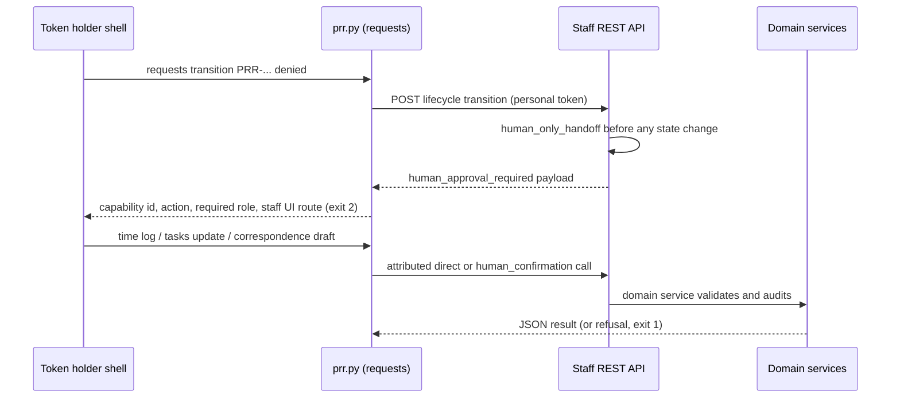

# Staff Command-Line Client

`integrations/cli/prr.py` is a single-file command-line client for the staff REST
API. Like the MCP transports, it is a thin presentation layer: it does not reproduce
deadline, authorization, exemption, correspondence, or lifecycle rules. Django
validates every read and write, attributes it to the personal-token holder, and
returns the same role errors and human-only handoffs that any other agent client
receives. See [MCP server](mcp.md) for the sibling LLM transports and
[agent parity](../architecture/agent-parity.md) for the capability contract.

## Where it sits



Caption: the CLI forwards every operation to the server; the server decides whether
an action is allowed, and the CLI only prints the result or the structured handoff.

## Commands and capability mapping

`COMMAND_CAPABILITIES` in `integrations/cli/prr.py` is the authoritative table from
command path to registered capability id. It covers:

- Reads: `capabilities`, `requests list|get`, `tasks list`, `systems list`,
  `exemptions list`, `audit search`, and `me` (which calls `/api/staff/auth/me`, the
  catalog's documented auth exception).
- Attributed writes: `tasks update`, `time log` (`time_entries.create`), and
  `requests transition`, which still passes through Django's lifecycle service.
- Correspondence drafts: `correspondence draft general|acknowledgment|clarification|estimate-revision|installment|responsive-records|closure|denial`.
  Drafts can be created but never approved, queued, or sent; those human-only
  operations have no command.

`requests transition … denied` cannot deny a request. The server returns the handoff
and the CLI exits with status 2 (`HumanApprovalRequired`, which extends `CLIError`).
Other expected failures raise `CLIError` and exit with status 1, including missing
configuration, which is detected before any network call.

## Configuration and transport rules

- Settings come from `PRR_BASE_URL` and `PRR_API_TOKEN`, or from the global
  `--base-url` and `--api-token` flags. Environment variables are preferred because
  command-line arguments may appear in process listings.
- The token must be a personal, attributed token created on the staff application's
  Agent Access page (`_AGENT_ACCESS_ROUTE`). A shared service or non-login identity
  must not be used.
- HTTPS is required except for `localhost` and numeric loopback addresses, and HTTP
  redirects are refused.
- Expired and revoked credentials produce different messages that point to the
  Agent Access fix.
- Output is a human table by default. Every leaf command accepts `--json`, which
  emits one parseable value on stdout. `audit search` pages with an opaque keyset
  cursor from the previous `next` URL; callers must not construct it.

## Change guidance

To add or change a CLI command:

1. Confirm the capability row exists in `apps/api/capabilities.py` and is not
   `human_only`. If it is human-only, do not add a command; the handoff path already
   prints the route.
2. Add the command to the argparse tree and to `COMMAND_CAPABILITIES` in
   `integrations/cli/prr.py`, keeping the mapping in sync with the capability id.
3. Add a case to `apps/api/tests/test_cli_client.py`. Two invariants are already
   asserted there: `test_each_command_maps_to_a_non_human_only_capability` and
   `test_human_only_response_prints_complete_handoff_and_exits_nonzero`.
4. Update the command table in `integrations/cli/README.md` when the command surface
   changes.

Non-goals: do not add client-side authorization, deadline arithmetic, or statutory
checks to the CLI. Those belong in the domain services the server calls.

## Testing

The CLI is tested against a live Django test server from the Django suite, so its
`requests` dependency and the real REST contract are exercised together.

- `CLIConfigurationTests` (`apps/api/tests/test_cli_client.py`): help output, command
  mapping, audit-search pagination rejection, missing configuration, and plain-HTTP
  refusal, all without a network call.
- `PRRCLILiveServerTests`: JSON output for reads, the attributed write commands,
  cursor following, the human-only handoff, and expired or revoked token messages.

Focused command (quiet on success, full diagnostics on failure):

```bash
PYTHON_DOTENV_DISABLED=1 python manage.py test apps.api.tests.test_cli_client --settings=config.test_settings
```

Related: the server-side capability rules are checked by
`apps/api/tests/test_agent_capabilities.py`, and the handoff machinery by
`apps/api/tests/test_human_only_handoffs.py`. Run those when a CLI change depends on a
new or altered capability row.
