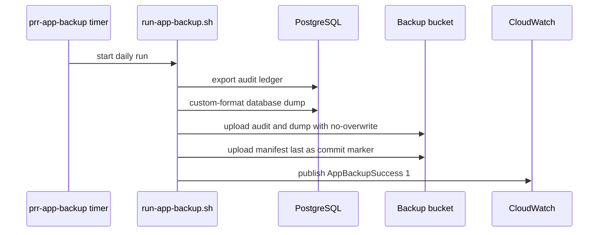

# Application backup and restore

Production has two independent recovery layers, both described in
[`docs/backups.md`](../../docs/backups.md). This page is the wiki's summary of
them and of the release ordering that depends on them.

- **Whole-host disaster recovery.** AWS Data Lifecycle Manager takes a daily
  encrypted EBS snapshot and keeps 14. It is not records retention.
- **Application backup.** `prr-app-backup@prod.timer` writes a daily PostgreSQL
  custom-format dump and a canonical, independently readable audit-ledger export to
  the production backup bucket.

## What one successful run writes

Each run gets a UUID and writes one prefix:

```text
app-backups/YYYY/MM/DD/<backup-id>/
  audit.jsonl.gz
  database.dump
  manifest.json
```

`audit.jsonl.gz` is generated first and holds the complete append-only audit ledger
in primary-key order. `database.dump` must pass `pg_restore --list`. `manifest.json`
records the release image, environment, sizes, SHA-256 values, and the audit row and
max-ID boundary. It uploads **last** and is the commit marker. The uploads require
`If-None-Match: *`, an S3 SHA-256 checksum, and server-side encryption. The only
retained local artifact is `last-success.json`, which contains no secrets.

`infra/aws/backup_manifest.py` creates and verifies the manifest without AWS access,
and proves that a restored database contains the exported audit boundary. The unit
tests in [`apps/api/tests/test_backup_system.py`](../../apps/api/tests/test_backup_system.py)
exercise that module.



Caption: one successful run; the manifest upload is the step that makes the prefix restorable.

## Monitoring and failure response

Each completed run publishes `PSD401/PRR AppBackupSuccess=1` in the `prod` dimension,
and a failed run publishes `0` when the AWS CLI is available. The CDK alarm
`psd401-prr-prod-app-backup-missing-or-failed` also breaches on missing daily data.
For an alarm:

1. Find the first failing command in `journalctl`. Later cleanup messages are not the cause.
2. Confirm the web and database containers are healthy and `/srv/prr` has free space.
3. Confirm the instance role can reach S3 and CloudWatch through IMDSv2.
4. Restart the service and require a new `manifest.json` URI. Never reuse or edit an incomplete prefix.
5. Run the restore drill if the failure involved PostgreSQL tooling, the manifest, checksums, or S3.

## Restore verifier and the release ordering

The production host cannot read backups. A separately authorized operator selects a
prefix that ends in `manifest.json` and downloads it only to a protected recovery
environment approved for requester and FERPA data. Developer workstations use
synthetic fixtures.

`infra/aws/verify-app-backup-restore.sh` (installed as `prr-verify-app-backup-restore`
by `infra/aws/install-app-backup.sh`) runs the restore check on one downloaded backup
directory. It first runs `backup_manifest.py verify` against `manifest.json`. It then
starts an ephemeral `postgres:16` container with no network, restores `database.dump`
with `pg_restore --exit-on-error`, and compares the restored `audit_auditlog` count and
maximum ID with the manifest's audit boundary. The test
`test_restore_drill_uses_an_ephemeral_networkless_postgres` in
[`apps/api/tests/test_backup_system.py`](../../apps/api/tests/test_backup_system.py)
asserts those mechanics.

In the production release script generated by
[`infra/cdk/lib/prr-hosting-stack.ts`](../../infra/cdk/lib/prr-hosting-stack.ts), the
application backup runs before any migration. `run_application_backup` starts
`prr-app-backup@prod.service` and fails the release with `application_backup_unavailable`
when the backup does not complete. Only after that does the script run
`release_manage migrate --noinput`. A migration-bearing release therefore always has a
backup taken by the same release before its migration. The source contains no check that
pins drill evidence or migration digests for the recurring deploy. `docs/backups.md`
describes such a gate, and that conflicts with the source; see
[open verification items](../quickstart.md#open-verification-items). The release
mechanics are in [aws-deployment.md](aws-deployment.md).

## Host disk-usage reporter

The same installer, `infra/aws/install-app-backup.sh`, installs a second host timer.
`prr-disk-usage@.timer` runs `prr-report-disk-usage` (from
[`infra/aws/report-disk-usage.sh`](../../infra/aws/report-disk-usage.sh)) three minutes after
boot and every five minutes after that. The timer is frequent because a disk fills between
daily checks. The release transaction in
[`infra/cdk/lib/prr-hosting-stack.ts`](../../infra/cdk/lib/prr-hosting-stack.ts) installs
and enables the same units.

- The script reads the root mount (`PRR_DISK_MOUNT`, default `/`) with `df -P`, rejects
  an unreadable or impossible value, and publishes `RootDiskUsedPercent` to the
  `PSD401/PRR` namespace, dimensioned by environment. It is read-only and deletes nothing.
- CDK's `root-disk-filling` alarm breaches at 80% for two periods. Missing data also
  breaches, so a stopped reporter is visible rather than silently healthy.
- Deployments prune superseded images, which removes the cause that first filled the
  disk. The reporter covers other growth, such as database size, logs, or a conversion spike.
- Tests: `infra/cdk/test/prr-hosting-stack.test.ts` asserts the installed reporter command,
  the timer enablement, and the `RootDiskUsedPercent` metric. Run it with
  `cd infra/cdk && bun test test/prr-hosting-stack.test.ts` when you change the
  install commands or the alarm. The Python backup tests in `apps/api/tests/test_backup_system.py`
  do not cover the disk reporter.

## Scope boundaries

- The backup is not a records retention schedule. The retention schedule is unconfirmed,
  so no lifecycle deletion rule exists (AGENTS.md).
- The alarms publish to the stack's SNS alarm topic, which emails the addresses in
  `alarmEmails` (`infra/cdk/lib/config.ts`). Changing who receives them is a CDK config
  change, and each new address must confirm its AWS subscription before it receives
  alarms. See [aws-deployment.md](aws-deployment.md#what-a-release-verifies).

## Related

- [deployment.md](deployment.md) — the production release command that triggers the backup step
- [aws-deployment.md](aws-deployment.md) — what a release verifies
- [compliance.md](../domain/compliance.md) — the append-only audit trail that the backup exports
