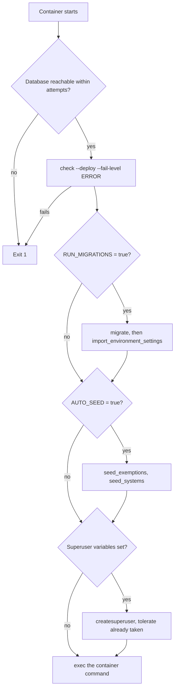

# Deployment guide

## Local development

Run backing services locally:

```bash
docker compose up -d db redis minio
```

Run Django from the host using the development instructions in
[docs/development.md](../../docs/development.md). Local development is not a
deployment target.

## Production

Production is `prr.psd401.net`. After changes merge to `main`, run:

```bash
cd infra/cdk && bunx cdk deploy psd401-prr-prod --require-approval never --profile psd401-prr-prod
```

Nothing runs between merge and this command. CDK owns the application source
asset, backup, migrations, container replacement, health handling, and
automatic rollback.

Do not use the base Compose file as a manual production deployment procedure.
The retired development environment is not a deployment target.

## Host Compose wrapper

On the AWS host, operators run Compose through `prr-compose`, not `docker compose`.
The script is [`infra/aws/prr-compose.sh`](../../infra/aws/prr-compose.sh). The CDK stack
installs it as `/usr/local/sbin/prr-compose` (`infra/cdk/lib/prr-hosting-stack.ts`). Its
test is in `infra/cdk/test/prr-hosting-stack.test.ts`. On every call the wrapper:

- resolves the live release from the `/srv/prr/cdk-current` symlink and requires
  `docker-compose.deploy.yml` and `docker-compose.aws.yml` in that release;
- takes the release image from the running `web` container, or from the version file,
  so a recreate cannot move a service onto a different build;
- adds the private Gmail activation overlay (`/srv/prr/.gmail-inbound-activation.compose.yml`)
  whenever that file exists, and prints `gmail=enabled` or `gmail=disabled` to stderr
  unless `PRR_COMPOSE_QUIET=1` is set.

The reason for the wrapper is the failure mode in its header: a Compose call that omits
the overlay changes inbound mail without any error. The CloudWatch alarm
`psd401-prr-<env>-gmail-inbound-missing-or-failed` is the signal for that failure
([AWS production release](aws-deployment.md#what-a-release-verifies)). The operator
commands are in [`docs/aws-deploy.md`](../../docs/aws-deploy.md#running-compose-on-the-host).

**Source conflict, unresolved.** The wrapper header and the alarm description say the
overlay's presence is what enables Gmail inbound polling. `docs/aws-deploy.md` says
polling is an application setting, that the overlay no longer decides anything, and that
a later release removes it. The application switch that gates polling is
`PRR_GMAIL_INBOUND_POLL_ENABLED` ([correspondence](../domain/correspondence.md#gmail-transport)).
Confirm with the release owner which account is current before relying on either
description. A change to the wrapper needs the `prr-hosting-stack.test.ts` check
below, because the wrapper's install and the release-pin logic are both asserted there.

Narrow checks: `bash -n infra/aws/prr-compose.sh` for syntax, and
`cd infra/cdk && bun test test/prr-hosting-stack.test.ts` for the stack wiring.

## Compose files

The repository root has four Compose files with different jobs. Only the AWS pair is
a deployment stack, and CDK still owns the release.

| File | Role |
|---|---|
| `docker-compose.yml` | Local developer dependency stack (Postgres, Redis, MinIO, ClamAV, and web, worker, and beat services). Its header says not to deploy it. The backing-service ports bind to loopback. |
| `docker-compose.deploy.yml` | Base stack for the AWS host: one release image, no bind mounts, and no object store. Database and Redis publish no host ports, and the web port binds to loopback behind a TLS proxy. |
| `docker-compose.aws.yml` | Overlay for the CDK-provisioned host. It points object storage at the environment's S3 bucket through the instance role and adds the TLS proxy. |
| `docker-compose.minio.yml` | Object-store overlay for CI configuration validation and storage-policy tests. Its header says it is not a runnable local stack or a deployment destination. |

Compose interpolates every file it is given before merging overlays. The base file
therefore carries no required object-store variable, and each deployment layers
exactly one store on top. The object-store contract is described in
[object storage and scanning](../architecture/object-storage-and-scanning.md).

The CI job `psd-ci-jobs.yml` checks both overlays with
`docker compose -f docker-compose.deploy.yml -f <overlay> config -q`. Run it with
placeholder values for the variables the overlay requires. It is a narrow, quiet check,
and it is the one to run after editing a compose file. The CI step "Prove the AWS overlay
needs no MinIO credential" also parses the base and AWS overlay with no MinIO values, which
guards against a required MinIO variable creeping into the base file. Changes to
`infra/cdk/` or the release path belong to [AWS production release](aws-deployment.md).

## Container startup

The image's `ENTRYPOINT` is `docker/entrypoint.sh` (`Dockerfile`). A container started from
this image runs the following sequence before it `exec`s its command. Production is the
exception, described below:

1. Wait for the database. `DB_WAIT_ATTEMPTS` (default 30) and `DB_WAIT_DELAY` (default 2
   seconds) bound the wait, and an unreachable database stops startup.
2. Run `manage.py check --deploy --fail-level ERROR`. Project security settings that are
   missing or use placeholder secrets stop startup.
3. When `RUN_MIGRATIONS=true`, run `migrate` and then `import_environment_settings`. The import
   writes each application-managed switch's deployed value to the settings store once. It
   never overwrites a value the district already stored ([configuration](../architecture/configuration.md)).
4. When `AUTO_SEED=true`, run `seed_exemptions` and `seed_systems`. The exemption taxonomy is
   described in [compliance](../domain/compliance.md#exemption-taxonomy), and the system
   registry in [collection and Vault](../domain/collection-and-vault.md).
5. When all three `DJANGO_SUPERUSER_*` variables are set, run `createsuperuser --noinput`.
   An "already taken" result is tolerated so restarts and redeploys do not fail.



Caption: the entrypoint's branching order. Migrations and seeding run before the superuser step,
and the deploy check runs before either.

In production the CDK deployment replaces the entrypoint and runs the settings import in the
worker service, so it sees the Gmail activation overlay, as the entrypoint's own comment
states. The CDK stack that owns this is
`infra/cdk/lib/prr-hosting-stack.ts`. The focused test for the Compose readiness wiring is
`DeploymentReadinessTests` in `apps/api/tests/test_deployment_settings.py`. No test in the
suite exercises `docker/entrypoint.sh` directly, so review a change to the script against the
sequence above.

See [AWS deployment](aws-deployment.md) for the release steps and
[backups](backups.md) for the recovery layers that every release relies on.
This repository no longer contains an on-prem deployment tree (`infra/onprem/` is absent)
or a `psd401-prr-dev-identity` stack (`infra/cdk/bin/prr.ts` defines the production stack
only). Do not look for or recreate them when changing deployment code.

