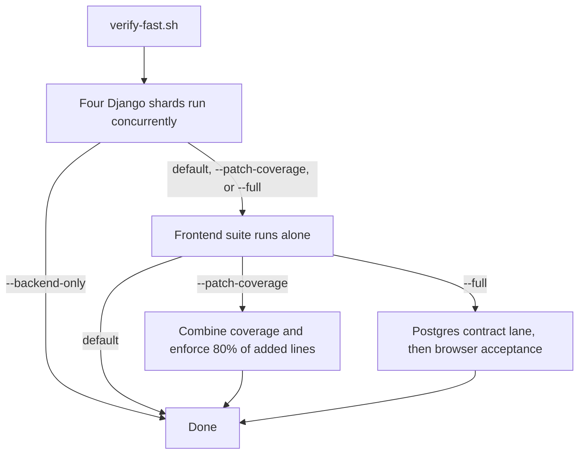

# Testing and Quality Gates

PSD401 PRR has several test lanes with different costs. Most work needs one focused Django
label. The full backend shard set, the frontend suite, and the Postgres and browser lanes are
conditional. This page says which lane proves what, and when each one is required. The
per-domain focused commands live in the [quickstart routing table](../quickstart.md#task-routing).

## Lanes

| Lane | Command | What it proves | When it is needed |
|---|---|---|---|
| Focused Django labels | `PYTHON_DOTENV_DISABLED=1 python manage.py test <dotted labels> --settings=config.test_settings` | One module's behavior, with complete failure output | Default for any change |
| Backend shards | `bash scripts/verify-fast.sh --backend-only` | The four Django shards (`apps.correspondence`, `apps.api`, `apps.records`, and `apps.audit apps.configuration apps.integrations apps.work_queue`) run concurrently | A change crosses modules, or touches a shared symbol such as `services.transition()`, `runtime.get()`, or the capability registry |
| Default gate | `bash scripts/verify-fast.sh` | Backend shards, then the frontend suite (`bun run test`, `lint`, `typecheck`, `build`) run alone | Before a merge that touches the frontend or the API contract |
| Patch coverage | `bash scripts/verify-fast.sh --patch-coverage` | Both suites under coverage, then 80% of added lines covered | Before merging a large branch. It is slower because instrumentation is not free |
| Postgres and browser | `bash scripts/verify-fast.sh --full` | Adds `scripts/run-postgres-contract-tests.sh` and every browser flow | A change touches concurrency, row locking, or a database-level guard |
| Casework acceptance smoke | `bash scripts/run-casework-acceptance.sh --smoke` | Four browser flows | A change touches a staff workflow end to end |
| Lint and typecheck | `uv run ruff check .` and `uv run python scripts/pyright_baseline.py` | Ruff reports zero findings, and pyright adds no per-file errors beyond `pyright-baseline.json` | Any Python change. `scripts/verify-fast.sh` also runs both |
| Infrastructure | `cd infra/cdk && bun test` and `bunx cdk synth --quiet` | CDK stack tests, and a credential-free synth | A change touches `infra/cdk`. Patch coverage does not instrument it |
| IaC policy scan (CI only) | Checkov over the synthesized templates in `infra/cdk/cdk.out` and over the Terraform root, at the version in `PRR_CHECKOV_VERSION`. In the `terraform` job, `fmt`, `validate`, and tflint run first | The rule packs run, and no rule is disabled for every resource. Suppressions are per resource, in `Metadata.checkov.skip` or inline `checkov:skip`. `apps/api/tests/test_iac_gates.py` asserts this wiring | A change touches `infra/cdk`, `infra/terraform`, or the CI workflow that runs them. Minimal local check: `PYTHON_DOTENV_DISABLED=1 python manage.py test apps.api.tests.test_iac_gates --settings=config.test_settings` |
| Terraform google-identity root | `terraform fmt -check -recursive`, then `terraform init -backend=false -input=false` and `terraform validate` in `infra/terraform/google-identity` | Formatting and provider-schema validity without touching remote state | A change touches the Terraform identity root. `init -backend=false` never reaches the remote state, as [development](../../docs/development.md) specifies |

`verify-fast.sh` prints one `PASS` or `FAIL` line per lane. On failure it prints the last 40
lines of each failing log. Use `--backend-only` while iterating on Python, and do not pipe the
output through a filter.

Claude Code also runs two infrastructure checks after agent edits. `.claude/settings.json`
runs `.claude/hooks/cdk-synth.sh` after edits under `infra/cdk/bin/` or `infra/cdk/lib/`, and
`.claude/hooks/terraform-check.sh` after edits to Terraform files under `infra/terraform/`. Both
hooks are a convenience for the agent loop; CI and the commands above are the gates. The
[development guide](../../docs/development.md#local-guards) describes their behavior.

The Python lanes in `verify-fast.sh` take their interpreter from `scripts/prr-python.sh`, which
prints `PRR_PYTHON_BIN` when it is set, then the checkout's `.venv`, then the main checkout's
`.venv` for a git worktree that has none, and otherwise `python3`. An explicit `PY` variable
overrides the helper.

Caption: the backend shards run concurrently, while vitest runs alone afterward. Running them
together caused worker starvation in the script's own measurements.

The blocking verification gate is also declared in `.psd/verify.json`. It names the build,
lint, typecheck, test, and e2e commands, the required Playwright flows, and one screenshot
per flow written to `.verification/`. `test_verify_gate_is_blocking_and_covers_every_required_surface`
in `apps/api/tests/test_casework_verification_foundation.py` fails when the flow list, the
screenshot map, or the commands drift. Run that test after you edit `.psd/verify.json` or add
a flow under `frontend/e2e/`, with `PYTHON_DOTENV_DISABLED=1 python manage.py test apps.api.tests.test_casework_verification_foundation --settings=config.test_settings`.

The Playwright browser lane is defined in `frontend/playwright.config.ts`. Its first web
server runs `scripts/run-e2e-server.sh`, which resolves the interpreter through
`scripts/prr-python.sh`, migrates a fresh SQLite database, seeds the casework test fixture,
and serves Django on `127.0.0.1:8000` with `config.e2e_settings` and `PRR_AUTH_MODE=local`.
The second server is the Vite dev server on port 4173. The e2e script deletes
`.verification/e2e.sqlite3` on each start, so it never reuses earlier browser state.

## Why the lanes are shaped this way

- **Sharding is by app label.** `config/test_settings.py` uses SQLite `:memory:`, so each
  process has a private database. The script does not use `manage.py test --parallel`, which
  the script notes fails with a pickling error and names no test.
- **Frontend runs alone.** The script runs vitest after the Django shards because vitest's
  own pool does not share the machine well with them.
- **Postgres is a contract lane.** `scripts/run-postgres-contract-tests.sh` starts a disposable
  `postgres:16` container, or uses a caller-supplied database that must carry an explicit
  disposable acknowledgment. It then runs a fixed list of concurrency and database-guard tests
  under `config.postgres_test_settings`. Those include `test_matter_kinds`, `test_next_response_due`,
  `test_lifecycle_authorization_concurrency`, `test_inbound_concurrency`, and
  `test_outbound_concurrency`. It then seeds a casework fixture and runs
  `measure_casework_performance` under `config.casework_performance_settings`. That module
  imports `config.postgres_test_settings` and calls `validate_disposable_database()` in
  [`apps/correspondence/performance_safety.py`](../../apps/correspondence/performance_safety.py) at
  import. The guard refuses fixture writes unless the explicit disposable sentinel is set and
  the database is a loopback URL with an allowlisted user. Do not point the performance
  settings at a shared database.
- **Quarantine excludes tests from gating.** `GATING` in `verify-fast.sh` passes
  `--exclude-tag=quarantine`. [`FLAKY.md`](../../FLAKY.md) is the register. A row needs an
  owner, an issue, an expiry no more than four weeks out, and two CI runs on the same commit,
  one red and one green. `apps/api/tests/test_flaky_register.py` fails when a row expires or
  is incomplete, or when a test is tagged without a row.
- **Regression contracts.** `apps/api/tests/test_feature_inventory_regressions.py` groups
  cases for defects a feature audit found: the staff API, hosted MCP, the Alta verify
  command, last-admin mapping deletion, the Vault client and polling, and the OpenAPI
  schema. Its header says the cases were written before the fixes they describe, so a
  failure can mean a fix is still outstanding rather than a new regression. Check the
  file's history and the owning page before you change a case. Focused command:
  `PYTHON_DOTENV_DISABLED=1 python manage.py test apps.api.tests.test_feature_inventory_regressions --settings=config.test_settings`.

## Test-quality gates

- **Patch coverage (80% of added lines).** `scripts/patch_coverage.py` intersects the lines a
  diff adds with the lines the coverage reports say are executable. It reads coverage.py JSON
  and Istanbul JSON. The base defaults to `origin/main` and can be set with
  `PRR_PATCH_COVERAGE_BASE`. The project has no overall coverage floor on purpose. Coverage runs
  under `COVERAGE_CORE=sysmon`, and `[tool.coverage.run]` must not enable `branch`. A contract
  test fails if the two settings disagree.
- **Mutation testing.** `.github/workflows/mutation-testing.yml` runs mutmut monthly over the
  deadline engine, identity, and the intake path that fixes `matter_kind`. `scripts/mutation_score.py`
  gates each module at an 80% kill rate. Mutation testing never blocks a merge. Surviving
  mutants become issues.
- **Contract tests for the gates.** `apps/api/tests/test_quality_gates.py` keeps the wiring of
  these gates in place. `apps/api/tests/test_patch_coverage.py` and `test_mutation_score.py`
  cover the two scripts.

## CI workflows

The lanes above are what an agent runs locally. GitHub Actions runs them from the
workflows in `.github/workflows/`, and each workflow has a different gating role:

| Workflow | Trigger | Gating role | What it runs |
|---|---|---|---|
| `ci.yml` (CI) | Push and pull request to `main` | Blocks merge through the `psd-ci` check | Calls the reusable `psd-ci-jobs.yml` with no secrets passed |
| `psd-ci-jobs.yml` (PSD CI jobs) | Called by `ci.yml` | Blocks merge; its last job requires every other job to succeed | Backend audits, lint and typecheck, the Django test shards, patch coverage on changed lines, the PostgreSQL legal-workflow concurrency job, the frontend test, lint, and build job, the Playwright smoke job, CDK tests with a credential-free synth, Terraform checks with Checkov, and the deployment Compose overlay checks |
| `nightly.yml` (Nightly) | Daily at 11:00 UTC, and manual | Not a PR gate. A failed scheduled run opens or updates a tracking issue | The full Playwright acceptance suite through `scripts/run-casework-acceptance.sh`, then the quarantined flows with `continue-on-error` |
| `mutation-testing.yml` | Monthly on the 1st at 12:00 UTC, and manual | Never blocks a merge | `mutmut` over the critical modules, scored by `scripts/mutation_score.py`. A report job files surviving mutants as an issue |
| `mcp-scan.yml` (MCP Scan) | Push to `main` that touches `integrations/mcp/`, `server.json`, `pyproject.toml`, `uv.lock`, or the workflow; weekly on Monday at 09:30 UTC; manual | Not a PR gate | Snyk Agent Scan analysis of `integrations/mcp/mcp-scan.json`. Without the `SNYK_TOKEN` secret it writes a skip notice to the step summary instead of passing. The token-free tool enumeration runs inside `psd-ci-jobs.yml` |
| `openwiki-update.yml` (OpenWiki Update) | Push to `main` that does not touch `openwiki/**`; weekly on Monday at 08:00 UTC; manual | Not a test gate | Calls the organization's reusable OpenWiki workflow to regenerate this wiki |
| `security-scan.yml` (Security Scan) | Pull request, push to `main`, weekly on Monday at 09:00 UTC, manual | Calls the reusable security-scan workflow pinned in the shared `PSD401/.github` repository | Scan logic lives in that shared repository, not in this one. This repository's tests do not cover the reusable job's contents |
| `license-check.yml` (License Check) | Pull request and push to `main` | Calls the reusable license-check workflow in `PSD401/.github` | Same boundary as the security scan: the license rules are defined outside this repository |
| `dependabot-auto-merge.yml` (Dependabot auto-merge) | `pull_request` | Auto-merges only patch-level dev-dependency Dependabot updates, under `permissions: contents: write`, `pull-requests: write` | `test_only_patch_level_dev_dependency_updates_auto_merge` in `apps/api/tests/test_security_boundaries.py` pins the trigger and the write permissions. Do not switch the trigger to `pull_request_target`, which would lose the write token |
| `claude.yml` (Claude Code) | Issue, issue comment, or review comment created by an owner or member that mentions `@claude` | Not a merge gate | Runs a bounded agent session with a 20-minute timeout, one run per issue or PR |
| `claude-code-review.yml` (Claude Review) | Pull request opened, synchronized, marked ready, or reopened | Provides the `claude-review` check | Calls the reusable Claude review workflow. Dependabot pull requests get a no-op job that reports the same check name |

The workflow shape is itself under test. `apps/api/tests/test_quality_gates.py` has
`CiShapeTests` for the caller and the reusable workflow, `NightlyFullSuiteTests` for the
nightly acceptance run, and `MutationTestingTests` for the monthly mutation job. Their
`PatchCoverageGateTests` and `SharedSetupActionTests` cover the patch-coverage gate and the
shared setup action. When you change a workflow file, run
`PYTHON_DOTENV_DISABLED=1 python manage.py test apps.api.tests.test_quality_gates --settings=config.test_settings`
before you rely on the change. Do not run the nightly or mutation workflows to check a
single-file change; they are scheduled runs with their own cost.

## Change guidance

- **Find the focused test first.** Each domain page lists its focused test homes, and the quickstart
  routing table names the narrow command. Start there instead of running a full lane.
- **A new gate or lane** must be added to `verify-fast.sh` and documented here. It must also be
  covered by a contract test in `apps/api/tests/test_quality_gates.py`. A gate that is not
  wired to CI is not a gate.
- **A new Postgres-only concurrency test** belongs in the list inside
  `scripts/run-postgres-contract-tests.sh`. Otherwise `--full` will not run it.
- **Quarantine is a last resort.** Tag a test only with a complete `FLAKY.md` row, and never to
  hide a deterministic failure. The mutation, Postgres, and patch-coverage gates exist to make
  silent weakening visible.
- **Scope boundary.** Do not run `--full`, the mutation workflow, or the casework performance
  measurement for a single-file change. The source-backed condition for each is in the table above.

Related: [Development](../../docs/development.md) (local setup and the full quality-gate list),
[Background jobs](../architecture/background-jobs.md) and [Matter kinds](../domain/matter-kinds.md),
which name the focused test homes for the timing-sensitive and legal-rule areas.
